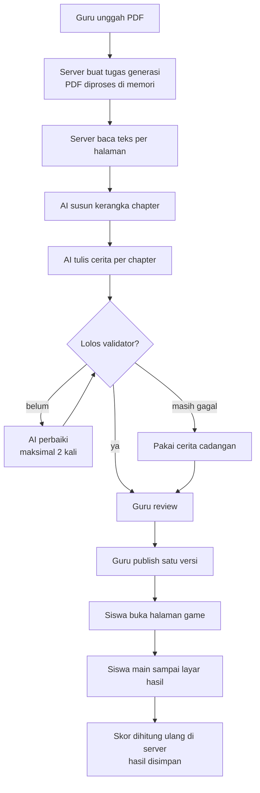
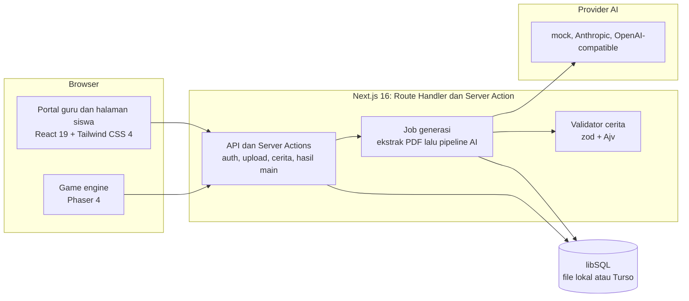

<div align="center">

# ClassQuest

### Dari satu PDF jadi petualangan belajar.

_Guru mengunggah materi, AI menyusunnya menjadi game cerita pixel 2D,
dan siswa belajar lewat alur cerita serta tantangan, bukan hafalan._

<br/>

[](https://classquest.justeita.com)
[](#kepatuhan-terhadap-ketentuan-lomba)
[](#tentang-classquest)
[](#tentang-classquest)


<br/>

[**Coba Aplikasi**](https://classquest.justeita.com) ·
[Latar Belakang](#latar-belakang-masalah) ·
[Fitur](#fitur-utama) ·
[Arsitektur](#arsitektur-sistem) ·
[Menjalankan](#menjalankan-aplikasi) ·
[Akun Demo](#akun-demo-dan-panduan-juri) ·
[Penggunaan AI](#penggunaan-ai)

</div>

---

## Daftar Isi

1. [Tentang ClassQuest](#tentang-classquest)
2. [Tim](#tim)
3. [Latar Belakang Masalah](#latar-belakang-masalah)
4. [Solusi dan Cara Kerja](#solusi-dan-cara-kerja)
5. [Fitur Utama](#fitur-utama)
6. [Arsitektur Sistem](#arsitektur-sistem)
7. [Teknologi](#teknologi)
8. [Struktur Repositori](#struktur-repositori)
9. [Menjalankan Aplikasi](#menjalankan-aplikasi)
10. [Akun Demo dan Panduan Juri](#akun-demo-dan-panduan-juri)
11. [Penggunaan AI](#penggunaan-ai)
12. [Etika, Privasi, dan Keamanan](#etika-privasi-dan-keamanan)
13. [Kualitas dan Pengujian](#kualitas-dan-pengujian)
14. [Kepatuhan terhadap Ketentuan Lomba](#kepatuhan-terhadap-ketentuan-lomba)
15. [Dokumentasi](#dokumentasi)
16. [Atribusi Pihak Ketiga](#atribusi-pihak-ketiga)
17. [Lisensi dan Penggunaan](#lisensi-dan-penggunaan)

---

## Tentang ClassQuest

ClassQuest mengubah materi pelajaran yang diunggah guru menjadi **game pixel 2D
bercerita**. Siswa tidak lagi membaca PDF panjang tanpa keterlibatan: mereka
menjelajahi dunia cerita, berbincang dengan karakter, dan menjawab tantangan yang
bersumber langsung dari materi guru.

| Item                    | Keterangan                                                          |
| ----------------------- | ------------------------------------------------------------------- |
| **Nama aplikasi**       | ClassQuest                                                          |
| **Kategori**            | Web                                                                 |
| **Subtema LOGICODIX**   | Smart & Fun Education                                               |
| **Target pengguna**     | Guru dan siswa SMP/SMA                                              |
| **Aplikasi live**       | [classquest.justeita.com](https://classquest.justeita.com)          |
| **Repositori**          | [github.com/justeita/ClassQuest](https://github.com/justeita/ClassQuest) |

> [!NOTE]
> Repositori ini adalah karya untuk **LOGICODIX 2026 Hackathon Competition**.
> Versi yang dinilai adalah commit final yang dicantumkan pada formulir
> submission.

---

## Tim

<div align="center">

<table>
  <tr>
    <td align="center" width="160">
      <a href="https://github.com/justeita">
        <br />
        <sub><b>@justeita</b></sub>
      </a>
    </td>
    <td align="center" width="160">
      <a href="https://github.com/Gerraldd">
        <br />
        <sub><b>@Gerraldd</b></sub>
      </a>
    </td>
    <td align="center" width="160">
      <a href="https://github.com/akwaqinthara">
        <br />
        <sub><b>@akwaqinthara</b></sub>
      </a>
    </td>
    <td align="center" width="160">
      <a href="https://github.com/davitapandjaitan">
        <br />
        <sub><b>@davitapandjaitan</b></sub>
      </a>
    </td>
  </tr>
</table>

</div>

**Nama tim:** Fastfetch

| Nama                                  | Peran     | Instansi                     | GitHub |
| ------------------------------------- | --------- | --------------------------- | ------   |
| Marson Arya Bagas Prasetyo            | Ketua tim | Universitas Negeri Surabaya | github.com/justeita         |
| Muhammad Geral Herpavy                | Anggota 1 | Universitas Negeri Surabaya | github.com/Gerraldd         |
| Fadhlurrahman Akwa Qinthara           | Anggota 2 | Universitas Negeri Surabaya | github.com/akwaqinthara     |
| Davita Syalom Maria Attira Pandjaitan | Anggota 3 | Universitas Negeri Surabaya | github.com/davitapandjaitan |

Seluruh commit berasal dari akun GitHub anggota tim yang terdaftar resmi di
LOGICODIX 2026.

---

## Latar Belakang Masalah

Materi pelajaran sering hanya berupa **PDF panjang**. Siswa membaca tanpa
keterlibatan, sementara guru kesulitan mengetahui bagian mana yang belum
dipahami. Tiga temuan berikut menunjukkan betapa nyatanya persoalan ini.

### 1. Kasus nyata: siswa SMP yang belum lancar membaca

Pemeriksaan kemampuan membaca di SMP Kabupaten **Buleleng, Bali** menemukan
**155 siswa belum bisa membaca** dan **208 siswa belum lancar membaca**. Mereka
sudah duduk di bangku SMP, tetapi fondasi literasinya belum kuat.

### 2. Gambaran nasional: PISA 2025

Hasil PISA 2025 (dirilis 8 September 2026) menunjukkan:

| Bidang      | Skor Indonesia | Rata-rata OECD | Siswa di bawah kompetensi dasar (Level 2) |
| ----------- | -------------- | -------------- | ----------------------------------------- |
| Matematika  | 364            | 463            | **83,07%**                                |
| Membaca     | 365            | 461            | -                                         |
| Sains       | 389            | 482            | 63,2%                                     |

### 3. Sisi guru: waktu habis untuk administrasi

Survei terhadap **211 guru di 27 provinsi** menemukan sekitar **8 dari 10 guru**
melaporkan bahwa platform administrasi digital (Merdeka Mengajar) menambah beban
administrasi mereka, dan **51%** mengerjakan tugas platform itu di luar jam
sekolah. Waktu untuk memperhatikan perkembangan siswa satu per satu pun makin
sempit.

> [!IMPORTANT]
> Survei guru di atas berfokus pada **beban administrasi digital**, bukan
> langsung pada pengumpulan data hasil belajar. Kaitannya dengan pemantauan
> belajar siswa adalah analisis tim ClassQuest.

**Sumber:**

- CNN Indonesia, 16 April 2025:
  [temuan siswa SMP Buleleng yang tidak lancar membaca](https://www.cnnindonesia.com/nasional/20250416112817-20-1219337/siswa-smp-tak-bisa-baca-cermin-bobrok-pendidikan-indonesia/amp)
- JawaPos, 14 September 2026:
  [Skor Membaca dan Sains Naik, 83 Persen Siswa Belum Kuasai Matematika Dasar](https://www.jawapos.com/nasional/2609130307/skor-membaca-dan-sains-naik-83-persen-siswa-belum-kuasai-matematika-dasar)
- Haeri & Afriansyah, _Aspirasi: Jurnal Masalah-Masalah Sosial_ Vol. 15 No. 2,
  Desember 2024:
  [Eksplorasi Beban Digital Guru](https://doi.org/10.46807/aspirasi.v15i2.4615)

---

## Solusi dan Cara Kerja

ClassQuest membalik alurnya: **guru tinggal mengunggah materi**, sistem yang
menyusun cerita, dan guru tetap memegang kendali sebelum siswa melihat hasilnya.

| Langkah | Siapa  | Apa yang terjadi                                                              |
| :-----: | ------ | ----------------------------------------------------------------------------- |
| **1**   | Guru   | Mengunggah PDF materi dan mengisi judul, mata pelajaran, jenjang, bahasa, nada |
| **2**   | Sistem | Mengekstrak teks, menyusun kerangka chapter, lalu menulis cerita per chapter  |
| **3**   | Sistem | Memvalidasi cerita, memperbaiki otomatis bila perlu, atau memakai cerita cadangan |
| **4**   | Guru   | Meninjau hasil dan mempublikasikan satu versi                                 |
| **5**   | Siswa  | Membuka tautan, memainkan cerita, dan menjawab tantangan                      |
| **6**   | Sistem | Menghitung skor di server dan menyimpan hasil bermain                         |

**Kenapa pendekatan ini kuat:**

- **Guru tetap memegang kendali.** Tidak ada keluaran AI yang sampai ke siswa
  tanpa melalui guru.
- **Cerita koheren dan tidak abstrak.** AI bekerja dengan prompt dan aturan
  tetap, lalu hasilnya diperiksa validator berskema.
- **Aset terkurasi.** AI hanya menyusun cerita dari pustaka aset (sprite,
  latar, musik) yang sudah tersedia, sehingga tampilan tetap konsisten.
- **Selalu ada hasil.** Bila AI gagal atau keluarannya tidak valid, sistem
  memakai cerita cadangan.
- **Fleksibel.** Provider AI bisa diganti lewat konfigurasi, tanpa mengubah kode.

---

## Fitur Utama

### Sudah berjalan di commit ini

| Fitur                                          | Status      | Cara mencoba                                      |
| ---------------------------------------------- | :---------: | ------------------------------------------------- |
| Halaman pengenalan                             | ✅ Berjalan | Buka `/`                                          |
| Game siswa dari cerita demo                    | ✅ Berjalan | Buka `/play/<storyId>` cerita demo                |
| Upload PDF + pembuatan job generasi            | ✅ Berjalan | `POST /api/upload`                                |
| Pipeline AI: ekstrak teks → outline → cerita   | ✅ Berjalan | `AI_PROVIDER=mock` atau provider nyata lewat env  |
| Login guru (akun + cookie sesi)                | ✅ Berjalan | `POST /api/auth/login`                            |
| Manajemen cerita guru (Server Actions)         | ✅ Berjalan | `src/app/guru/actions.ts`                         |
| Simpan hasil bermain siswa + ringkasan         | ✅ Berjalan | `src/server/play-results`                         |
| Portal guru: dashboard, materi, kelas          | ✅ Berjalan | Buka `/guru/masuk` setelah `bun run db:seed`      |
| Kelas dan siswa (buat kelas, tambah siswa)     | ✅ Berjalan | `/guru/kelas`                                     |

### Rencana pengembangan

Yang belum ada di commit ini adalah **editor cerita**
(`/guru/materi/[storyId]/edit`) dan **preview draft**, dua langkah terakhir dari
alur "guru meninjau dan mengedit cerita sebelum publish". Urutan pengerjaan ada
di [docs/10-roadmap/hackathon-plan.md](docs/10-roadmap/hackathon-plan.md).

- [ ] Editor cerita: guru mengubah dialog dan soal tanpa menyentuh JSON
- [ ] Preview draft: guru melihat hasil edit sebelum dipublish
- [ ] Penyempurnaan deploy ke Vercel + Turso dan berkas submission

### Batas unggahan PDF

| Ketentuan                       | Nilai                                               |
| ------------------------------- | --------------------------------------------------- |
| Ukuran berkas                   | Maksimal 20 MB                                      |
| Jenis berkas                    | PDF dengan lapisan teks (bukan hasil scan murni)    |
| Teks minimum                    | Sekitar 200 karakter                                |
| Halaman yang diproses           | Maksimal 40 halaman diekstrak; 15 halaman atau 30.000 karakter pertama dipakai AI |

---

## Arsitektur Sistem

### Alur data



### Komponen sistem



### Keputusan desain penting

- **Cerita adalah JSON dengan skema tetap.** Skema ada di
  [`docs/02-data-model/story.schema.json`](docs/02-data-model/story.schema.json),
  dan divalidasi oleh validator yang sama di client dan server.
- **Pipeline berlapis dan terbatas.** Outline, lalu cerita per chapter, lalu
  validasi dengan repair maksimal 2 kali. Jumlah panggilan AI dan waktunya
  dibatasi, dan bila tetap gagal sistem memakai cerita cadangan.
- **Provider AI dapat diganti.** Satu antarmuka, tiga implementasi:

  ```mermaid
  flowchart LR
    PL["Pipeline generasi"] --> IF["Antarmuka LlmProvider"]
    IF --> M["MockProvider<br/>tanpa kunci, tanpa biaya"]
    IF --> AN["Anthropic"]
    IF --> OC["OpenAI-compatible<br/>router atau model lain"]
  ```

- **Aset game dari pustaka tetap.** Sebagian digambar generator repo, sebagian
  aset yang sudah diproses, sehingga AI hanya menyusun cerita dari aset yang
  sudah ada.
- **PDF tidak disimpan.** Berkas diproses di memori dan yang tersimpan hanya
  story JSON.

Detail lengkap: [docs/01-architecture/overview.md](docs/01-architecture/overview.md)
dan [docs/01-architecture/data-flow.md](docs/01-architecture/data-flow.md).

---

## Teknologi

| Lapisan              | Teknologi                          | Keterangan                                                     |
| -------------------- | ---------------------------------- | -------------------------------------------------------------- |
| Framework            | Next.js 16 (App Router)            | Server Component, Route Handler, Server Action                 |
| Bahasa               | TypeScript                         | Strict mode                                                    |
| UI                   | React 19, Tailwind CSS 4           |                                                                |
| Game                 | Phaser 4.2.1                       | Client-only. Halaman dev `/game`, game siswa `/play/[storyId]` |
| Database             | libSQL (`@libsql/client`)          | File lokal untuk dev; Turso untuk produksi                     |
| Validasi             | zod, Ajv                           | Skema cerita dan input API                                     |
| Ekstraksi PDF        | unpdf                              | Dibaca di memori                                               |
| AI                   | Mock + Anthropic/OpenAI-compatible | Provider dipilih lewat `AI_PROVIDER`; ADR 0006 masih terbuka   |
| Layanan pihak ketiga | Vercel Hobby + Turso               | Hosting Vercel; database libSQL Turso (ADR 0013)               |
| Runtime dan package  | Bun 1.4.0                          | Satu-satunya package manager yang dipakai                      |

---

## Struktur Repositori

```text
ClassQuest/
├── src/
│   ├── app/          # Route dan layout App Router (halaman, /api, /guru, /play)
│   ├── server/       # Auth, upload, job, database, hasil bermain
│   ├── ai/           # Pipeline generasi, prompt, provider AI
│   ├── story/        # Skema, validator, dan skoring cerita
│   ├── game/         # Game engine Phaser (client-only)
│   └── assets/       # Manifes aset game
├── docs/             # Kontrak produk, arsitektur, dan aturan kerja
├── scripts/          # Skrip bantu (migrasi, seed, impor aset)
└── public/           # Aset statis (gambar, audio, font)
```

---

## Menjalankan Aplikasi

### Prasyarat

- [Bun](https://bun.sh) 1.4.0
- Node.js ≥ 20.9.0 (dipakai sebagian tooling)

### Instalasi

```bash
git clone https://github.com/justeita/ClassQuest.git
cd ClassQuest
bun install
cp .env.example .env.local
```

### Konfigurasi

Salin `.env.example` menjadi `.env.local`, lalu isi nilainya. `.env.example`
sudah memuat **semua** nama variabel yang dibaca server, tanpa nilai asli.

```bash
# Provider AI (lihat docs/03-ai-pipeline/provider-setup.md)
AI_PROVIDER=mock        # mock berjalan tanpa kunci; provider nyata lewat env
AI_API_KEY=
AI_MODEL=
AI_BASE_URL=
AI_TIMEOUT_MS=60000

# Akun seed guru dan siswa. Keempatnya wajib diisi; tidak ada akun demo bawaan.
TEACHER_SEED_USERNAME=
TEACHER_SEED_PASSWORD=
STUDENT_SEED_USERNAME=
STUDENT_SEED_PASSWORD=

# Wajib. Kosong berarti login selalu gagal.
TEACHER_SESSION_SECRET=

# Database libSQL. Lokal: file:./local.db; produksi: Turso.
DATABASE_URL=file:./local.db
DATABASE_AUTH_TOKEN=
```

<details>
<summary><b>Memilih provider AI</b></summary>

<br/>

| `AI_PROVIDER`       | Variabel yang diisi                                  | Catatan                                                    |
| ------------------- | ---------------------------------------------------- | ---------------------------------------------------------- |
| `mock`              | Tidak ada                                            | Tanpa kunci dan tanpa biaya. Cocok untuk development dan uji alur |
| `anthropic`         | `AI_API_KEY`, `AI_MODEL`                             | Memakai Anthropic SDK                                      |
| `openai-compatible` | `AI_BASE_URL`, `AI_MODEL`, `AI_API_KEY` (opsional)   | Untuk router atau layanan yang kompatibel dengan OpenAI    |

Panduan lengkap: [docs/03-ai-pipeline/provider-setup.md](docs/03-ai-pipeline/provider-setup.md).

</details>

> [!WARNING]
> Jangan commit `.env.local`. Tidak ada kredensial di repositori ini, dan
> seluruh rahasia hanya dibaca dari environment variable.

### Menyiapkan database dan akun

```bash
bun run db:migrate   # membuat tabel
bun run db:seed      # membuat akun guru dan siswa dari variabel TEACHER_SEED_* dan STUDENT_SEED_*
```

### Menjalankan

```bash
bun dev
```

Buka <http://localhost:3000>.

### Pemeriksaan

```bash
bun run check   # format, lint, typecheck, test
bun run build   # build produksi
```

### Deploy (Vercel + Turso)

1. Buat database Turso dan catat `DATABASE_URL` serta `DATABASE_AUTH_TOKEN`.
2. Impor repositori ke Vercel dan isi seluruh variabel dari `.env.example`
   pada pengaturan environment.
3. Jalankan `bun run db:migrate` dan `bun run db:seed` terhadap database produksi.
4. Pastikan kuota provider AI tetap aktif selama masa penilaian.

Detail langkah setup dan deploy: [docs/08-workflow/setup.md](docs/08-workflow/setup.md).

### Pemecahan masalah

| Gejala                                   | Penyebab umum                                  | Solusi                                                    |
| ---------------------------------------- | ---------------------------------------------- | --------------------------------------------------------- |
| Login selalu gagal                       | `TEACHER_SESSION_SECRET` kosong                | Isi variabel itu di `.env.local`                          |
| `db:seed` gagal                          | Salah satu variabel `*_SEED_*` kosong          | Isi keempat variabel akun seed                            |
| Upload PDF ditolak                       | PDF hasil scan tanpa lapisan teks, atau > 20 MB | Gunakan PDF yang teksnya bisa diseleksi dan ukuran lebih kecil |
| Cerita yang muncul terasa generik        | AI gagal atau `AI_PROVIDER=mock`, sehingga cerita cadangan dipakai | Periksa `AI_PROVIDER`, kunci, dan model                   |

---

## Akun Demo dan Panduan Juri

**Aplikasi live:** [classquest.justeita.com](https://classquest.justeita.com)

Guru masuk dengan **username + sandi**; sandi disimpan sebagai hash scrypt di
tabel `teachers`. Akun dibuat lewat `bun run db:seed` (lihat
[`docs/08-workflow/setup.md`](docs/08-workflow/setup.md)) dengan
`TEACHER_SEED_*` dan `STUDENT_SEED_*` dari environment. Tidak ada akun demo
bawaan: seed gagal bila variabel itu kosong.

Akun demo untuk juri memakai username dan sandi yang diisi lewat environment saat
deploy. Sesuai aturan kredensial, nilainya tidak ditulis di repositori;
kredensial aktif dicantumkan pada kolom **Akun Demonstrasi** di formulir
submission. Endpoint masuk: `POST /api/auth/login` dengan body
`{ "username": "<username>", "password": "<sandi>" }`.

### Alur uji cepat (±5 menit)

1. Buka [classquest.justeita.com](https://classquest.justeita.com), lalu masuk
   ke portal guru di `/guru/masuk` dengan akun demo.
2. Unggah PDF materi yang teksnya bisa diseleksi (contoh: 3-10 halaman).
3. Pantau progres job sampai selesai. Tahapnya: ekstrak, outline, generate,
   validasi, simpan.
4. Buka materi hasil generasi dan publikasikan.
5. Buka halaman siswa di `/play/<storyId>` lalu mainkan sampai layar hasil.
6. Skor dihitung ulang di server dan hasil bermain tersimpan.

> [!TIP]
> Tanpa kunci AI pun alur bisa dicoba penuh dengan `AI_PROVIDER=mock`.

### Peta penilaian: di mana juri menemukan buktinya

| Kriteria (bobot)                           | Lihat bagian                                                                                 |
| ------------------------------------------ | -------------------------------------------------------------------------------------------- |
| Kesesuaian Masalah dan Solusi (25%)        | [Latar Belakang Masalah](#latar-belakang-masalah), [Solusi dan Cara Kerja](#solusi-dan-cara-kerja) |
| Inovasi dan Implementasi Teknologi (25%)   | [Arsitektur Sistem](#arsitektur-sistem), [Penggunaan AI](#penggunaan-ai)                     |
| Rekayasa Perangkat Lunak (25%)             | [Fitur Utama](#fitur-utama), [Struktur Repositori](#struktur-repositori), [Kualitas dan Pengujian](#kualitas-dan-pengujian), [Dokumentasi](#dokumentasi) |
| Desain dan Pengalaman Pengguna (15%)       | [Solusi dan Cara Kerja](#solusi-dan-cara-kerja), alur uji cepat di atas                      |
| Etika dan Keamanan Digital (10%)           | [Etika, Privasi, dan Keamanan](#etika-privasi-dan-keamanan), [Atribusi Pihak Ketiga](#atribusi-pihak-ketiga) |

---

## Penggunaan AI

### Sebagai alat bantu pengembangan

Sebagian kode, test, dan dokumentasi disusun dengan bantuan asisten coding AI
(OpenCode), lalu dibaca, dijalankan, dan diverifikasi oleh anggota tim lewat
`bun run check` dan `bun run build`. Tidak ada kode yang di-commit tanpa
dipahami minimal satu anggota.

### Sebagai fitur produk

Pipeline generasi cerita sudah berjalan:

1. Guru mengunggah PDF.
2. Sistem mengekstrak teks per halaman.
3. AI menyusun kerangka chapter.
4. AI menulis cerita per chapter.
5. Validator memeriksa hasilnya; bila belum lolos, AI memperbaiki (maksimal 2
   kali), dan bila tetap gagal sistem memakai cerita cadangan.
6. Guru meninjau sebelum siswa melihat hasilnya.

Provider dipilih lewat env (`AI_PROVIDER=mock` untuk development tanpa biaya).
Layanan dan model yang dipakai pada aplikasi live: Weizerouter / Gemini 3.8 Flash

Detail dan keputusan provider ada di
[docs/11-logicodix/14-ai-dan-atribusi.md](docs/11-logicodix/14-ai-dan-atribusi.md).

### Transparansi dan batasan AI

- AI hanya **menyusun draf cerita**; keputusan akhir ada pada guru.
- Keluaran AI selalu melewati validator berskema sebelum disimpan.
- **Data pribadi siswa tidak dikirim ke model.** Yang dikirim hanya teks materi
  yang diunggah guru.
- Bila AI tidak tersedia, aplikasi tetap bisa menghasilkan cerita lewat cerita
  cadangan, sehingga alur guru tidak terhenti.

---

## Etika, Privasi, dan Keamanan

| Aspek                      | Penerapan                                                                                  |
| -------------------------- | ------------------------------------------------------------------------------------------ |
| **Kredensial**             | Hanya dari environment variable; `.env.local` masuk `.gitignore`; `.env.example` berisi nama tanpa nilai |
| **Autentikasi guru**       | Sandi disimpan sebagai hash scrypt; sesi lewat cookie yang ditandatangani `TEACHER_SESSION_SECRET`; login gagal (fail closed) bila secret kosong |
| **Pembatasan akses**       | Rate limit pada login, upload, dan penyimpanan hasil bermain                               |
| **Privasi materi**         | PDF diproses di memori dan tidak disimpan; yang tersimpan hanya story JSON                 |
| **Privasi siswa**          | Data pribadi siswa tidak dikirim ke model AI                                               |
| **Integritas skor**        | Skor dihitung ulang di server, bukan dipercaya dari client                                 |
| **Validasi input**         | Seluruh input API divalidasi dengan skema; keluaran AI divalidasi sebelum disimpan         |
| **Transparansi AI**        | Penggunaan AI (pengembangan dan fitur) didokumentasikan di bagian [Penggunaan AI](#penggunaan-ai) |
| **Efisiensi sumber daya**  | Teks materi yang dikirim ke AI dibatasi, jumlah panggilan dan waktu pipeline dibatasi, `mock` tersedia untuk development tanpa biaya |
| **Atribusi**               | Seluruh pustaka dan aset pihak ketiga dicantumkan di [Atribusi Pihak Ketiga](#atribusi-pihak-ketiga) |

---

## Kualitas dan Pengujian

```bash
bun run check   # format, lint, typecheck, test
bun run test    # hanya test (vitest)
bun run build   # build produksi
```

- Test mencakup skema dan validator cerita, skoring, pipeline AI dengan provider
  mock, auth, upload, dan job.
- Pemeriksaan repo (format, lint, typecheck, test) berjalan di CI pada setiap
  perubahan.
- Cerita dan kontrak API didokumentasikan di `docs/` dan dijaga dengan test
  dokumentasi agar tidak melenceng dari kode.

---

## Kepatuhan terhadap Ketentuan Lomba

| Ketentuan LOGICODIX 2026                                   | Status di repositori                                             |
| ---------------------------------------------------------- | ---------------------------------------------------------------- |
| Produk berbasis Web, berupa MVP yang dapat dijalankan      | ✅ Aplikasi web, dapat dicoba di URL live                        |
| Memakai satu subtema resmi                                 | ✅ Smart & Fun Education                                         |
| Kode dan komponen utama dikembangkan selama Hacking Week   | ✅ Riwayat commit berkala, tanpa bulk upload                     |
| Pesan commit memakai awalan `feat`, `fix`, `docs`, `style`, `refactor`, `chore` | ✅ Dijaga oleh test kepatuhan                  |
| Tidak ada kredensial di repositori                         | ✅ Semua lewat environment variable; `.env.example` tanpa nilai  |
| README memuat tim, produk, fitur, teknologi, arsitektur, panduan menjalankan, akun demo, penggunaan AI, atribusi | ✅ Lihat bagian-bagian di atas |
| Aplikasi dapat diakses lewat browser tanpa biaya bagi juri | ✅ [classquest.justeita.com](https://classquest.justeita.com)    |
| Sumber dan atribusi pihak ketiga dicantumkan               | ✅ Lihat [Atribusi Pihak Ketiga](#atribusi-pihak-ketiga)         |

---

## Dokumentasi

| Topik                          | Berkas                                                                                   |
| ------------------------------ | ---------------------------------------------------------------------------------------- |
| Indeks dokumentasi             | [docs/README.md](docs/README.md)                                                         |
| Gambaran arsitektur            | [docs/01-architecture/overview.md](docs/01-architecture/overview.md)                     |
| Alur data                      | [docs/01-architecture/data-flow.md](docs/01-architecture/data-flow.md)                   |
| Struktur repositori            | [docs/01-architecture/repo-structure.md](docs/01-architecture/repo-structure.md)         |
| Skema story JSON               | [docs/02-data-model/story.schema.json](docs/02-data-model/story.schema.json)             |
| Setup provider AI              | [docs/03-ai-pipeline/provider-setup.md](docs/03-ai-pipeline/provider-setup.md)           |
| Inventaris dan lisensi aset    | [docs/07-assets/inventory.md](docs/07-assets/inventory.md)                               |
| Setup dan deploy               | [docs/08-workflow/setup.md](docs/08-workflow/setup.md)                                   |
| Roadmap pengerjaan             | [docs/10-roadmap/hackathon-plan.md](docs/10-roadmap/hackathon-plan.md)                   |
| Penggunaan AI dan atribusi     | [docs/11-logicodix/14-ai-dan-atribusi.md](docs/11-logicodix/14-ai-dan-atribusi.md)       |

---

## Atribusi Pihak Ketiga

| Komponen                  | Sumber                            | Lisensi    |
| ------------------------- | --------------------------------- | ---------- |
| Next.js                   | https://nextjs.org                | MIT        |
| React                     | https://react.dev                 | MIT        |
| Tailwind CSS              | https://tailwindcss.com           | MIT        |
| Phaser                    | https://phaser.io                 | MIT        |
| Bun                       | https://bun.sh                    | MIT        |
| libSQL (`@libsql/client`) | https://libsql.org                | MIT        |
| unpdf                     | https://github.com/unjs/unpdf     | MIT        |
| zod                       | https://zod.dev                   | MIT        |
| Anthropic SDK             | https://github.com/anthropics/sdk | Apache-2.0 |
| Starter `create-next-app` | https://github.com/vercel/next.js | MIT        |

### Aset gambar dan audio game

| Aset                                                                           | Sumber                                                                                                      | Lisensi      |
| ------------------------------------------------------------------------------ | ----------------------------------------------------------------------------------------------------------- | ------------ |
| Peta desa, objek `world_*`, `char_mc`, `char_npc_*`, potret, dan `bgm_default` | Dibuat tim dengan alat AI generatif, diproses `scripts/import-world.mjs` dan `scripts/import-portraits.mjs` | Milik proyek |
| `bg_default`, `ui_textbox`, `ui_portrait_frame`, `ui_default`, `sfx_*`         | Dibuat generator repo                                                                                       | Milik proyek |

Peta desa, potongan objek, karakter, potret, dan lagu disalin apa adanya dari
folder paket aset proyek di luar repo oleh `scripts/import-world.mjs` (dan
`scripts/import-portraits.mjs` untuk potret dialog); yang di-commit hanya berkas
yang benar-benar dipakai game. Paket itu **dibuat tim sendiri dengan alat AI
generatif** (gambar desa, potongan objek, karakter, dan potret), lalu disusun di
editor peta `pixel-map-placer.html`. Tidak ada aset yang diambil dari situs
paket aset gratis maupun dari game komersial. Rincian per berkas dicatat di
[docs/07-assets/inventory.md](docs/07-assets/inventory.md#sumber-dan-lisensi).

Spritesheet karakter desa memakai gaya delapan arah. Potret dialog memakai gaya
anime dengan enam ekspresi (`neutral`, `happy`, `sad`, `angry`, `shocked`,
`thinking`) per karakter, disalin dari paket aset anime proyek. Musik
`bgm_default` adalah satu lagu berlatar desa yang ikut dalam paket aset proyek.

Font Patrick Hand memakai lisensi SIL OFL 1.1 (`public/fonts/OFL.txt`).

---

## Lisensi dan Penggunaan

Status lisensi proyek belum ditentukan (`TBD`). Aset pihak ketiga tetap mengikuti
lisensi masing-masing seperti pada tabel di atas.

---

<div align="center">

**ClassQuest** · dibuat untuk **LOGICODIX 2026**

_"NextGen Digital Innovation: Crafting Creative Solutions for a Better Society"_

[⬆ Kembali ke atas](#classquest)

</div>
