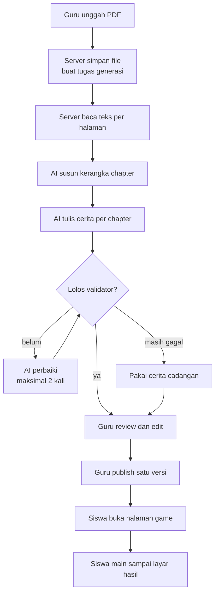

# ClassQuest

ClassQuest mengubah materi pelajaran yang diunggah guru menjadi game pixel 2D
bercerita, supaya siswa belajar lewat alur cerita dan tantangan, bukan hafalan.

> **Status:** masih tahap awal. Repo ini baru berisi scaffold Next.js dan
> dokumentasi kontrak. Belum ada fitur produk yang bisa dicoba. Rencana lengkap
> ada di [docs/](docs/README.md).

## Tim

| Nama  | Peran     | Instansi |
| ----- | --------- | -------- |
| `TBD` | Ketua tim | `TBD`    |
| `TBD` | Anggota   | `TBD`    |

Nama lengkap dan instansi diisi saat data tim dikunci. Akun GitHub yang memegang
repo: [@justeita](https://github.com/justeita) dan
[@Gerraldd](https://github.com/Gerraldd).

## Produk

- **Kategori:** Web
- **Nama aplikasi:** ClassQuest
- **Subtema LOGICODIX 2026:** Smart & Fun Education
- **Masalah:** materi pelajaran sering hanya berupa PDF panjang, sehingga siswa
  membaca tanpa keterlibatan dan guru sulit tahu bagian mana yang belum dipahami.
- **Target pengguna:** guru dan siswa SMP/SMA.
- **Solusi:** guru mengunggah PDF, sistem menyusun cerita game dari materi itu,
  guru meninjau dan mengedit, lalu siswa memainkannya. Semua keluaran bisa
  diperiksa guru sebelum sampai ke siswa.

## Fitur Utama

Belum ada fitur yang berjalan pada versi ini. Tabel akan diisi hanya dengan fitur
yang benar-benar jalan di commit final.

| Fitur | Status | Cara mencoba |
| ----- | ------ | ------------ |
| —     | —      | —            |

### Rencana

Urutan pengerjaan ada di [docs/10-roadmap/hackathon-plan.md](docs/10-roadmap/hackathon-plan.md).

1. Guru mengunggah PDF materi dan memantau status generasi.
2. AI menyusun kerangka chapter lalu menulis cerita per chapter.
3. Guru meninjau dan mengedit cerita sebelum publish.
4. Siswa memainkan cerita di browser dan mendapat layar hasil.

## Teknologi

| Lapisan              | Teknologi                | Keterangan                                     |
| -------------------- | ------------------------ | ---------------------------------------------- |
| Framework            | Next.js 16 (App Router)  | Server Component, Route Handler, Server Action |
| Bahasa               | TypeScript               | Strict mode                                    |
| UI                   | React 19, Tailwind CSS 4 |                                                |
| Game                 | Phaser 4.2.1             | Client-only. Shell placeholder di `/game`      |
| Database             | `TBD`                    | Keputusan ada di ADR 0005                      |
| AI                   | `TBD`                    | Keputusan provider ada di ADR 0006             |
| Layanan pihak ketiga | `TBD`                    | Diisi saat deployment ditentukan               |
| Runtime & package    | Bun 1.4.0                | Satu-satunya package manager yang dipakai      |

## Arsitektur



Cerita disimpan sebagai JSON dengan schema tetap, divalidasi validator yang sama
di client dan server. Aset game disiapkan di awal dari pustaka tetap — sebagian
digambar generator repo, sebagian aset pihak ketiga yang sudah diproses — jadi AI
hanya menyusun cerita dari aset yang sudah ada.

Detail: [docs/01-architecture/overview.md](docs/01-architecture/overview.md) dan
[docs/01-architecture/data-flow.md](docs/01-architecture/data-flow.md).

## Menjalankan Aplikasi

### Prasyarat

- Bun 1.4.0
- Node.js ≥ 20.9.0 (dipakai sebagian tooling)

### Instalasi

```bash
git clone https://github.com/justeita/ClassQuest.git
cd ClassQuest
bun install
cp .env.example .env.local
```

### Konfigurasi

Saat ini `.env.example` hanya berisi komentar karena aplikasi belum membaca satu
variabel pun. Begitu fitur AI dan penyimpanan masuk, nama variabelnya ditambahkan
di sana tanpa nilai rahasia. Tidak ada kredensial di repo ini.

### Menjalankan

```bash
bun dev
```

Buka http://localhost:3000.

### Pemeriksaan

```bash
bun run check   # format, lint, typecheck, test
bun run build   # build produksi
```

### Struktur singkat

- `src/app` — route dan layout App Router
- `docs/` — kontrak produk, arsitektur, dan aturan kerja
- `public/` — aset statis

## Akun Demo

Belum ada autentikasi pada versi ini.

## Penggunaan AI

**Sebagai alat bantu pengembangan:** sebagian kode, test, dan dokumentasi disusun
dengan bantuan asisten coding AI (OpenCode), lalu dibaca, dijalankan, dan
diverifikasi oleh anggota tim lewat `bun run check` dan `bun run build`. Tidak ada
kode yang di-commit tanpa dipahami minimal satu anggota.

**Sebagai fitur produk:** direncanakan, belum ada. Rencananya AI menyusun cerita
dari teks materi; guru tetap meninjau dan mengedit sebelum siswa melihat hasilnya.
Data pribadi siswa tidak dikirim ke model. Detail dan keputusan provider ada di
[docs/11-logicodix/14-ai-dan-atribusi.md](docs/11-logicodix/14-ai-dan-atribusi.md).

## Atribusi Pihak Ketiga

| Komponen                  | Sumber                            | Lisensi |
| ------------------------- | --------------------------------- | ------- |
| Next.js                   | https://nextjs.org                | MIT     |
| React                     | https://react.dev                 | MIT     |
| Tailwind CSS              | https://tailwindcss.com           | MIT     |
| Bun                       | https://bun.sh                    | MIT     |
| Starter `create-next-app` | https://github.com/vercel/next.js | MIT     |

Aset gambar game:

| Aset                                                                     | Sumber                                    | Lisensi                                   |
| ------------------------------------------------------------------------ | ----------------------------------------- | ----------------------------------------- |
| `prop_tree_large`, `prop_tree_medium`, `prop_tree_flower`                | Craftpix — Free Top Down Trees Pixel Art  | Craftpix Free License                     |
| `prop_bush_small`, `prop_bush_flower`                                    | Craftpix — Free Top Down Bushes Pixel Art | Craftpix Free License                     |
| `prop_shelf`, `prop_door`                                                | Craftpix — Main Character's Home          | Craftpix Free License                     |
| `map_halaman_sekolah`                                                    | Ventilatore — The Fan-tasy Tileset (Free) | The Fan-tasy Free License (non-komersial) |
| Background, karakter (termasuk `char_nino`), tile, prop lain, musik, sfx | Dibuat generator repo                     | Milik proyek                              |

Semua paket Craftpix berasal dari <https://craftpix.net>. Lisensi freebie-nya
mengizinkan pemakaian komersial dan modifikasi; atribusi tidak diwajibkan, tetapi
kami cantumkan di sini. Yang disimpan di repo hanya aset yang sudah dipotong dan
dipakai game, bukan isi paket mentah. Detail berkas asal dan kotak potong ada di
[docs/07-assets/inventory.md](docs/07-assets/inventory.md#sumber-dan-lisensi).

`char_nino` adalah gambar orisinal generator yang terinspirasi siluet dan warna
rambut karakter referensi, bukan salinan berkas seni berhak cipta.

`map_halaman_sekolah` adalah peta halaman sekolah yang dijahit dari **The
Fan-tasy Tileset (Free)** oleh Ventilatore
(<https://ventilatore.itch.io/the-fantasy-tileset>) lewat
`scripts/compose-map.mjs`. Edisi gratisnya **non-komersial**: boleh dipakai dan
diubah untuk proyek non-komersial, tetapi tidak boleh dijual atau didistribusikan
ulang sebagai aset. Yang di-commit hanya satu PNG peta jadi, bukan tileset
mentahnya. Bila ClassQuest kelak dikomersialkan, peta ini wajib diganti aset
berlisensi komersial atau digambar ulang tim.

Musik dan SFX disintesis sendiri oleh `scripts/lib/audio.mjs`, jadi tidak ada
komponen audio pihak ketiga. Font Patrick Hand memakai lisensi SIL OFL 1.1
(`public/fonts/OFL.txt`).

## Lisensi dan Penggunaan

Status lisensi proyek belum ditentukan (`TBD`). Aset pihak ketiga tetap mengikuti
lisensi masing-masing seperti pada tabel di atas.
