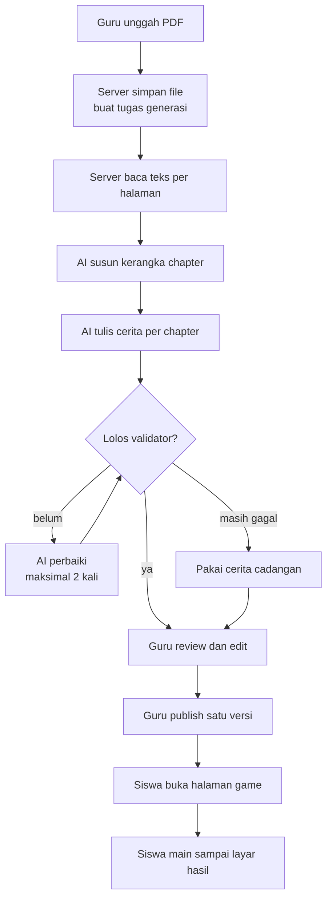

# ClassQuest

ClassQuest mengubah materi pelajaran yang diunggah guru menjadi game pixel 2D
bercerita, supaya siswa belajar lewat alur cerita dan tantangan, bukan hafalan.

> **Status:** dalam pengembangan aktif menjelang Hacking Week LOGICODIX 2026.
> Backend (upload, pipeline AI, cerita, auth guru, hasil main), halaman game
> siswa, portal guru (dashboard, materi, kelas), dan halaman pengenalan di `/`
> sudah jalan; yang belum ada adalah editor cerita dan preview draft. Rencana
> lengkap ada di [docs/](docs/README.md).

## Tim

| Nama  | Peran     | Instansi |
| ----- | --------- | -------- |
| `TBD` | Ketua tim | `TBD`    |
| `TBD` | Anggota   | `TBD`    |

Nama lengkap dan instansi diisi saat data tim dikunci. Akun GitHub yang memegang
repo: [@justeita](https://github.com/justeita) dan
[@Gerraldd](https://github.com/Gerraldd).

## Produk

- **Kategori:** Web
- **Nama aplikasi:** ClassQuest
- **Subtema LOGICODIX 2026:** Smart & Fun Education
- **Masalah:** materi pelajaran sering hanya berupa PDF panjang, sehingga siswa
  membaca tanpa keterlibatan dan guru sulit tahu bagian mana yang belum dipahami.
- **Target pengguna:** guru dan siswa SMP/SMA.
- **Solusi:** guru mengunggah PDF, sistem menyusun cerita game dari materi itu,
  guru meninjau dan mengedit, lalu siswa memainkannya. Semua keluaran bisa
  diperiksa guru sebelum sampai ke siswa.

## Fitur Utama

Yang sudah berjalan di commit saat ini:

| Fitur                                        | Status   | Cara mencoba                                   |
| -------------------------------------------- | -------- | ---------------------------------------------- |
| Game siswa dari cerita demo                  | Berjalan | Buka `/play/<storyId>` cerita demo             |
| Upload PDF + pembuatan job generasi          | Berjalan | `POST /api/upload`                             |
| Pipeline AI: ekstrak teks → outline → cerita | Berjalan | `AI_PROVIDER=mock` atau provider nyata via env |
| Login guru (akun + cookie sesi)              | Berjalan | `POST /api/auth/login`                         |
| Manajemen cerita guru (Server Actions)       | Berjalan | `src/app/guru/actions.ts`                      |
| Simpan hasil bermain siswa + ringkasan       | Berjalan | `src/server/play-results`                      |
| Portal guru: dashboard, materi, kelas        | Berjalan | Buka `/guru/masuk` setelah `bun run db:seed`   |
| Kelas & siswa (buat kelas, tambah siswa)     | Berjalan | `/guru/kelas`                                  |

### Rencana

Yang belum ada di commit ini adalah **editor cerita**
(`/guru/materi/[storyId]/edit`) dan **preview draft** — dua langkah terakhir dari
alur "guru meninjau dan mengedit cerita sebelum publish". Detail dan urutan
pengerjaan ada di
[docs/10-roadmap/hackathon-plan.md](docs/10-roadmap/hackathon-plan.md).

1. Editor cerita: guru mengubah dialog dan soal tanpa menyentuh JSON.
2. Preview draft: guru melihat hasil edit sebelum dipublish.
3. Deploy ke Vercel + Turso dan melengkapi berkas submission.

## Teknologi

| Lapisan              | Teknologi                          | Keterangan                                                     |
| -------------------- | ---------------------------------- | -------------------------------------------------------------- |
| Framework            | Next.js 16 (App Router)            | Server Component, Route Handler, Server Action                 |
| Bahasa               | TypeScript                         | Strict mode                                                    |
| UI                   | React 19, Tailwind CSS 4           |                                                                |
| Game                 | Phaser 4.2.1                       | Client-only. Halaman dev `/game`, game siswa `/play/[storyId]` |
| Database             | libSQL (`@libsql/client`)          | File lokal untuk dev; Turso untuk produksi                     |
| AI                   | Mock + Anthropic/OpenAI-compatible | Provider dipilih lewat `AI_PROVIDER`; ADR 0006 masih terbuka   |
| Layanan pihak ketiga | Vercel Hobby + Turso               | Hosting Vercel; database libSQL Turso (ADR 0013)               |
| Runtime & package    | Bun 1.4.0                          | Satu-satunya package manager yang dipakai                      |

## Arsitektur



Cerita disimpan sebagai JSON dengan schema tetap, divalidasi validator yang sama
di client dan server. Aset game disiapkan di awal dari pustaka tetap — sebagian
digambar generator repo, sebagian aset pihak ketiga yang sudah diproses — jadi AI
hanya menyusun cerita dari aset yang sudah ada.

Detail: [docs/01-architecture/overview.md](docs/01-architecture/overview.md) dan
[docs/01-architecture/data-flow.md](docs/01-architecture/data-flow.md).

## Menjalankan Aplikasi

### Prasyarat

- Bun 1.4.0
- Node.js ≥ 20.9.0 (dipakai sebagian tooling)

### Instalasi

```bash
git clone https://github.com/justeita/ClassQuest.git
cd ClassQuest
bun install
cp .env.example .env.local
```

### Konfigurasi

Salin `.env.example` menjadi `.env.local`, lalu isi nilainya. `.env.example`
sudah memuat **semua** nama variabel yang dibaca server, tanpa nilai asli:

```bash
# Provider AI (lihat docs/03-ai-pipeline/provider-setup.md)
AI_PROVIDER=mock        # mock berjalan tanpa kunci; provider nyata lewat env
AI_API_KEY=
AI_MODEL=
AI_BASE_URL=
AI_TIMEOUT_MS=60000

# Akun seed guru dan siswa. Keempatnya wajib diisi; tidak ada akun demo bawaan.
TEACHER_SEED_USERNAME=
TEACHER_SEED_PASSWORD=
STUDENT_SEED_USERNAME=
STUDENT_SEED_PASSWORD=

# Wajib. Kosong berarti login selalu gagal.
TEACHER_SESSION_SECRET=

# Database libSQL. Lokal: file:./local.db; produksi: Turso.
DATABASE_URL=file:./local.db
DATABASE_AUTH_TOKEN=
```

Detail langkah setup dan deploy ada di
[docs/08-workflow/setup.md](docs/08-workflow/setup.md). Jangan commit
`.env.local`; tidak ada kredensial di repo ini.

### Menjalankan

```bash
bun dev
```

Buka http://localhost:3000.

### Pemeriksaan

```bash
bun run check   # format, lint, typecheck, test
bun run build   # build produksi
```

### Struktur singkat

- `src/app` — route dan layout App Router
- `docs/` — kontrak produk, arsitektur, dan aturan kerja
- `public/` — aset statis

## Akun Demo

Aplikasi live: `TBD` (diisi setelah deploy pertama ke Vercel).

Guru masuk dengan **username + sandi**; sandi disimpan sebagai hash scrypt di
tabel `teachers`. Akun dibuat lewat `bun run db:seed` (lihat
[`docs/08-workflow/setup.md`](docs/08-workflow/setup.md)) dengan
`TEACHER_SEED_*`/`STUDENT_SEED_*` dari environment. Tidak ada akun demo bawaan:
seed gagal bila variabel itu kosong.

Akun demo untuk juri memakai username dan sandi yang diisi lewat environment saat
deploy. Sesuai aturan kredensial, nilainya tidak ditulis di repositori; kredensial
aktif dicantumkan pada kolom **Akun Demonstrasi** di formulir submission.
Endpoint masuk: `POST /api/auth/login` dengan body
`{ "username": "<username>", "password": "<sandi>" }`.

## Penggunaan AI

**Sebagai alat bantu pengembangan:** sebagian kode, test, dan dokumentasi disusun
dengan bantuan asisten coding AI (OpenCode), lalu dibaca, dijalankan, dan
diverifikasi oleh anggota tim lewat `bun run check` dan `bun run build`. Tidak ada
kode yang di-commit tanpa dipahami minimal satu anggota.

**Sebagai fitur produk:** pipeline generasi cerita sudah berjalan — guru
mengunggah PDF, sistem mengekstrak teks, menyusun kerangka chapter, lalu menulis
cerita per chapter dengan validasi dan repair. Provider dipilih lewat env
(`AI_PROVIDER=mock` untuk development tanpa biaya). Guru tetap meninjau dan
mengedit sebelum siswa melihat hasilnya. Data pribadi siswa tidak dikirim ke
model. Detail dan keputusan provider ada di
[docs/11-logicodix/14-ai-dan-atribusi.md](docs/11-logicodix/14-ai-dan-atribusi.md).

## Atribusi Pihak Ketiga

| Komponen                  | Sumber                            | Lisensi    |
| ------------------------- | --------------------------------- | ---------- |
| Next.js                   | https://nextjs.org                | MIT        |
| React                     | https://react.dev                 | MIT        |
| Tailwind CSS              | https://tailwindcss.com           | MIT        |
| Phaser                    | https://phaser.io                 | MIT        |
| Bun                       | https://bun.sh                    | MIT        |
| libSQL (`@libsql/client`) | https://libsql.org                | MIT        |
| unpdf                     | https://github.com/unjs/unpdf     | MIT        |
| zod                       | https://zod.dev                   | MIT        |
| Anthropic SDK             | https://github.com/anthropics/sdk | Apache-2.0 |
| Starter `create-next-app` | https://github.com/vercel/next.js | MIT        |

Aset gambar dan audio game:

| Aset                                                                           | Sumber                                                                                                      | Lisensi      |
| ------------------------------------------------------------------------------ | ----------------------------------------------------------------------------------------------------------- | ------------ |
| Peta desa, objek `world_*`, `char_mc`, `char_npc_*`, potret, dan `bgm_default` | Dibuat tim dengan alat AI generatif, diproses `scripts/import-world.mjs` dan `scripts/import-portraits.mjs` | Milik proyek |
| `bg_default`, `ui_textbox`, `ui_portrait_frame`, `ui_default`, `sfx_*`         | Dibuat generator repo                                                                                       | Milik proyek |

Peta desa, potongan objek, karakter, potret, dan lagu disalin apa adanya dari
folder paket aset proyek di luar repo oleh `scripts/import-world.mjs` (dan
`scripts/import-portraits.mjs` untuk potret dialog); yang di-commit hanya berkas
yang benar-benar dipakai game. Paket itu **dibuat tim
sendiri dengan alat AI generatif** (gambar desa, potongan objek, karakter, dan
potret), lalu disusun di editor peta `pixel-map-placer.html`. Tidak ada aset
yang diambil dari situs paket aset gratis maupun dari game komersial. Rincian
per berkas dicatat di
[docs/07-assets/inventory.md](docs/07-assets/inventory.md#sumber-dan-lisensi).

Spritesheet karakter desa memakai gaya delapan arah. Potret dialog memakai gaya
anime dengan enam ekspresi (`neutral`, `happy`, `sad`, `angry`, `shocked`,
`thinking`) per karakter, disalin dari paket aset anime proyek. Musik
`bgm_default` adalah satu lagu berlatar desa yang ikut dalam paket aset proyek.

Font Patrick Hand memakai lisensi SIL OFL 1.1 (`public/fonts/OFL.txt`).

## Lisensi dan Penggunaan

Status lisensi proyek belum ditentukan (`TBD`). Aset pihak ketiga tetap mengikuti
lisensi masing-masing seperti pada tabel di atas.
