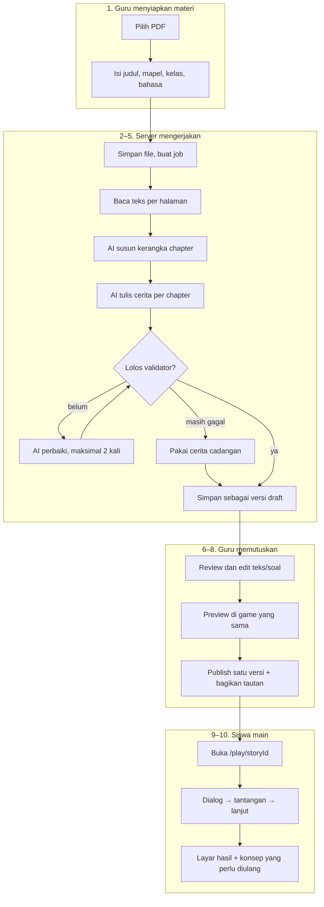

# Alur Pengguna

Dokumen ini menjelaskan alur end-to-end. Untuk detail teknis tiap langkah, lihat
tautan di setiap bagian.

## Alur utama: materi → game



Yang perlu diingat dari gambar di atas:

- **Guru bisa berhenti di mana saja.** Job tetap jalan walau tab ditutup.
- **Siswa hanya melihat versi `published`.** Draft tidak pernah bocor ke siswa.
- **Selalu ada hasil.** Kalau AI gagal total, cerita cadangan yang dipakai.

## Langkah 1 — Upload materi (guru)

**Tujuan:** guru memberi sumber isi satu-satunya.

- Guru membuka `/guru/materi/baru`.
- Memilih file PDF (drag & drop atau tombol pilih).
- Mengisi metadata minimal: **judul**, **mata pelajaran**, **jenjang/kelas**,
  **bahasa**.
- Menekan "Buat cerita".

**Yang harus terjadi:**

- Validasi file sebelum upload: tipe `application/pdf`, ukuran ≤ batas
  (lihat [`../06-backend/jobs-and-limits.md`](../06-backend/jobs-and-limits.md)),
  dan bisa dibaca sebagai PDF.
- Pesan error spesifik, bukan "upload gagal".
- Setelah submit, guru langsung masuk ke halaman status generasi; tidak menunggu
  di halaman upload.

**Kegagalan yang harus ditangani:**

| Kasus                   | Perilaku                                                                                                                       |
| ----------------------- | ------------------------------------------------------------------------------------------------------------------------------ |
| Bukan PDF               | Tolak di client + server, jelaskan alasan                                                                                      |
| File terlalu besar      | Tolak, sebutkan batas                                                                                                          |
| PDF hasil scan (gambar) | Deteksi teks kosong → job `failed` dengan `NO_TEXT_LAYER`, minta guru memakai PDF ber-teks. OCR **tidak** dikerjakan di MVP    |
| PDF terenkripsi         | Tolak dengan pesan jelas                                                                                                       |
| Materi terlalu sedikit  | Tetap lanjut, tapi sistem mengisi 3 chapter dengan memperdalam konsep yang ada (batas bawah schema) dan menandai `source.gaps` |

## Langkah 2 — Ekstraksi teks (server)

**Tujuan:** mengubah PDF menjadi teks yang aman diproses.

- Ambil teks per halaman, buang header/footer berulang bila memungkinkan.
- Normalisasi whitespace, tapi **jangan** merangkum di tahap ini.
- Simpan teks per halaman agar nanti bisa dirujuk saat validasi.
- **Perlakukan teks PDF sebagai data tidak tepercaya** (bisa mengandung instruksi
  yang menyerupai perintah ke AI). Lihat
  [`../01-architecture/security-and-privacy.md`](../01-architecture/security-and-privacy.md).

Detail: [`../03-ai-pipeline/pipeline.md`](../03-ai-pipeline/pipeline.md).

## Langkah 3 — Outline (AI, tahap 1)

**Tujuan:** menentukan struktur cerita sebelum menulis detail, supaya cerita
nyambung dan tidak melebar.

Output yang diharapkan: daftar chapter, masing-masing dengan:

- judul,
- konsep materi yang dibahas (`concept`),
- ringkasan 1–2 kalimat,
- halaman materi yang jadi dasarnya (`sourcePages`), supaya tahap berikutnya
  hanya perlu mengirim bagian yang relevan.

Bentuk lengkapnya ada di [`../03-ai-pipeline/pipeline.md`](../03-ai-pipeline/pipeline.md#4-outline-pass).
Guru **tidak** melihat JSON ini secara mentah. Kalau outline gagal, pipeline
berhenti dengan pesan yang bisa ditindaklanjuti.

## Langkah 4 — Generate cerita (AI, tahap 2)

**Tujuan:** menulis isi tiap chapter memakai aset yang tersedia.

- AI menerima: aturan cerita, daftar aset (id + deskripsi), outline, dan teks
  materi.
- Output: JSON sesuai [`../02-data-model/story-schema.md`](../02-data-model/story-schema.md).
- AI **tidak boleh** membuat `assetId` baru, karakter baru di luar cast, atau
  menambah fakta di luar materi.

## Langkah 5 — Validasi dan repair

Dua lapis:

1. **Struktural** — cocok dengan schema (`story.schema.json`, divalidasi dengan
   Ajv), id unik, referensi tidak menggantung.
2. **Semantik** — aset ada di manifest, `speakerId` ada di cast, tiap chapter
   punya tantangan, teks tidak melebihi batas textbox.

Kalau gagal: kirim daftar error ke AI untuk diperbaiki (maksimal N kali). Kalau
tetap gagal: pakai **fallback story** deterministik supaya demo tidak pernah kosong.

Detail: [`../03-ai-pipeline/validation-and-repair.md`](../03-ai-pipeline/validation-and-repair.md).

## Langkah 6 — Review dan edit (guru)

**Tujuan:** guru memastikan cerita benar dan sesuai gaya mengajarnya.

Guru melihat:

- daftar chapter + ringkasan,
- isi tiap scene sebagai kartu dialog yang bisa diedit,
- daftar tantangan beserta jawaban benar dan penjelasan,
- peringatan validasi yang belum terselesaikan,
- tombol **Preview** untuk mencoba langsung.

Yang bisa diedit (MVP):

- teks narasi dan dialog,
- memilih `backgroundId`/`musicId` dari daftar aset yang ada,
- teks soal, opsi, jawaban benar, penjelasan,
- urutan scene dalam chapter,
- menghapus tantangan (boleh disimpan sebagai draft, tapi publish diblokir bila
  chapter jadi tanpa tantangan — `E_CHAPTER_NO_CHALLENGE`).

Detail: [`../05-frontend/story-editor.md`](../05-frontend/story-editor.md).

## Langkah 7 — Simpan versi

Setiap simpan menghasilkan versi baru (bukan menimpa), supaya guru bisa kembali
ke versi sebelumnya. Versi yang dipakai siswa adalah versi yang di-**publish**.

Status cerita punya lima nilai: `processing`, `draft`, `published`, `failed`,
`archived`. Alurnya:

```text
upload → processing ─ sukses → draft ─ publish → published ─ arsip → archived
                     └ gagal  → failed ─ coba lagi → processing
```

Tidak ada status `ready` — alasannya ada di
[`../06-backend/persistence.md`](../06-backend/persistence.md#kenapa-tidak-ada-ready).
Acuan yang mengikat adalah enum di dokumen itu.

## Langkah 8 — Bagikan ke siswa

Guru mendapat:

- tautan `/play/[storyId]`, dan
- kode kelas singkat (opsional, masih `TBD` — lihat
  [`../05-frontend/game-player.md`](../05-frontend/game-player.md)).

Siswa membuka tautan, memasukkan nama panggilan (opsional), lalu main. Tidak perlu
akun.

## Langkah 9 — Siswa bermain

- Game memuat chapter pertama, menampilkan dialog, lalu tantangan.
- Siswa menjawab; game memberi umpan balik + penjelasan.
- Progres disimpan lokal sehingga refresh tidak menghapus kemajuan.
- Setelah chapter terakhir, muncul layar hasil.

Detail: [`../04-game/interaction-loop.md`](../04-game/interaction-loop.md).

## Langkah 10 — Hasil

Layar hasil menampilkan:

- jumlah tantangan benar/total,
- daftar konsep yang perlu diulang (dari `conceptTag` yang salah),
- tombol "main lagi" dan "kembali ke awal".

Hasil dikirim ke server bila memungkinkan; kalau gagal, tetap tampil lokal.

## Alur alternatif dan tepi

| Situasi                            | Perilaku yang diharapkan                              |
| ---------------------------------- | ----------------------------------------------------- |
| AI gagal total                     | Fallback story + banner "menggunakan cerita cadangan" |
| Guru menutup tab saat generate     | Job tetap jalan di server; status bisa dilihat lagi   |
| Siswa refresh di tengah game       | Progres dipulihkan dari localStorage                  |
| Aset gagal dimuat                  | Placeholder berlabel + game tetap bisa lanjut         |
| Guru menghapus cerita yang dipakai | Tolak, atau arsipkan (soft delete)                    |
| Materi bahasa Inggris              | Seluruh teks cerita mengikuti `meta.language`         |
