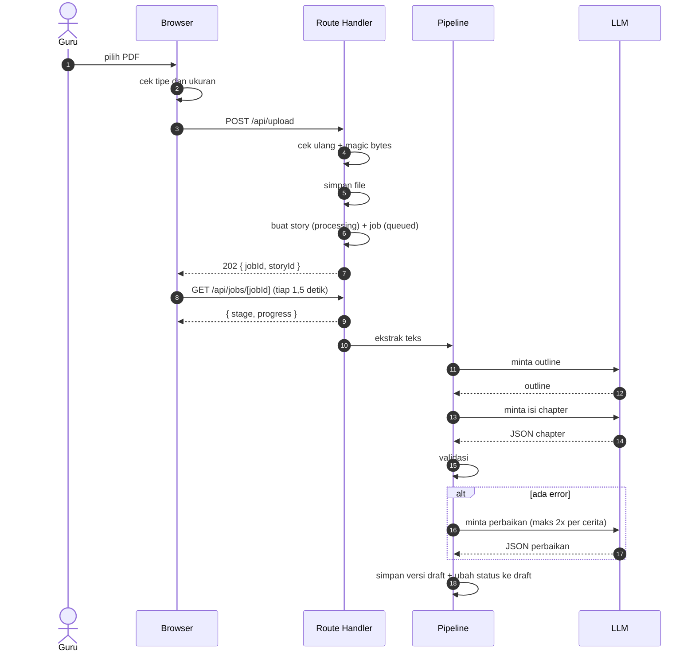
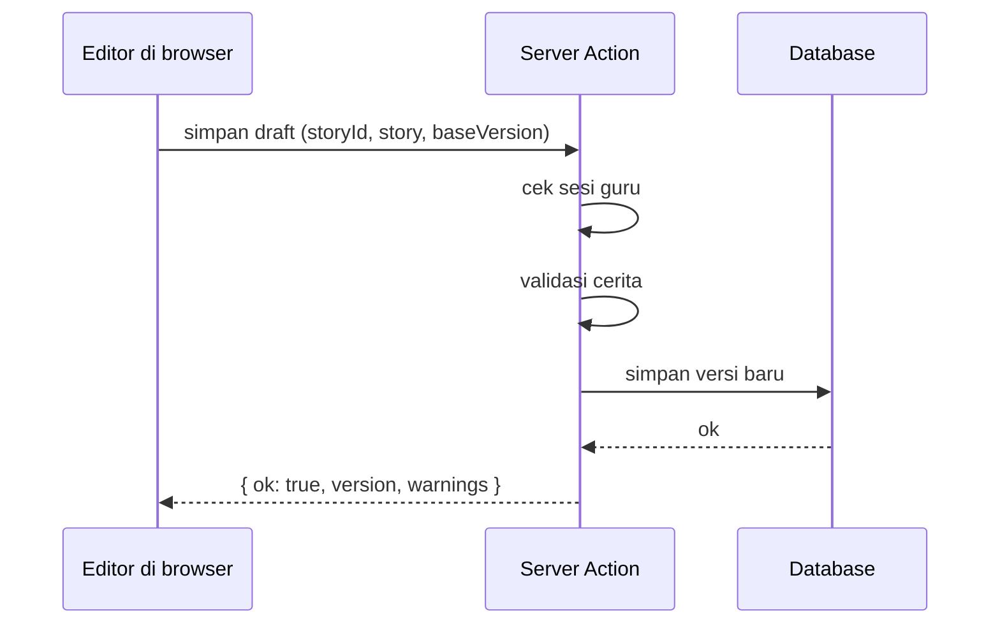
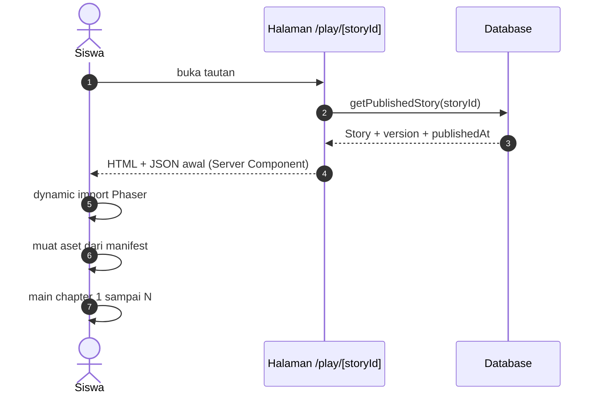
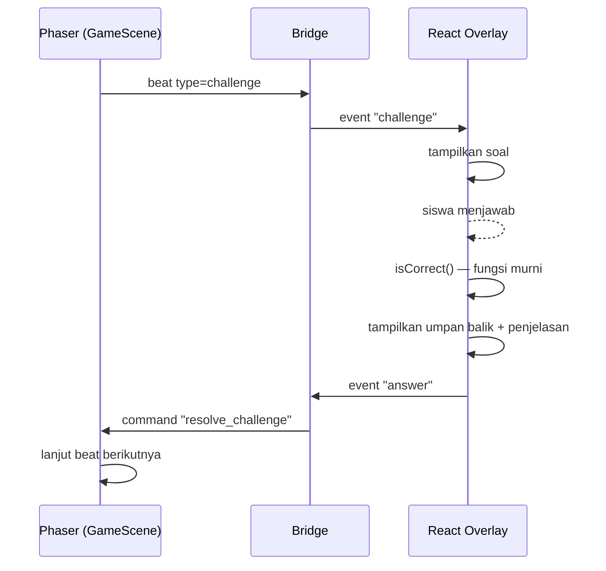

# Alur Data

Dokumen ini menjawab: **data apa berpindah ke mana, dalam bentuk apa, dan di mana
batas kepercayaannya.**

## Peta data

| Data             | Bentuk               | Disimpan di                                        | Pemilik    |
| ---------------- | -------------------- | -------------------------------------------------- | ---------- |
| PDF materi       | file biner           | object storage (TBD)                               | guru       |
| Teks per halaman | `string[]`           | memori selama job (boleh di kolom job untuk debug) | sistem     |
| Outline          | `OutlineChapter[]`   | memori selama job (boleh di kolom job untuk debug) | sistem     |
| Cerita           | `Story` (JSON)       | DB (JSONB/JSON)                                    | guru       |
| Status job       | `Job`                | DB                                                 | sistem     |
| Hasil main       | `PlayResult`         | DB (opsional) + lokal                              | siswa/guru |
| Progres main     | `PlayProgress`       | `localStorage`                                     | siswa      |
| Manifest aset    | `AssetManifest` (TS) | bundle (statis)                                    | tim        |

Teks per halaman dan outline **tidak wajib** disimpan permanen. Keduanya hidup
selama satu job; kalau disimpan, tempatnya di baris `jobs` (untuk debugging), bukan
tabel baru. Yang mengikat hanya `story_versions` — lihat
[`../06-backend/persistence.md`](../06-backend/persistence.md).

## Alur 1 — Upload dan generasi



`done` **tidak** dikirim pada respons upload. Respons pertama hanya `202`; siswa
guru baru tahu hasilnya lewat polling `GET /api/jobs/[jobId]`, yang pada akhirnya
mengembalikan `stage: "done"` (atau `"failed"`).

**Batas kepercayaan:**

- File dari client = tidak tepercaya → validasi ulang di server.
- Teks PDF = tidak tepercaya → bisa berisi instruksi palsu; diperlakukan sebagai
  data, bukan perintah (lihat [`security-and-privacy.md`](./security-and-privacy.md)).
- Output LLM = tidak tepercaya → wajib lolos validator sebelum disimpan sebagai
  `draft`.

**Bentuk status job:**

```ts
type JobStage =
  | "queued"
  | "extracting"
  | "outlining"
  | "generating"
  | "validating"
  | "repairing"
  | "saving"
  | "done"
  | "failed";

type Job = {
  id: string;
  storyId: string;
  stage: JobStage;
  progress: number; // hanya 5, 15, 30, 55, 75, 90, 100
  message?: string;
  errorCode?: string; // kolom DB `error_code`
  startedAt: string;
  finishedAt?: string;
};
```

`errorCode` di sini adalah **bentuk internal/DB**. Di JSON API, error selalu
dibungkus: `error: { code, message }` — lihat
[`../06-backend/api-contract.md`](../06-backend/api-contract.md). Jangan
mengembalikan `errorCode` mentah ke client.

## Alur 2 — Edit cerita oleh guru



Aturan:

- **Setiap simpan = versi baru.** Jangan menimpa versi yang sedang dipublish.
- **Validasi tidak memblokir simpan, tapi memblokir publish.** Error struktural
  maupun semantik dikembalikan sebagai `errors`; guru tetap boleh menyimpan
  setengah jadi. Yang tidak boleh: publish cerita yang masih punya `errors`.
- Nama action dan bentuk responsnya mengikuti
  [`../06-backend/api-contract.md`](../06-backend/api-contract.md#server-actions-bukan-endpoint-publik):
  `saveStoryDraft` → `SaveStoryResult` (`{ ok: true, version, warnings }` atau
  `{ ok: false, errors }` atau `{ ok: false, conflict: true, latestVersion }`).
- Server Action wajib memeriksa otorisasi sendiri, karena bisa dipanggil langsung
  via POST.

## Alur 3 — Siswa memuat dan memainkan cerita



Halaman play adalah **Server Component** yang membaca database langsung lewat
`getPublishedStory()`, bukan `fetch` ke API sendiri. Endpoint
`GET /api/stories/[storyId]` tetap ada untuk kebutuhan lain (mis. preview dari
client), dan bentuknya ber-envelope: `{ storyId, version, publishedAt, story }`.

Perhatikan: halaman mengambil data di server, **bukan** di browser. Kalau
browser yang mengambil, siswa harus melihat dua kali loading (shell lalu game),
dan id cerita draft berisiko ikut terkirim.

**Kenapa cerita diambil di server:** game butuh JSON utuh sebelum aset dimuat;
mengambil di server menghindari loading spinner ganda dan mencegah ID cerita
draft bocor ke siswa (server hanya mengembalikan versi `published`).

**Progres siswa:**

```ts
type PlayProgress = {
  storyId: string;
  storyVersion: number;
  chapterIndex: number;
  sceneIndex: number;
  beatIndex: number;
  answers: Record<
    string,
    { challengeId: string; correct: boolean; at: string }
  >;
  updatedAt: string;
};
```

Disimpan di `localStorage` dengan key `classquest:progress:{storyId}`.

## Alur 4 — Tantangan dijawab



Perhatikan: **React yang menilai, bukan Phaser.** Penilaian memakai fungsi murni
di `src/story/scoring.ts` yang sama dengan yang dipakai preview, jadi tidak
mungkin ada dua versi jawaban benar. Jangan menduplikasi logika benar/salah.

## Alur 5 — Selesai dan hasil

```text
Game selesai
   │
   ├─ hitung PlayResult dari answers (pure function)
   ├─ simpan ke localStorage
   ├─ tampilkan ResultScreen (client)
   └─ (opsional) POST hasil ke server
```

Kalau POST gagal, hasil tetap tampil. Jangan blokir siswa karena jaringan.

## Cache dan revalidasi

Karena `cacheComponents: true`:

| Data                        | Strategi                                               |
| --------------------------- | ------------------------------------------------------ |
| Halaman marketing/landing   | Statis (default)                                       |
| Dashboard guru              | Dinamis, `Suspense` per bagian                         |
| Daftar materi               | Dinamis; revalidate setelah simpan/publish             |
| `GET /api/stories/[id]`     | `no-store` (harus selalu versi terbaru yang published) |
| Aset game (`public/assets`) | Immutable, cache panjang; ganti nama file bila berubah |

Jangan memakai `use cache` untuk data yang bisa berubah setelah guru mengedit,
kecuali ditandai `cacheTag` dan diinvalidasi saat publish.

## Kegagalan dan perilaku yang diharapkan

| Titik gagal                        | Perilaku                                                   |
| ---------------------------------- | ---------------------------------------------------------- |
| Upload gagal                       | Job tidak dibuat; guru tetap di form dengan pesan error    |
| Ekstraksi menghasilkan teks kosong | Job `failed` dengan `errorCode: "NO_TEXT_LAYER"`           |
| LLM timeout                        | Retry sekali, lalu `failed` atau fallback tergantung tahap |
| JSON tidak valid                   | Repair (maks N), lalu fallback                             |
| Aset hilang saat load              | Placeholder + lanjut; catat di console                     |
| DB gagal saat simpan               | Tampilkan error, jangan klaim sukses                       |
