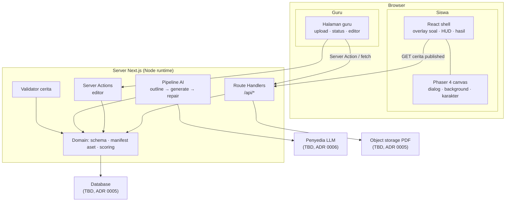

# Arsitektur: Gambaran Umum

## Bentuk sistem

Satu aplikasi Next.js (App Router) yang melayani dua pengalaman sekaligus:

- **Web app** untuk guru: upload, status generasi, editor cerita, preview.
- **Game** untuk siswa: Phaser 4 di dalam halaman React.

Tidak ada service terpisah. Pekerjaan berat (ekstraksi PDF, panggilan AI) berjalan
di server Next.js; game berjalan sepenuhnya di browser.



Tiga hal yang paling mudah dilupakan dari gambar itu:

- **Game tidak pernah menyentuh database.** Ia menerima satu JSON cerita, lalu
  jalan sendiri di browser.
- **Tidak ada service terpisah.** Pekerjaan berat (baca PDF, panggil AI) berjalan
  di server Next.js yang sama.
- **Semua kunci API ada di kotak server.** Tidak ada satu pun yang sampai ke
  browser.

## Tanggung jawab per lapisan

| Lapisan          | Isi                                                 | Aturan                                                       |
| ---------------- | --------------------------------------------------- | ------------------------------------------------------------ |
| `src/app`        | Route, layout, page, route handler, server action   | Tipis. Tidak berisi logika domain.                           |
| `src/components` | UI React reusable (guru + shell game)               | Tidak memanggil AI langsung.                                 |
| `src/story`      | Schema, tipe, validator, scoring, fallback          | **Pure functions**, mudah dites, tidak tahu DB/HTTP.         |
| `src/ai`         | Prompt builder, provider client, pipeline, repair   | Tidak tahu React. Hanya input teks + output `Story`.         |
| `src/assets`     | Manifest aset (sumber kebenaran id aset)            | Statis, tanpa dependensi runtime.                            |
| `src/game`       | Phaser scenes, bridge ke React, loader aset         | Hanya jalan di client. Tidak melakukan fetch ke DB langsung. |
| `src/server`     | Akses DB, storage, job                              | Satu-satunya tempat yang menyentuh kredensial.               |
| `src/lib`        | Utilitas kecil, env (`env.ts`), aturan tahun ajaran | Murni, tanpa React/DB. Boleh dipakai client **dan** server.  |

Aturan dependensi (tidak boleh dibalik):

```text
app → components → story
app → server → story + ai + assets
ai  → story + assets
game → story + assets
app, components, server → lib (aturan bersama, mis. tahun ajaran)
story → assets (untuk validasi id)
lib, story, assets → (tidak mengimpor apa pun dari app/server/game)
```

## Keputusan arsitektur kunci

1. **Story JSON sebagai kontrak tunggal.** Prompt, validator, editor, dan engine
   memakai tipe yang sama. Lihat [ADR 0002](../09-decisions/0002-story-json-as-contract.md).
2. **Aset tetap.** Tidak ada generasi aset; semua `assetId` berasal dari manifest.
   Lihat [ADR 0003](../09-decisions/0003-fixed-asset-library.md).
3. **Phaser hanya di client.** Dimuat dinamis, tidak pernah dirender di server.
   Lihat [ADR 0004](../09-decisions/0004-phaser-4.md).
4. **UI hybrid.** Dunia & dialog di Phaser; tantangan, menu, dan form di DOM.
   Lihat [ADR 0007](../09-decisions/0007-hybrid-ui.md).
5. **AI hanya di server.** Tidak ada kunci API di bundle client.
6. **Selalu ada fallback.** Pipeline tidak boleh menghasilkan layar kosong.

## Konsekuensi yang harus diterima

- **Phaser + Next butuh kehati-hatian.** Phaser mengakses `window`; semua impor
  harus dinamis dan hanya di `useEffect`. Lihat [`../04-game/engine.md`](../04-game/engine.md).
- **Cache Components aktif.** Halaman dinamis perlu `Suspense`/streaming; jangan
  memakai `export const runtime`. Lihat [`tech-stack.md`](./tech-stack.md).
- **Dua bahasa UI.** Editor guru adalah form biasa; game adalah canvas. Konsistensi
  visual dijaga lewat design token bersama, bukan lewat satu framework UI.
- **Belum ada auth nyata.** Jangan simpan data sensitif; lihat
  [`security-and-privacy.md`](./security-and-privacy.md).

## Yang belum diputuskan

| Pertanyaan                       | Dokumen                                                                |
| -------------------------------- | ---------------------------------------------------------------------- |
| Database & storage apa?          | [ADR 0005](../09-decisions/0005-persistence-and-storage.md)            |
| Provider LLM apa?                | [ADR 0006](../09-decisions/0006-ai-provider.md)                        |
| Auth guru seperti apa?           | [`../06-backend/persistence.md`](../06-backend/persistence.md)         |
| Job berjalan sinkron atau async? | [`../06-backend/jobs-and-limits.md`](../06-backend/jobs-and-limits.md) |
