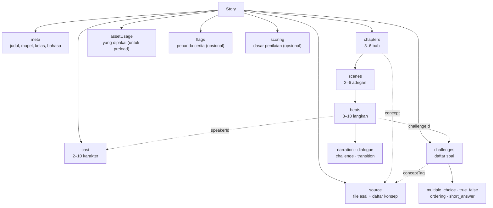

# Story Schema (v1.0)

**Ini kontrak utama proyek.** Prompt AI, validator, story editor, dan game engine
semuanya memakai bentuk ini. Kalau satu pihak mengubah bentuk tanpa mengubah yang
lain, produk rusak.

- Tipe TypeScript: `src/story/schema.ts` (rencana)
- Validator: `src/story/validate.ts` (rencana)
- Contoh valid: [`story.example.json`](./story.example.json)
- Bentuk untuk mesin: [`story.schema.json`](./story.schema.json) — JSON Schema
  2020-12, dipakai tes untuk memastikan dokumen ini tidak menyimpang
- Kode error: [`validation-rules.md`](./validation-rules.md)
- Keputusan: [ADR 0002](../09-decisions/0002-story-json-as-contract.md)

> Dokumen ini untuk dibaca manusia. [`story.schema.json`](./story.schema.json)
> adalah versi yang dijalankan mesin. `docs/02-data-model/story-schema.test.ts`
> menjaga keduanya tetap dekat, tapi **tidak semua hal**:
>
> - yang **dijaga otomatis**: daftar field tingkat atas `Story`, nomor versi, dan
>   angka batas teks (`240`, `80`, `400`, `120`, `60`, `140`) di
>   [`validation-rules.md`](./validation-rules.md) serta `challenge-types.md`;
> - yang **tidak** dijaga: arti dan perilaku tiap field. Kalau kamu mengubah
>   arti sesuatu, tidak ada tes yang akan menangkapnya — kamu yang harus
>   memperbarui dokumen ini.

## Prinsip

1. **Semua id stabil dan buatan mesin.** Jangan pakai judul sebagai id.
2. **Tidak ada teks bebas di luar field yang ditentukan.** Ini membatasi halusinasi.
3. **Semua referensi harus menunjuk sesuatu yang ada.** Tidak ada referensi
   menggantung.
4. **Aset selalu berupa id dari manifest.** Tidak ada path file di dalam cerita.
5. **Perubahan breaking menaikkan `schemaVersion`.**

## Bentuk tingkat atas



Garis putus-putus itu **referensi**, bukan kepemilikan. Semuanya harus menunjuk
sesuatu yang benar-benar ada; kalau tidak, validator menolak dengan
`E_UNKNOWN_*`. Itu sebabnya contoh di bawah selalu memakai nama yang sama di
beberapa tempat.

```ts
type Story = {
  schemaVersion: "1.0";
  meta: StoryMeta;
  source: StorySource;
  cast: Character[];
  chapters: Chapter[];
  challenges: Challenge[];
  assetUsage: AssetUsage;
  flags?: Flag[];
  scoring?: Scoring;
};
```

### `meta`

```ts
type StoryMeta = {
  id: string; // id internal, dibuat server (nanoid), bukan oleh AI
  title: string; // 3..80 karakter
  subject: string; // mis. "IPA", "Sejarah"
  gradeLevel: string; // mis. "SMP 7"
  language: string; // BCP-47: "id", "en"
  tone: string; // mis. "hangat dan penasaran"
  synopsis: string; // 40..400 karakter
  estimatedMinutes: number; // 3..30
};
```

### `source`

Jejak asal cerita. Dipakai untuk audit dan untuk menampilkan "dari materi apa".

```ts
type StorySource = {
  fileName: string; // nama file asli, hanya untuk tampilan
  pageCount: number; // 1..40
  concepts: string[]; // 1..12 konsep materi, mis. ["Evaporasi", "Kondensasi"]
  gaps?: string[]; // hal yang tidak ada di materi tapi dibutuhkan cerita
};
```

`gaps` penting: kalau AI butuh detail yang tidak ada di PDF, ia **tidak boleh
mengarang**. Ia menuliskan kekurangan itu di sini supaya guru tahu.

### `cast`

```ts
type Character = {
  id: string; // pola: char_[a-z0-9_]+
  name: string; // nama tampilan, 1..40 karakter
  role: "player" | "mentor" | "npc" | "antagonist";
  spriteId: string; // harus ada di manifest, kind "character"
  description?: string; // 0..160 karakter
  smallTalk?: string; // 1..240 karakter, obrolan singkat di luar peran
};
```

Aturan:

- 2–10 karakter.
- Tepat **satu** `role: "player"`.
- Minimal satu `mentor` (pemandu yang menyampaikan materi).
- `id` tidak boleh duplikat.
- `smallTalk` **opsional**. Kalau diisi, karakter itu bisa diajak bicara singkat
  saat bukan pemberi quest scene aktif: satu kalimat di textbox, tanpa mengubah
  urutan cerita. Karakter tanpa `smallTalk` tetap diam. Pipeline AI tidak wajib
  mengisinya.

### `chapters`

```ts
type Chapter = {
  id: string; // pola: ch_[a-z0-9_]+
  title: string; // 3..60 karakter
  concept: string; // HARUS salah satu dari source.concepts
  summary: string; // 20..240 karakter
  backgroundId: string; // default background chapter
  musicId: string; // default musik chapter
  scenes: Scene[]; // 2..6
};
```

### `scenes`

```ts
type Scene = {
  id: string; // pola: sc_[a-z0-9_]+
  title?: string; // 0..60 karakter, untuk editor guru
  backgroundId?: string; // override background chapter
  musicId?: string; // override musik chapter
  beats: Beat[]; // 3..10
};
```

### `beats`

```ts
type Beat =
  | {
      type: "narration";
      text: string;
      speakerId?: string;
      expression?: Expression;
    }
  | {
      type: "dialogue";
      speakerId: string;
      text: string;
      expression?: Expression;
      textVariants?: TextVariant[]; // opsional, 1.0 tetap valid tanpanya
    }
  | {
      type: "challenge";
      challengeId: string;
      maxAttempts?: 1 | 2 | 3; // default 1
      onWrong?: OnWrong; // konsekuensi jawaban salah
    }
  | { type: "transition"; effect: "fade" | "cut"; text?: string };

type Expression =
  "neutral" | "happy" | "sad" | "angry" | "shocked" | "thinking";

type TextVariant = {
  when: { flag: string; is: boolean }; // flag harus ada di top-level flags
  text: string; // 1..240 karakter
};

type OnWrong = {
  setFlags?: Record<string, boolean>; // flag harus ada di top-level flags
  retryQuestions?: string[]; // jumlah = maxAttempts - 1, tiap 5..300 karakter
  detour?: DetourBeat[]; // maksimal 3 beat, tanpa challenge
};

type DetourBeat =
  | {
      type: "narration";
      text: string;
      speakerId?: string;
      expression?: Expression;
    }
  | {
      type: "dialogue";
      speakerId: string;
      text: string;
      expression?: Expression;
      textVariants?: TextVariant[];
    };
```

Aturan:

| Field         | Aturan                                                      |
| ------------- | ----------------------------------------------------------- |
| `text`        | 1–240 karakter. Harus muat di textbox tanpa scroll.         |
| `speakerId`   | Harus ada di `cast`.                                        |
| `challengeId` | Harus ada di `challenges`.                                  |
| `expression`  | Opsional; salah satu dari enam ekspresi, default `neutral`. |
| `transition`  | Tidak boleh jadi beat terakhir sebuah scene.                |

`narration` = narator tanpa karakter. `dialogue` = karakter berbicara.

Potret **tidak** direferensikan lewat path di cerita: game mengambilnya dari
manifest karakter (`portraits`, satu berkas per ekspresi di
`public/assets/portrait/<nama>/`). Field `expression` hanya memilih ekspresi
mana yang ditampilkan. `narration` boleh memunculkan potret **tanpa** nama
pembicara lewat `speakerId` + `expression`; karena itu `expression` pada
`narration` wajib disertai `speakerId`. Gaya tampilannya ada di
[`../04-game/scene-format.md`](../04-game/scene-format.md) dan ADR 0020.

#### Konsekuensi jawaban salah (opsional)

Semua field di bawah ini **opsional**. Cerita yang tidak memakainya tetap sah
dan berperilaku seperti v1.0 biasa (`maxAttempts` efektif 1).

- `maxAttempts` — jumlah percobaan menjawab, 1–3. Default 1.
- `onWrong` — dijalankan setelah jawaban salah:
  - `detour` — maksimal **3 beat** `narration`/`dialogue` yang ditampilkan
    sebelum soal yang sama ditanyakan ulang. Detour **tidak boleh** berisi
    `challenge`.
  - `setFlags` — menyalakan/mematikan flag cerita. Setiap id flag harus
    dideklarasikan di top-level [`flags`](#flags).
  - `retryQuestions` — teks soal pengganti untuk percobaan berikutnya. Jumlahnya
    **harus tepat** `maxAttempts - 1`; percobaan ke-_n_ memakai
    `retryQuestions[n - 1]`.
- Retry **hanya** mengganti teks soal. `options` dan `correctOptionId` (atau
  `correctAnswer`/`correctOrder`/`acceptedAnswers`) tidak berubah, jadi jawaban
  benar tetap sama di semua percobaan.
- `textVariants` pada beat `dialogue` memilih teks alternatif saat flag cocok:
  `{ when: { flag, is } }`. Kalau tidak ada varian yang cocok, `text` dipakai.

Contoh:

```json
{
  "type": "challenge",
  "challengeId": "chl_01_01",
  "maxAttempts": 2,
  "onWrong": {
    "setFlags": { "flg_salah_hitung": true },
    "retryQuestions": [
      "Coba baca ulang resepnya. Kalau 3 bagian tepung menjadi 9 cangkir, berapa bagian gula?"
    ],
    "detour": [
      {
        "type": "narration",
        "text": "Nara mencoret hitungan pertamanya dan menarik napas."
      },
      {
        "type": "dialogue",
        "speakerId": "char_npc_1",
        "text": "Tidak apa-apa, kita hitung pelan-pelan lagi."
      }
    ]
  }
}
```

### `challenges`

Bentuk lengkap per tipe ada di [`challenge-types.md`](./challenge-types.md).
Ringkasnya:

```ts
type Challenge =
  | MultipleChoiceChallenge
  | TrueFalseChallenge
  | OrderingChallenge
  | ShortAnswerChallenge;

type ChallengeBase = {
  id: string; // pola: chl_[a-z0-9_]+
  type: ChallengeType;
  prompt: string; // 5..300 karakter
  conceptTag: string; // HARUS salah satu dari source.concepts
  difficulty: 1 | 2 | 3;
  explanation: string; // 10..400 karakter, wajib
  hints?: string[]; // 0..2, masing-masing <= 140 karakter
  points?: number; // default 10
};
```

### `assetUsage`

Daftar aset yang benar-benar dipakai. Bukan sumber kebenaran (yang menentukan
adalah field `backgroundId`/`musicId`/`spriteId`), tapi berguna untuk preload dan
audit.

```ts
type AssetUsage = {
  backgrounds: string[];
  music: string[];
  sprites: string[];
};
```

Validator memastikan isinya **sama** dengan hasil pemindaian cerita. Kalau beda,
itu `E_ASSET_USAGE_MISMATCH`.

> SFX tidak muncul di cerita. Suara UI (`sfx_click`, `sfx_correct`, `sfx_wrong`)
> dimainkan otomatis oleh game, jadi tidak perlu direferensikan AI.

### `flags`

Penanda cerita opsional yang bisa dinyalakan oleh jawaban salah dan dibaca oleh
`textVariants`.

```ts
type Flag = {
  id: string; // pola: flg_[a-z0-9_]+
  default: boolean; // nilai awal sebelum cerita berjalan
};
```

- `flags` boleh tidak ada; artinya cerita tidak memakai flag.
- Setiap id yang muncul di `onWrong.setFlags` atau `textVariants[].when.flag`
  harus dideklarasikan di sini (`E_FLAG_UNDECLARED`).
- Id flag harus unik (`E_DUPLICATE_ID`).

### `scoring`

```ts
type Scoring = {
  basis: "firstAttempt";
};
```

Menentukan dasar penilaian. Satu-satunya nilai yang didukung saat ini adalah
`"firstAttempt"`: skor dihitung dari jawaban benar pada percobaan pertama, bukan
dari percobaan terakhir. `scoring` boleh tidak ada dan berarti
`{ "basis": "firstAttempt" }`.

## Contoh minimal

```json
{
  "schemaVersion": "1.0",
  "meta": {
    "id": "st_demo01",
    "title": "Ke Mana Perginya Genangan Itu?",
    "subject": "IPA",
    "gradeLevel": "SMP 7",
    "language": "id",
    "tone": "hangat dan penasaran",
    "synopsis": "Nara mengikuti perjalanan setetes air dari halaman sekolah sampai kembali lagi ke bumi.",
    "estimatedMinutes": 8
  },
  "source": {
    "fileName": "siklus-air.pdf",
    "pageCount": 6,
    "concepts": ["Evaporasi", "Kondensasi", "Infiltrasi"]
  },
  "cast": [
    {
      "id": "char_nara",
      "name": "Nara",
      "role": "player",
      "spriteId": "char_nara"
    },
    {
      "id": "char_pak_bima",
      "name": "Pak Bima",
      "role": "mentor",
      "spriteId": "char_pak_bima"
    }
  ],
  "chapters": [
    {
      "id": "ch_01",
      "title": "Pagi yang Menguap",
      "concept": "Evaporasi",
      "summary": "Nara memperhatikan genangan di halaman sekolah yang menyusut tanpa diseka.",
      "backgroundId": "bg_classroom_day",
      "musicId": "bgm_school_calm",
      "scenes": [
        {
          "id": "sc_01_01",
          "beats": [
            {
              "type": "narration",
              "text": "Bel berbunyi. Di depan kelas, Pak Bima menunjuk genangan air yang mulai mengering."
            },
            {
              "type": "dialogue",
              "speakerId": "char_pak_bima",
              "text": "Genangan itu tadi pagi masih penuh. Ke mana airnya?"
            },
            {
              "type": "dialogue",
              "speakerId": "char_nara",
              "text": "Aku tidak melihat ada yang mengepelnya, Pak."
            }
          ]
        }
      ]
    }
  ],
  "challenges": [],
  "assetUsage": {
    "backgrounds": ["bg_classroom_day"],
    "music": ["bgm_school_calm"],
    "sprites": ["char_nara", "char_pak_bima"]
  }
}
```

> Contoh di atas **tidak** lolos validator penuh (hanya 1 chapter, 1 scene,
> 3 beat, tanpa tantangan) — dipakai hanya untuk menunjukkan bentuk. Untuk
> fixture yang valid, pakai [`story.example.json`](./story.example.json).

## Aturan yang tidak boleh dilanggar

| Aturan                                      | Kode error                  |
| ------------------------------------------- | --------------------------- |
| `schemaVersion` harus `"1.0"`               | `E_SCHEMA_VERSION`          |
| 3–6 chapter                                 | `E_CHAPTER_COUNT`           |
| 2–6 scene per chapter                       | `E_SCENE_COUNT`             |
| 3–10 beat per scene                         | `E_BEAT_COUNT`              |
| Tiap chapter minimal 1 beat `challenge`     | `E_CHAPTER_NO_CHALLENGE`    |
| Tiap tantangan dirujuk minimal satu kali    | `E_ORPHAN_CHALLENGE`        |
| Tiap tantangan dirujuk maksimal satu kali   | `E_DUPLICATE_CHALLENGE_REF` |
| Tidak ada `assetId` di luar manifest        | `E_UNKNOWN_ASSET`           |
| Tidak ada `speakerId` di luar `cast`        | `E_UNKNOWN_SPEAKER`         |
| `expression` narasi wajib punya `speakerId` | `E_SCHEMA`                  |
| `expression` ∈ enam ekspresi potret         | `E_SCHEMA`                  |
| `concept`/`conceptTag` ∈ `source.concepts`  | `E_UNKNOWN_CONCEPT`         |
| Semua id unik                               | `E_DUPLICATE_ID`            |
| Teks tidak melebihi batas                   | `E_TEXT_TOO_LONG`           |
| Flag di `setFlags`/`textVariants` terdaftar | `E_FLAG_UNDECLARED`         |
| `retryQuestions` = `maxAttempts` − 1        | `E_RETRY_COUNT`             |
| Detour maksimal 3 beat tanpa challenge      | `E_DETOUR_TOO_LONG`         |

Daftar lengkap + contoh pesan: [`validation-rules.md`](./validation-rules.md).

## Kompatibilitas

- Field baru yang **opsional** boleh ditambah di `1.x`.
- Menghapus field, mengubah tipe, atau mengubah arti field → `2.0`.
- Game harus menolak memuat `schemaVersion` mayor yang tidak dikenal, dengan pesan
  "cerita dibuat dengan versi lebih baru".
- Jangan menyimpan data tambahan di dalam `Story`. Metadata internal (versi,
  status, pemilik) hidup di record database, bukan di JSON cerita.
