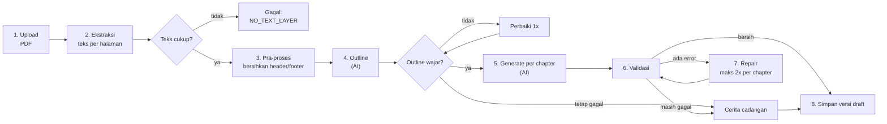

# Pipeline AI: PDF → Cerita

Tujuan pipeline: mengubah materi guru menjadi `Story` yang **valid**, **setia pada
materi**, dan **bisa dimainkan** — dengan biaya dan waktu yang wajar.

Implementasi target: `src/ai/pipeline.ts`.

## Tahapan



Tabel berikut adalah rincian tiap kotak di gambar.

| #   | Tahap      | Input                     | Output                 | Model? | Gagal →                           |
| --- | ---------- | ------------------------- | ---------------------- | ------ | --------------------------------- |
| 1   | Upload     | file PDF                  | file tersimpan         | Tidak  | tolak, pesan error                |
| 2   | Ekstraksi  | file PDF                  | `pages: string[]`      | Tidak  | `failed`                          |
| 3   | Pra-proses | `pages`                   | teks bersih + metadata | Tidak  | `failed`                          |
| 4   | Outline    | teks materi               | `Outline`              | Ya     | retry 1x → perbaiki 1x → fallback |
| 5   | Generate   | outline + potongan materi | chapter + tantangan    | Ya     | retry 1x → repair → fallback      |
| 6   | Validasi   | satu chapter / cerita     | `ValidationResult`     | Tidak  | repair                            |
| 7   | Repair     | draft + errors            | draft baru             | Ya     | jatah 2 per chapter → fallback    |
| 8   | Simpan     | `Story` valid             | versi cerita           | Tidak  | `failed`                          |

## 1–3. Ekstraksi dan pra-proses

Tujuan: teks yang bersih, cukup, dan aman.

- Ekstrak teks **per halaman**, pertahankan nomor halaman.
- Buang header/footer berulang: baris yang sama muncul di > 60% halaman.
- Buang nomor halaman yang berdiri sendiri.
- Normalisasi spasi, jangan mengubah isi.
- Hitung `charCount`; kalau < 200 karakter → `NO_TEXT_LAYER` (kemungkinan PDF scan).
- Batasi jumlah halaman dan total karakter (lihat
  [`../06-backend/jobs-and-limits.md`](../06-backend/jobs-and-limits.md)):
  - PDF > 40 halaman → ditolak sebelum diproses (`TOO_MANY_PAGES`);
  - hanya **15 halaman pertama** yang diproses;
  - kalau teks masih > 30.000 karakter, **potong dari halaman terakhir** (bukan
    ambil awal + akhir), dan catat di `source.gaps`.

  Alasannya: materi sekolah dibaca berurutan, jadi bagian awal hampir selalu lebih
  penting daripada bagian akhir. Membuang ekor juga membuat `sourcePages` di
  outline tetap bisa dihitung dengan mudah. Satu strategi saja — jangan campur
  "awal + akhir" dengan "15 halaman pertama".

**Jangan** merangkum di tahap ini. Ringkasan dilakukan model, dengan instruksi
eksplisit, supaya bisa diaudit.

## 4. Outline pass

Tujuan: menentukan struktur sebelum menulis, supaya cerita tidak melebar dan tiap
chapter punya konsep jelas.

Input: teks materi (utuh bila muat, atau per bagian).

Output:

```ts
type Outline = {
  title: string;
  synopsis: string;
  language: string;
  concepts: string[]; // 1..12
  cast: { id: string; name: string; role: CharacterRole; spriteId: string }[];
  chapters: {
    id: string;
    title: string;
    concept: string; // salah satu concepts
    summary: string;
    sourcePages: number[]; // halaman materi yang jadi dasar
  }[];
  gaps: string[];
};
```

Aturan:

- Jumlah chapter mengikuti panjang materi: 3 chapter untuk materi pendek,
  maksimal 6.
- Satu chapter = satu konsep. Jangan menggabungkan dua konsep besar.
- `sourcePages` memungkinkan generate hanya mengirim halaman relevan → hemat token
  dan mengurangi halusinasi.
- Kalau materi hanya cukup untuk 2 konsep, tetap buat 3 chapter: chapter ketiga
  **memperdalam** salah satu konsep (contoh penerapan, latihan), bukan mengarang
  konsep baru. Catat di `gaps` bila perlu. Lihat
  [`generation-rules.md`](./generation-rules.md#cakupan-konsep).

Validasi outline (ringan, sebelum generate):

- `concepts` tidak kosong dan tidak duplikat.
- `chapters[].concept` ∈ `concepts`.
- `cast` punya tepat satu `player` dan minimal satu `mentor`.
- Semua `spriteId` ada di manifest.
- 3 ≤ jumlah chapter ≤ 6.

Kalau outline gagal validasi → satu kali perbaikan, lalu fallback.

## 5. Generate pass

Dijalankan **per chapter**, bukan sekaligus. Alasannya:

- output lebih pendek → lebih kecil kemungkinan JSON terpotong,
- konteks bisa dibatasi ke halaman relevan,
- kegagalan satu chapter tidak membuang semuanya.

Konteks yang dikirim untuk chapter ke-N:

1. System prompt + aturan (lihat [`prompt-contract.md`](./prompt-contract.md)).
2. Schema output.
3. Daftar aset (id, kind, label, tags).
4. Outline lengkap (judul chapter lain + konsepnya) — untuk kontinuitas.
5. Ringkasan chapter sebelumnya + status karakter (siapa di mana, tahu apa).
6. Potongan materi untuk chapter ini (`sourcePages`).

**State kontinuitas** inilah yang membuat cerita nyambung. Tanpa ini, tiap chapter
akan terasa seperti cerita terpisah.

```ts
type ContinuityState = {
  previousChapterSummary: string; // 1..2 kalimat
  characterStates: { id: string; location: string; knows: string[] }[];
  openThreads: string[]; // hal yang belum selesai, harus ditutup nanti
};
```

`ContinuityState` **tidak** disimpan di dalam `Story`. `Story` memakai
`additionalProperties: false`, jadi menambah field di sana akan ditolak validator.
Bentuk yang dipakai:

- Prompt generate meminta model mengembalikan **dua** objek: `chapter` (bagian dari
  `Story`) dan `continuity` (di luar `Story`).
- Kalau provider tidak mendukung output berlapis, jalankan panggilan kecil
  terpisah: "ringkas chapter ini dalam 2 kalimat + status karakter", dengan
  output `ContinuityState`. Itu dihitung dalam anggaran 18 panggilan.
- Pipeline menyimpan `continuity` di memori selama job berjalan, dan boleh
  menyimpannya di kolom job untuk debugging. Ia tidak pernah masuk ke JSON cerita.

## 6–7. Validasi dan repair

Lihat [`validation-and-repair.md`](./validation-and-repair.md).

## 8. Simpan

- Simpan sebagai **versi draft** baru.
- Simpan juga: `promptVersion`, `model`, `tokenUsage`, `durationMs`, `attempts`.
- Jangan menimpa versi yang sudah dipublish.

## Fallback

Fallback adalah cerita deterministik yang sudah ada di repo
(`src/story/fallback.ts`), dibangun dari template + konsep dari materi.

Fallback wajib:

- lolos validator,
- memakai aset yang ada,
- tetap menyebut konsep dari materi (bukan cerita generik kosong),
- ditandai `usedFallback: true` di record (bukan di dalam `Story`),
- menyertakan `reason` dan `diagnostics` (kode + path error validasi terakhir,
  maksimal 20) supaya operator tahu tahap mana yang gagal. `runJob()` menulis
  keduanya ke `jobs.log` sebagai JSON; tidak ada teks materi di dalamnya.

## Anggaran dan timeout

Nilai awal (lihat [`../06-backend/jobs-and-limits.md`](../06-backend/jobs-and-limits.md)):

| Parameter                    | Nilai awal                                 |
| ---------------------------- | ------------------------------------------ |
| Maks halaman PDF             | 40 (hanya 15 pertama diproses)             |
| Maks karakter teks materi    | 30.000                                     |
| Timeout ekstraksi            | 20 detik                                   |
| Timeout per panggilan LLM    | 60 detik (pagar, bukan target)             |
| Percobaan ulang jaringan     | 1                                          |
| Percobaan repair per chapter | 2                                          |
| Percobaan repair per cerita  | 2 (setelah semua chapter digabung)         |
| Panggilan LLM per cerita     | 18 (batas atas)                            |
| Maks output token/panggilan  | 8.000 (agar reasoning tidak memotong JSON) |
| Anggaran waktu total         | 240 detik (deadline)                       |

Dua angka terakhir sering dijumlahkan dengan salah. **60 detik × 6 chapter bukan
anggarannya.** 60 detik adalah pagar untuk satu panggilan yang menggantung;
anggaran sebenarnya adalah deadline 240 detik. Sebelum memulai panggilan baru,
pipeline mengecek sisa waktu, dan kalau sisa < 30 detik ia langsung memakai
fallback. Alasan angka-angka ini dinaikkan dari 12/2/120 ada di
[ADR 0017](../09-decisions/0017-anggaran-pipeline-per-unit.md): error mekanis
terjadi per chapter, jadi jatah repair harus per chapter.

## Pseudocode

```ts
export async function generateStory(input: {
  pages: string[];
  fileName: string;
  meta: StoryMetaInput;
  signal?: AbortSignal;
}): Promise<GenerateResult> {
  const text = preprocess(pages);
  assertUsableText(text);

  // --- Outline ---
  let outline = await withRetry(() => generateOutline(text, meta, signal), 1);
  let outlineCheck = validateOutline(outline);

  if (!outlineCheck.ok) {
    outline = await repairOutline(outline, outlineCheck.errors, signal);
    outlineCheck = validateOutline(outline);
  }

  // Outline yang tetap tidak wajar BUKAN layar error: pakai cerita cadangan.
  // Ini yang digambar sebagai D2 -- "tetap gagal" --> Y di diagram atas.
  if (!outlineCheck.ok) return fallbackResult(meta, outlineCheck.errors);

  // --- Generate per chapter ---
  let continuity: ContinuityState = initialState(outline);
  const chapters: Chapter[] = [];
  const challenges: Challenge[] = [];
  let storyRepairsLeft = 2; // repair tingkat cerita saja

  for (const planned of outline.chapters) {
    const excerpt = pickPages(text, planned.sourcePages);

    let result = await withRetry(
      () =>
        generateChapter({
          outline,
          planned,
          excerpt,
          continuity,
          meta,
          signal,
        }),
      1,
    );

    // Validasi per chapter, bukan validateStory penuh.
    // Cerita belum lengkap di titik ini: chapter lain belum ada, jadi
    // validateStory() akan SELALU gagal E_CHAPTER_COUNT dan memaksa fallback.
    let check = validateChapter(result, { outline, planned });
    let chapterRepairsLeft = 2; // per CHAPTER, bukan per cerita

    while (!check.ok && chapterRepairsLeft > 0) {
      chapterRepairsLeft -= 1;
      result = await repairChapter({
        outline,
        planned,
        excerpt,
        continuity,
        draft: result,
        errors: check.errors,
        signal,
      });
      check = validateChapter(result, { outline, planned });
    }

    if (!check.ok) return fallbackResult(meta, check.errors);

    chapters.push(result.chapter);
    challenges.push(...result.challenges);
    continuity = result.continuity;
  }

  // --- Validasi penuh, sekali, setelah semua chapter ada ---
  let story = assemble(outline, { chapters, challenges });
  let finalCheck = validateStory(story);

  // Repair tingkat cerita punya jatah sendiri (cerita belum lengkap sebelumnya,
  // jadi ini satu-satunya tempat ia bisa diperiksa).
  while (!finalCheck.ok && storyRepairsLeft > 0) {
    storyRepairsLeft -= 1;
    story = await repairStory(story, finalCheck.errors, signal);
    finalCheck = validateStory(story);
  }

  return finalCheck.ok
    ? { ok: true, story, usedFallback: false }
    : fallbackResult(meta, finalCheck.errors);
}
```

Tiga hal yang sengaja dibuat eksplisit di kode itu:

1. **`validateChapter` ≠ `validateStory`.** `validateChapter` memeriksa satu
   chapter dengan konteks outline: jumlah scene/beat, id unik di dalam chapter,
   `speakerId` ∈ `cast`, `challengeId` ∈ tantangan chapter itu, dan batas teks.
   Aturan tingkat cerita (3–6 chapter, `assetUsage` lengkap) baru diperiksa di
   akhir. Tanpa pemisahan ini, chapter pertama tidak akan pernah lolos.
2. **`chapterRepairsLeft` di dalam loop chapter, `storyRepairsLeft` di luar.**
   Jatah repair dipisah per tingkat: satu chapter rusak tidak menghabiskan jatah
   chapter lain, dan repair tingkat cerita punya jatah sendiri. Lihat
   [ADR 0017](../09-decisions/0017-anggaran-pipeline-per-unit.md).
3. **`challenges` global.** Di `Story`, tantangan hidup di array tingkat atas,
   bukan di dalam chapter; `assemble` yang menggabungkannya. Tidak ada variabel
   `allChallenges` yang tidak pernah didefinisikan.

## Prinsip yang tidak boleh dilanggar

1. **Materi adalah satu-satunya sumber fakta.** Tidak ada pengetahuan tambahan.
2. **Aset tidak dibuat.** Hanya dipilih dari manifest.
3. **Output selalu divalidasi.** Tidak ada jalur "percaya model".
4. **Selalu ada hasil.** Fallback lebih baik daripada layar error saat demo.
5. **Semua panggilan LLM di server.** Lihat
   [`../01-architecture/security-and-privacy.md`](../01-architecture/security-and-privacy.md).
