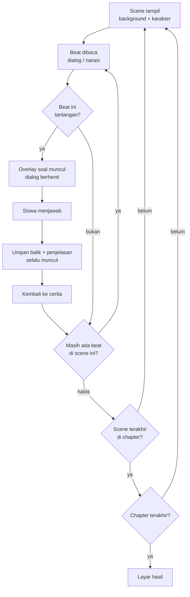

# Desain Game

## Arah visual

**Gaya:** pixel art 2D, bergaya Omori — kontras terang/gelap yang kuat, ruang yang
terasa sedikit sunyi, warna pastel yang pudar, dan detail kecil yang membuat dunia
terasa nyata.

**Yang diambil dari Omori:** komposisi, palet, rasa kesepian yang hangat, transisi
antar "dunia".

**Yang tidak diambil:** tema trauma, horor psikologis, kekerasan, dan nada depresif.
ClassQuest harus aman dimainkan siswa sekolah.

Cara menerjemahkan arah ini menjadi ruangan yang dilihat dari atas — satuan tile,
perspektif objek, urutan gambar, dan kamera — ada di
[`world-design.md`](./world-design.md).

### Palet

Sembilan warna ini yang dipakai: **enam warna inti** untuk dunia, **dua warna
fungsional** untuk umpan balik, dan **satu aksen karakter** untuk membedakan
tokoh. Tidak ada warna lain.

| Peran          | Warna     | Terlihat seperti | Dipakai untuk                    |
| -------------- | --------- | ---------------- | -------------------------------- |
| Latar terang   | `#F4EFE6` | kertas krem      | langit, dinding, area aman       |
| Latar gelap    | `#14201A` | hijau malam      | malam, ruang tertutup, misteri   |
| Aksen utama    | `#E8A87C` | jingga pasir     | elemen penting, sorotan          |
| Aksen dingin   | `#7FA6C9` | biru air         | air, langit, suasana tenang      |
| Teks           | `#1F1E28` | hampir hitam     | dialog di atas panel terang      |
| Teks terang    | `#F7F4EC` | putih tulang     | dialog di atas panel gelap       |
| Benar / sukses | `#6F9B7A` | hijau lumut      | tanda jawaban benar, progres     |
| Peringatan     | `#C9A227` | kuning tua       | status "perlu direview", catatan |
| Aksen karakter | `#D98FA3` | rosa lembut      | rambut dan pita tokoh penanda    |

Cara memakai tanpa bingung:

- **Dua warna teks tidak boleh tertukar.** Teks `#1F1E28` di atas panel gelap
  tidak terbaca; itu bug, bukan selera.
- **Aksen utama untuk satu hal per layar.** Kalau semuanya jingga, tidak ada yang
  menonjol.
- **Aksen dingin menandai air dan ketenangan.** Jangan dipakai untuk peringatan.
- **Hijau dan kuning hanya untuk umpan balik,** bukan untuk menghias dunia.
  Jawaban salah sengaja **tidak** memakai merah menyala; lihat bagian umpan balik.
- **Aksen karakter hanya untuk tokoh.** `#D98FA3` menandai identitas karakter
  (misalnya rambut Nino), bukan bahan dunia, UI, atau umpan balik.

Jangan menambah warna di luar palet tanpa memperbarui dokumen ini dan
[`../07-assets/asset-guide.md`](../07-assets/asset-guide.md).

#### Ramp turunan

Aset piksel butuh lebih dari sembilan nilai untuk membentuk bayangan dan cahaya.
Semua nilai tambahan di bawah ini **bukan warna baru**: masing-masing adalah
hasil `mix()` dua warna palet atau `shade()` satu warna palet dengan faktor
tetap. Definisinya ada di `scripts/lib/palette.mjs` (`RAMP`), dan generator aset
hanya boleh memakai warna dari tabel ini.

| Nama         | Hex       | Asal                                         |
| ------------ | --------- | -------------------------------------------- |
| `deep`       | `#0B120E` | `night` × 0.55                               |
| `nightMid`   | `#0E1713` | `night` × 0.72                               |
| `neutral700` | `#3D4C43` | `night` + `neutral500` (1/3)                 |
| `neutral500` | `#8FA396` | netral tengah (dipakai teks sekunder DOM)    |
| `neutral300` | `#D9E4DA` | netral terang (dipakai teks isi panel gelap) |
| `skyNight`   | `#2C3D41` | `night` + `cool` (0.22)                      |
| `skyDusk`    | `#544937` | `night` + `warm` (0.30)                      |
| `skyDay`     | `#BFCED9` | `paper` + `cool` (0.45)                      |
| `far`        | `#21302F` | `night` + `cool` (0.12)                      |
| `mid`        | `#293B3D` | `night` + `cool` (0.20)                      |
| `near`       | `#191F20` | `night` + `ink` (0.45)                       |
| `skin`       | `#EFCFB6` | `warm` + `paper` (0.55)                      |
| `skinShade`  | `#9E785A` | `warm` + `night` (0.35)                      |
| `water`      | `#64859D` | `cool` + `night` (0.25)                      |
| `waterDeep`  | `#445C69` | `cool` + `night` (0.55)                      |
| `leaf`       | `#587C62` | `moss` + `night` (0.25)                      |
| `leafLight`  | `#9EB8A0` | `moss` + `paper` (0.35)                      |
| `glow`       | `#DAC173` | `gold` + `paper` (0.40)                      |
| `blushLight` | `#E5BAC1` | `blush` + `paper` (0.45)                     |
| `blushShade` | `#9E6E7A` | `blush` + `night` (0.30)                     |

Menambah entri `RAMP` berarti menambah baris di tabel ini pada PR yang sama.

### Resolusi dan skala

- Resolusi internal: **640×360** (16:9), kelipatan tile 16×16 — keputusan di
  [ADR 0009](../09-decisions/0009-resolution-and-scale.md). Sama dengan
  `GAME_WIDTH`/`GAME_HEIGHT` di `src/game/constants.ts`.
- Ditampilkan lewat `ukuranKanvas()` (`Phaser.Scale.NONE` + `zoom`, bukan `FIT`):
  skala **bulat** 2× di 720p dan 3× di 1080p dipakai saat sisa ruangnya tipis
  (≤6%), jadi pixel paling tajam. Kalau tidak, skala **penuh** (mis. 1,83×)
  supaya kanvas mengisi bingkai halaman — dulu layar pendek hanya mendapat strip
  960×360 dengan bar gelap besar.
- `pixelArt: true` dan `roundPixels: true` **wajib** di konfigurasi Phaser.
  `pixelArt` membuat tekstur memakai nearest-neighbor; `roundPixels` membulatkan
  gambar ke piksel utuh. Objek yang diskalakan tetap butuh
  `setVertexRoundMode("fullAuto")` — lihat
  [`world-design.md`](./world-design.md#kamera).
- Halaman game memberi margin 8–24 px dan bingkai membulat, jadi sisa ruang
  terbaca sebagai bingkai jendela, bukan kanvas yang menempel ke tepi.
- Konsekuensi yang harus dijaga: pada skala penuh, lebar piksel bisa bergantian
  1–2 px layar. Itu diterima karena posisi objek, kamera, dan vertex sudah
  dikunci ke piksel utuh, jadi polanya diam — bukan getaran. Pada layar kecil,
  skala bisa mendekati 1× dan teks jadi terlalu kecil; batas dan jalan keluarnya
  ada di [`accessibility.md`](./accessibility.md#ukuran-teks).

## Suasana dan pacing

| Elemen         | Keputusan                                                          |
| -------------- | ------------------------------------------------------------------ |
| Durasi         | 5–10 menit per cerita                                              |
| Ritme          | Dialog pendek, satu tantangan setiap 1–2 menit                     |
| Musik          | Satu track per chapter (default, hemat aset); scene boleh override |
| Transisi       | Fade 300 ms; cut hanya untuk kejutan kecil                         |
| Kecepatan teks | Typewriter 30–40 karakter/detik, bisa dipercepat dengan klik       |

Aturan pacing:

- Jangan lebih dari 6 beat dialog/narasi berturut-turut tanpa interaksi.
- Tantangan pertama muncul dalam 60 detik pertama.
- Setiap chapter berakhir dengan perubahan lokasi atau suasana.

## Loop permainan

Tidak ada:

- game over,
- nyawa,
- timer yang menekan,
- hukuman karena salah.

Kesalahan adalah bagian dari belajar. Yang diberikan hanya penjelasan.

## Kontrol

| Aksi                | Keyboard                  | Mouse/Touch           |
| ------------------- | ------------------------- | --------------------- |
| Gerak               | `W`/`A`/`S`/`D`, panah    | D-pad virtual (nanti) |
| Interaksi NPC       | `Space` / `Enter`         | Tombol interaksi      |
| Lanjut dialog       | `Space` / `Enter`         | Klik/tap di mana saja |
| Pilih opsi          | `1`–`5`, panah + `Enter`  | Klik/tap              |
| Kirim jawaban       | `Enter`                   | Tombol "Jawab"        |
| Lewati animasi teks | `Space`                   | Klik                  |
| Buka menu           | `Esc`                     | Tombol menu           |
| Ulangi chapter      | `Esc` → `↑`/`↓` → `Enter` | Menu → "Ulangi"       |

Semua aksi utama harus bisa dilakukan **tanpa mouse**.

## Eksplorasi (fase `explore`)

Per ADR 0008, siswa bergerak bebas top-down di dalam scene — ala Undertale,
bukan dunia terbuka:

- Scene adalah unit cerita; **ruangan** adalah unit peta. Beberapa scene boleh
  terjadi di ruangan yang sama (`roomId`), dan perpindahan di antara scene itu
  mempertahankan posisi pemain — peta tidak dibangun ulang. Urutan antar-ruangan
  tetap linear mengikuti cerita, bukan pintu yang bebas dipilih.
- Pemain spawn di titik tetap saat masuk ruangan baru (atau saat "Ulangi
  chapter"), lalu bergerak 4 arah dengan collision sederhana (arcade physics,
  gravity 0).
- NPC/objek interaksi punya zona kecil; saat pemain berada di dalamnya, chip
  `Space` muncul dan memicu deretan beat dialog/tantangan pada NPC pemberi quest.
  NPC non-peran bisa menyapa singkat lewat `smallTalk` tanpa memicu beat.
- Penanda `!` hanya ada di atas pemberi quest scene aktif, mengikuti kamera.
  Penanda dan chip disembunyikan selama dialog, tantangan, atau menu.
- Untuk MVP, data map, spawn, penempatan NPC, dan collision didefinisikan **di
  sisi game** (`src/game/`, map dummy) dan tidak mengubah kontrak Story JSON.
- Gerak terkunci saat textbox, overlay tantangan, atau menu terbuka.

## Layar

| Layar     | Isi                                                              |
| --------- | ---------------------------------------------------------------- |
| Boot      | Logo kecil, progress bar pemuatan aset                           |
| Judul     | Judul cerita, "Mulai", "Lanjutkan" (bila ada progres), "Tentang" |
| Cerita    | Ruangan map, pemain, NPC, textbox, panel quest                   |
| Tantangan | Overlay: soal, opsi, tombol jawab, feedback, penjelasan          |
| Jeda      | Lanjut, ulangi chapter, pengaturan suara, keluar                 |
| Hasil     | Skor, jumlah benar, konsep yang perlu diulang, "Main lagi"       |

## Umpan balik

| Situasi                         | Umpan balik                                                     |
| ------------------------------- | --------------------------------------------------------------- |
| Jawaban benar                   | `sfx_correct`, sorotan hijau `#6F9B7A`, penjelasan muncul       |
| Jawaban salah                   | `sfx_wrong`, highlight lembut (bukan merah menyala), penjelasan |
| Semua tantangan chapter selesai | Transisi + ringkasan singkat                                    |
| Cerita selesai                  | Layar hasil + ajakan mengulang                                  |

Nada umpan balik: **mendorong**, bukan menghakimi. Contoh teks salah:
"Belum tepat. Yang menarik: uap air naik karena lebih ringan." Bukan "Salah."

## Hubungan cerita dan mekanik

Setiap elemen mekanik harus punya alasan di cerita:

| Mekanik           | Alasan naratif                                              |
| ----------------- | ----------------------------------------------------------- |
| Eksplorasi        | Siswa menjelajahi lokasi yang sedang diceritakan            |
| Dialog            | Karakter sedang mengamati/menjelaskan                       |
| Tantangan         | Karakter menghadapi pertanyaan atau teka-teki               |
| Perpindahan scene | Perjalanan mengikuti alur materi                            |
| Layar hasil       | Penutup cerita, kembali ke titik awal dengan pemahaman baru |

Kalau sebuah tantangan tidak punya alasan naratif, tulis ulang ceritanya — jangan
tempel soal di tengah dialog.

## Yang tidak dikerjakan (MVP)

- Dunia terbuka lintas chapter (kamera multi-layar, pintu bebas).
- Line-of-sight, stealth, atau AI musuh.
- Inventory, item, combat.
- Pilihan dialog bercabang.
- Mini-game di luar tantangan.
- Voice acting.
- Save ke cloud.

## Referensi internal

- Keputusan top-down: [`../09-decisions/0008-top-down-movement.md`](../09-decisions/0008-top-down-movement.md)
- Arsitektur teknis: [`engine.md`](./engine.md)
- Mapping cerita → scene: [`scene-format.md`](./scene-format.md)
- Loop interaksi detail: [`interaction-loop.md`](./interaction-loop.md)
- Spesifikasi aset: [`../07-assets/asset-guide.md`](../07-assets/asset-guide.md)
