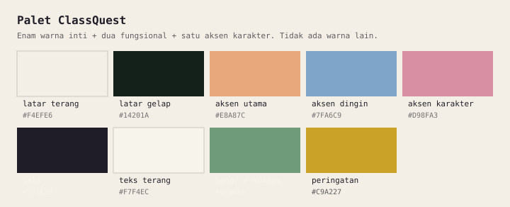
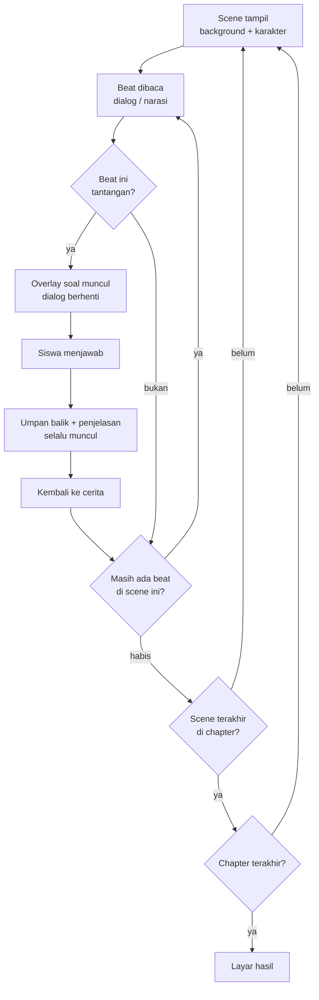

# Desain Game

## Arah visual

**Gaya:** pixel art 2D, bergaya Omori — kontras terang/gelap yang kuat, ruang yang
terasa sedikit sunyi, warna pastel yang pudar, dan detail kecil yang membuat dunia
terasa nyata.

**Yang diambil dari Omori:** komposisi, palet, rasa kesepian yang hangat, transisi
antar "dunia".

**Yang tidak diambil:** tema trauma, horor psikologis, kekerasan, dan nada depresif.
ClassQuest harus aman dimainkan siswa sekolah.

### Palet

Delapan warna ini yang dipakai: **enam warna inti** untuk dunia, dan **dua warna
fungsional** untuk umpan balik. Tidak ada warna lain.

| Peran          | Warna     | Terlihat seperti | Dipakai untuk                    |
| -------------- | --------- | ---------------- | -------------------------------- |
| Latar terang   | `#F4EFE6` | kertas krem      | langit, dinding, area aman       |
| Latar gelap    | `#14201A` | hijau malam      | malam, ruang tertutup, misteri   |
| Aksen utama    | `#E8A87C` | jingga pasir     | elemen penting, sorotan          |
| Aksen dingin   | `#7FA6C9` | biru air         | air, langit, suasana tenang      |
| Teks           | `#1F1E28` | hampir hitam     | dialog di atas panel terang      |
| Teks terang    | `#F7F4EC` | putih tulang     | dialog di atas panel gelap       |
| Benar / sukses | `#6F9B7A` | hijau lumut      | tanda jawaban benar, progres     |
| Peringatan     | `#C9A227` | kuning tua       | status "perlu direview", catatan |

Cara memakai tanpa bingung:

- **Dua warna teks tidak boleh tertukar.** Teks `#1F1E28` di atas panel gelap
  tidak terbaca; itu bug, bukan selera.
- **Aksen utama untuk satu hal per layar.** Kalau semuanya jingga, tidak ada yang
  menonjol.
- **Aksen dingin menandai air dan ketenangan.** Jangan dipakai untuk peringatan.
- **Hijau dan kuning hanya untuk umpan balik,** bukan untuk menghias dunia.
  Jawaban salah sengaja **tidak** memakai merah menyala; lihat bagian umpan balik.

Jangan menambah warna di luar palet tanpa memperbarui dokumen ini dan
[`../07-assets/asset-guide.md`](../07-assets/asset-guide.md).

### Resolusi dan skala

- Resolusi internal: **480×270** (16:9). Ini sama dengan `GAME_WIDTH`/`GAME_HEIGHT`
  di `src/game/config.ts`.
- Ditampilkan dengan `Phaser.Scale.FIT` mengikuti ukuran kontainer, jadi skalanya
  bisa pecahan (mis. 2.67x di layar 1280 px). Itu wajar.
- `pixelArt: true` dan `roundPixels: true` **wajib** di konfigurasi Phaser.
  `pixelArt` yang membuat tekstur memakai nearest-neighbor, sehingga pixel tetap
  tajam walau skalanya pecahan — bukan integer scaling manual.
- Konsekuensi yang harus dijaga: pada layar kecil, skala bisa mendekati 1x dan
  teks jadi terlalu kecil. Batas dan jalan keluarnya ada di
  [`accessibility.md`](./accessibility.md#ukuran-teks).

## Suasana dan pacing

| Elemen         | Keputusan                                                          |
| -------------- | ------------------------------------------------------------------ |
| Durasi         | 5–10 menit per cerita                                              |
| Ritme          | Dialog pendek, satu tantangan setiap 1–2 menit                     |
| Musik          | Satu track per chapter (default, hemat aset); scene boleh override |
| Transisi       | Fade 300 ms; cut hanya untuk kejutan kecil                         |
| Kecepatan teks | Typewriter 30–40 karakter/detik, bisa dipercepat dengan klik       |

Aturan pacing:

- Jangan lebih dari 6 beat dialog/narasi berturut-turut tanpa interaksi.
- Tantangan pertama muncul dalam 60 detik pertama.
- Setiap chapter berakhir dengan perubahan lokasi atau suasana.

## Loop permainan

Tidak ada:

- game over,
- nyawa,
- timer yang menekan,
- hukuman karena salah.

Kesalahan adalah bagian dari belajar. Yang diberikan hanya penjelasan.

## Kontrol

| Aksi                | Keyboard                  | Mouse/Touch           |
| ------------------- | ------------------------- | --------------------- |
| Lanjut dialog       | `Space` / `Enter`         | Klik/tap di mana saja |
| Pilih opsi          | `1`–`5`, panah + `Enter`  | Klik/tap              |
| Kirim jawaban       | `Enter`                   | Tombol "Jawab"        |
| Lewati animasi teks | `Space`                   | Klik                  |
| Buka menu           | `Esc`                     | Tombol menu           |
| Ulangi chapter      | `Esc` → `↑`/`↓` → `Enter` | Menu → "Ulangi"       |

Semua aksi utama harus bisa dilakukan **tanpa mouse**.

## Layar

| Layar     | Isi                                                              |
| --------- | ---------------------------------------------------------------- |
| Boot      | Logo kecil, progress bar pemuatan aset                           |
| Judul     | Judul cerita, "Mulai", "Lanjutkan" (bila ada progres), "Tentang" |
| Cerita    | Background, karakter, textbox, HUD chapter                       |
| Tantangan | Overlay: soal, opsi, tombol jawab, feedback, penjelasan          |
| Jeda      | Lanjut, ulangi chapter, pengaturan suara, keluar                 |
| Hasil     | Skor, jumlah benar, konsep yang perlu diulang, "Main lagi"       |

## Umpan balik

| Situasi                         | Umpan balik                                                     |
| ------------------------------- | --------------------------------------------------------------- |
| Jawaban benar                   | `sfx_correct`, sorotan hijau `#6F9B7A`, penjelasan muncul       |
| Jawaban salah                   | `sfx_wrong`, highlight lembut (bukan merah menyala), penjelasan |
| Semua tantangan chapter selesai | Transisi + ringkasan singkat                                    |
| Cerita selesai                  | Layar hasil + ajakan mengulang                                  |

Nada umpan balik: **mendorong**, bukan menghakimi. Contoh teks salah:
"Belum tepat. Yang menarik: uap air naik karena lebih ringan." Bukan "Salah."

## Hubungan cerita dan mekanik

Setiap elemen mekanik harus punya alasan di cerita:

| Mekanik           | Alasan naratif                                              |
| ----------------- | ----------------------------------------------------------- |
| Dialog            | Karakter sedang mengamati/menjelaskan                       |
| Tantangan         | Karakter menghadapi pertanyaan atau teka-teki               |
| Perpindahan scene | Perjalanan mengikuti alur materi                            |
| Layar hasil       | Penutup cerita, kembali ke titik awal dengan pemahaman baru |

Kalau sebuah tantangan tidak punya alasan naratif, tulis ulang ceritanya — jangan
tempel soal di tengah dialog.

## Yang tidak dikerjakan (MVP)

- Gerak bebas top-down dengan collision.
- Inventory, item, combat.
- Pilihan dialog bercabang.
- Mini-game di luar tantangan.
- Voice acting.
- Save ke cloud.

## Referensi internal

- Arsitektur teknis: [`engine.md`](./engine.md)
- Mapping cerita → scene: [`scene-format.md`](./scene-format.md)
- Loop interaksi detail: [`interaction-loop.md`](./interaction-loop.md)
- Spesifikasi aset: [`../07-assets/asset-guide.md`](../07-assets/asset-guide.md)
