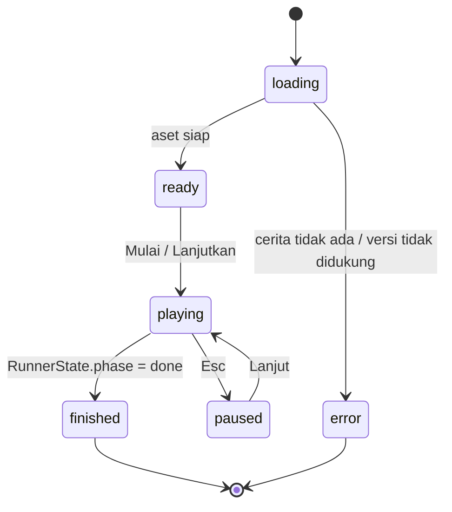
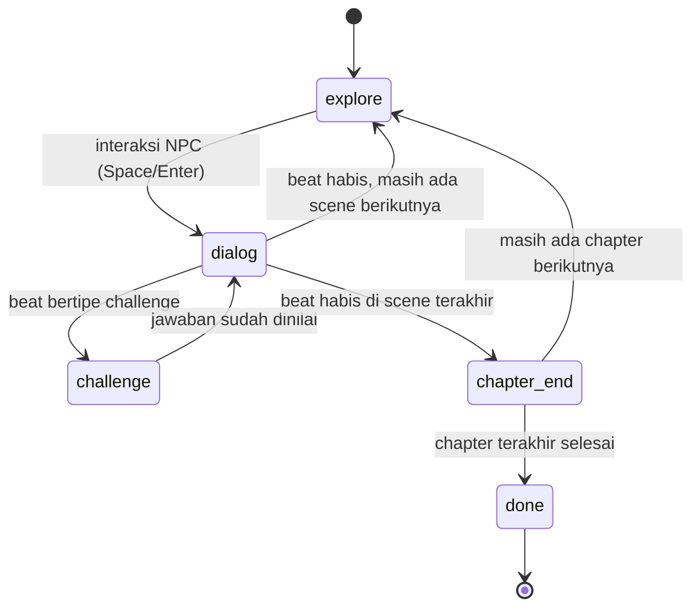

# Loop Interaksi

Dokumen ini merinci perilaku runtime: apa yang terjadi saat siswa menekan tombol,
menjawab, menutup tab, atau kehilangan fokus.

## Dua state, bukan satu

Ada dua mesin state yang berbeda, dan dokumen ini sebelumnya menyamakannya. Itu
salah. Yang benar:

| State                  | Dipegang oleh | Isi                                                                          |
| ---------------------- | ------------- | ---------------------------------------------------------------------------- |
| `RunnerState.phase`    | `StoryRunner` | `explore`, `dialog`, `challenge`, `chapter_end`, `done` — murni, tanpa React |
| `GameShellState.phase` | `GameShell`   | `loading`, `ready`, `playing`, `paused`, `finished`, `error`                 |

`StoryRunner` menjawab **"di mana kita di dalam cerita"**. `GameShell` menjawab
**"layar apa yang sedang terlihat"**. Keduanya dipetakan begini:

| `RunnerState.phase` | `GameShellState.phase` | Yang tampil                               |
| ------------------- | ---------------------- | ----------------------------------------- |
| —                   | `loading`              | progress bar aset                         |
| —                   | `ready`                | layar judul, tombol Mulai                 |
| `explore`           | `playing`              | ruangan map + pemain + NPC                |
| `dialog`            | `playing`              | canvas + panel dialog + teks DOM          |
| `challenge`         | `playing`              | canvas + `ChallengeOverlay` (DOM)         |
| `chapter_end`       | `playing`              | kartu chapter berikutnya terbuka otomatis |
| `done`              | `finished`             | `ResultScreen` (DOM)                      |
| —                   | `paused`               | `PauseMenu` (DOM)                         |
| —                   | `error`                | layar error                               |

`paused` dan `error` **tidak** ada di `StoryRunner`, karena keduanya bukan posisi
di dalam cerita — cerita berhenti di tempat yang sama, hanya presentasinya yang
berubah. `challenge` juga bukan fase shell: canvas tetap `playing`, overlay
tantangan hanya menumpang di atasnya.



Dan di dalam `playing`, `StoryRunner` berjalan sendiri:



Setiap scene dibuka dalam fase `explore` (ADR 0008): pemain berjalan bebas di
ruangan. Interaksi dengan NPC/objek memutar deretan beat scene itu; ketika deretan
beat habis, kembali ke `explore` (scene berikutnya) atau berhenti di
`chapter_end`. `explore` hanya pernah dijeda oleh textbox, overlay tantangan,
atau menu — cerita tetap berhenti di beat yang sama.

Pergantian bab **tidak menunggu tombol**. Begitu `StoryRunner` mencapai
`chapter_end` (`akhirBab()`), `GameScene` menjadwalkan pembukaan bab berikutnya
sendiri setelah jeda singkat (`JEDA_AKHIR_BAB_MS`), lalu memanggil `advance()`
sekali. Bab berikutnya terbuka di fase `explore`, sama seperti perpindahan scene
biasa, dan kartu judul chapter muncul sebagai penanda. Pemain tetap boleh
mempercepat dengan Space/Enter; jadwal otomatis dibatalkan saat bab dimulai ulang
atau scene dihancurkan. Bab terakhir selesai juga lewat jalur ini: `advance()`
dari `chapter_end` mengakhiri cerita dan memunculkan `ResultScreen`.

NPC pemberi quest scene aktif memulai deretan beat scene. Pemberi quest adalah
pembicara `dialogue` pertama di scene yang ada di daftar NPC ruangan; bila tidak
ada yang cocok, NPC pertama di ruangan dipakai agar alur tidak macet.

NPC lain tetap bisa diajak bicara **singkat** bila `cast` memberi mereka
`smallTalk` (ADR 0016): kotak `Space` yang sama bergaya seperti penanda quest,
tetapi muncul sebagai pop-up di atas papan nama — **dipusatkan** sejajar nama,
bukan meluncur ke kanan karena tidak ada `!` — lalu satu kalimat tampil di
textbox tanpa menggeser posisi cerita. Setelah textbox ditutup, pemain kembali
bebas berjalan. NPC tanpa `smallTalk` tetap berdiri sebagai penghalang dan tidak
memunculkan prompt.

Saat interaksi dimulai — baik dialog cerita maupun obrolan singkat — NPC yang
diajak bicara **berbalik menghadap pemain**, sesuai posisi pemain relatif NPC
(mis. pemain di selatan → NPC menghadap selatan). Arah hadap itu dihitung
`arahKe()` di `karakter.ts` dan tidak mengubah posisi cerita.

Scene dan ruangan adalah dua hal berbeda. Scene adalah unit cerita, ruangan
adalah unit peta (`roomId`). Beberapa scene boleh terjadi di ruangan yang sama;
perpindahan scene seperti itu mempertahankan posisi pemain dan tidak membangun
ulang peta. Spawn ruangan hanya dipakai saat masuk `roomId` baru atau saat
"Ulangi chapter". Ini berlaku juga setelah soal dijawab: duduk di depan NPC yang
sama, bukan melompat ke tengah ruangan.

`RunnerState` didefinisikan di [`engine.md`](./engine.md#alur-state); dokumen ini
tidak menyalin tipenya, hanya perilakunya.

## Aksi pengguna

| Aksi                        | State       | Efek                                                                |
| --------------------------- | ----------- | ------------------------------------------------------------------- |
| `W`/`A`/`S`/`D`, panah      | `explore`   | Gerakkan pemain 4 arah dalam ruangan                                |
| `Space` / `Enter` dekat NPC | `explore`   | Mulai deretan beat scene; NPC non-peran menampilkan obrolan singkat |
| Klik/tap di mana saja       | `dialog`    | Sedang mengetik → selesaikan teks; sudah → beat berikutnya          |
| `Space` / `Enter`           | `dialog`    | Sama seperti klik                                                   |
| `1`–`5`                     | `challenge` | Pilih opsi (belum submit)                                           |
| `Enter`                     | `challenge` | Submit jawaban (bila ada pilihan)                                   |
| `Esc`                       | `dialog`    | Buka menu jeda                                                      |
| Klik "Lanjut"               | `dialog`    | Sama seperti klik di mana saja                                      |
| Klik "Ulangi chapter"       | `paused`    | Reset ke awal chapter, simpan progres                               |
| `Tab` / tombol "Percepat"   | `dialog`    | Tahan: time-lapse beat sampai soal atau explore                     |

Aturan input:

- **Debounce 150 ms** untuk klik/Spasi, agar satu tekanan tidak melewati dua beat.
- Saat `explore`, gerak bebas; saat `dialog`/`challenge`, input gerak **terkunci**.
- Saat `challenge`, input dialog **diabaikan**.
- Saat transisi/fade, input diabaikan sampai selesai.
- **Percepat tidak pernah melewati soal.** `Tab`/tombol "Percepat" hanya aktif
  saat fase `dialog` dan memakai pola tahan-tombol ala Persona: selama ditahan,
  beat dimajukan bertahap seperti time-lapse (100 ms per beat); dilepas, tempo
  kembali normal. Skip berhenti di beat `challenge`, dan fade transisi tetap
  diputar. Setiap beat yang dilewati tetap masuk buku catatan log.
- Saat tab tidak aktif (`visibilitychange`), game pause otomatis.

## Alur tantangan

```text
1. Phaser kirim { type: "challenge", challengeId }
2. React menampilkan panel di atas dialog (dialog tetap terlihat, typewriter
   dibekukan):
   - prompt
   - opsi/statement/item/input
   - tombol "Jawab" (disabled sampai ada pilihan)
3. Siswa memilih → tombol aktif
4. Siswa submit
5. scoring.isCorrect(challenge, answer)  ← fungsi murni
6. Panel menampilkan feedback:
   - benar/salah (tanpa warna menyala)
   - explanation (hanya saat benar atau percobaan terakhir)
   - tombol "Lanjut" di footer
7. Klik "Lanjut" → kirim { type: "resolve_challenge", correct }
8. Phaser menutup pause, lanjut beat berikutnya
```

Detail penting:

- **Penilaian terjadi sekali per percobaan.** Jangan menilai ulang saat render.
- **Soal bisa diulang bila cerita memakai `onWrong`.** Tantangan dengan `onWrong`
  punya `maxAttempts` 2 atau 3 (lihat
  [`../02-data-model/story-schema.md`](../02-data-model/story-schema.md#konsekuensi-jawaban-salah-opsional)).
  Setelah jawaban salah **dan** masih ada percobaan, game memutar `detour`
  (narasi/dialog singkat) lewat kotak dialog yang sama, lalu membuka lagi soal
  yang sama dengan teks `retryQuestions`. Opsi dan jawaban benar tidak berubah.
- **Penjelasan hanya tampil saat benar atau di percobaan terakhir.** Selama masih
  ada percobaan berikutnya, overlay tidak menampilkan `explanation` supaya soal
  ulang tetap bermakna; game baru mengirim `graded` (beserta penjelasan) untuk
  hasil final.
- **Overlay tidak menutup saat dinilai.** Mengganti potret pembicara jadi
  senang/marah adalah perubahan tampilan saja; kartu umpan balik tetap di
  tempatnya sampai siswa menekan "Lanjut". Di luar aksi pemain, overlay hanya
  ditutup oleh `detour` (soal diulang setelah detour selesai) — bukan oleh
  sembarang dialog.
- **Tanpa `onWrong`, perilaku lama berlaku.** `maxAttempts` efektif 1, jadi satu
  kemunculan soal hanya bisa dijawab sekali: overlay menampilkan jawaban benar +
  penjelasan, lalu "Lanjut". Ini yang membuat skor punya arti.
- **Tapi mengulang bukan mustahil.** Kalau siswa me-refresh, keluar, atau memilih
  "Ulangi chapter", soal itu akan muncul lagi dari awal. Itu memang disengaja:
  ini game belajar, bukan ujian.
- **Skor memakai percobaan pertama.** Progres menyimpan
  `answers[challengeId] = { correct, at }`; nilai pertama tidak ditimpa saat soal
  dijawab ulang. `weakConcepts` di layar hasil memakai data yang sama, jadi
  mengulang tidak menghapus catatan bahwa konsep itu sempat salah.
- **Batasan yang diketahui:** "Ulangi chapter" **tidak** me-reset jumlah
  percobaan atau nilai flag konsekuensi jawaban salah. Tantangan yang sudah
  memakai percobaan tetap begitu setelah chapter diulang, jadi jawaban salah
  berikutnya bisa langsung dianggap percobaan terakhir. Skor juga tetap memakai
  percobaan pertama. Membetulkannya tidak termasuk MVP.
- Fokus keyboard otomatis pindah ke overlay saat muncul, dan kembali ke canvas
  saat ditutup.
- `Esc` **tidak menutup** overlay tantangan. Satu-satunya jalan keluar adalah
  menjawab lalu "Lanjut", supaya siswa tidak bisa melewati soal tanpa dijawab dan
  skor tidak pernah bolong.

## Umpan balik

| Hasil | Suara         | Visual                             | Teks contoh                                                    |
| ----- | ------------- | ---------------------------------- | -------------------------------------------------------------- |
| Benar | `sfx_correct` | Opsi terpilih diberi border aksen  | "Tepat. Uap air naik karena lebih ringan daripada air cair."   |
| Salah | `sfx_wrong`   | Opsi terpilih diberi border netral | "Belum tepat. Yang menarik: uap air naik karena lebih ringan." |

Jangan memakai warna merah menyala, teks "SALAH", atau getaran keras. Nada harus
mendorong rasa ingin tahu.

## Progres dan resume

Disimpan setiap kali beat berubah (di-throttle 500 ms):

```ts
type PlayProgress = {
  storyId: string;
  storyVersion: number;
  chapterIndex: number;
  sceneIndex: number;
  beatIndex: number;
  answers: Record<string, { correct: boolean; at: string }>;
  updatedAt: string;
};
```

Aturan:

- Key: `classquest:progress:{storyId}`.
- **Versi cerita dicek.** Kalau `storyVersion` berbeda, progres lama dibuang dan
  siswa mulai dari awal (dengan konfirmasi).
- Saat resume, game mulai dari **awal scene** tempat beat terakhir, bukan tengah
  beat. Lebih sederhana dan tidak pernah menampilkan tantangan yang sudah dijawab.
- Tombol "Mulai ulang" menghapus progres.

## Menu jeda

Isi:

- Lanjut
- Ulangi chapter
- Pengaturan suara: slider **Musik** dan **Efek suara** terpisah (0–100%, step 5) + tombol mute per baris
- Keluar (kembali ke halaman awal)

Saat menu terbuka: game pause, musik **volume turun** (bukan berhenti), input
dialog diabaikan. Nilai tersimpan di `localStorage`
(`classquest:settings:v1`) dan dipakai lagi saat game dibuat. Mute musik tidak
mematikan efek suara; HUD hanya menampung toggle musik, SFX diatur di menu.

Buku catatan (`B`): dunia dibekukan (`scene.pause()`) **tanpa** menurunkan
musik; log tidak bisa dibuka saat soal aktif; `Esc` atau `B` menutupnya.

## Penanganan error runtime

| Error                         | Perilaku                                                               |
| ----------------------------- | ---------------------------------------------------------------------- |
| Aset gagal dimuat             | Lanjut tanpa crash; aset tampil kosong (belum ada handler `loaderror`) |
| `challengeId` tidak ditemukan | Lewati beat, catat error, jangan crash                                 |
| `speakerId` tidak dikenal     | Tampilkan sebagai narasi, catat error                                  |
| Audio diblokir browser        | Mulai senyap, tampilkan tombol "Nyalakan suara"                        |
| `localStorage` penuh/ditolak  | Lanjut tanpa simpan, beri tahu sekali                                  |
| Story `schemaVersion` beda    | Tampilkan layar "cerita tidak didukung", jangan render sebagian        |

Prinsip: **satu error tidak boleh menghentikan seluruh permainan**, kecuali
schema tidak didukung.

## Autoplay audio

Browser memblokir audio sebelum interaksi pengguna. Karena itu:

- Jangan memutar musik di `PreloadScene`.
- Mulai musik setelah aksi pertama (klik "Mulai" atau klik pertama di dialog).
- Kalau tetap gagal, tampilkan ikon suara yang bisa diklik.

## Fokus dan keyboard

- Canvas diberi `tabindex="0"` dan `aria-label` singkat.
- Overlay tantangan memakai focus trap sederhana.
- Setelah overlay ditutup, fokus kembali ke canvas.
- Jangan menangkap `Tab` secara global.

## Input sentuh

Perangkat sentuh (ADR 0021) memakai kontrol yang **mengirim command yang sama**
dengan papan tombol, bukan jalur gerak kedua:

- **Joystick** (`move`): tongkat analog disnap ke salah satu dari delapan
  `ArahGerak` — sama persis dengan tombol gerak — lalu dijalankan
  `gerakkanPemain()` yang sama. `null` saat tongkat dilepas berarti berhenti.
- **Tombol aksi** (`interact` / `advance`): satu tombol besar yang labelnya
  mengikuti konteks. Di dekat NPC jadi "Bicara" (`interact`, sama dengan
  `Space`/`Enter`); saat dialog menunggu jadi "Lanjut" (`advance`). Saat tidak ada
  yang bisa dilakukan tombolnya mati.
- Selama soal, kontrol gerak disembunyikan; pilihan jawaban punya tombolnya
  sendiri di DOM.
- Label prompt `Space` berganti jadi "Sentuh" dan semua keycap keyboard
  disembunyikan (`Keycap` mengembalikan `null`), karena tidak ada tombol fisik di
  perangkat itu.
- **Tombol "Layar penuh"** (layar judul dan HUD) memenuhkan halaman lalu mencoba
  mengunci orientasi mendatar (ADR 0022). Bukan bagian alur cerita: tidak ada
  command bus, dan gagal memenuhkan layar tidak mengubah jalannya permainan.
- Ketukan memakai `touch-action: manipulation` supaya tidak tertahan menunggu
  ketuk-dua-kali zoom; akar `GameCanvas` `touch-manipulation`, hanya pad tongkat
  yang `touch-none`.

## Skenario tepi

| Skenario                             | Perilaku yang benar                                                                       |
| ------------------------------------ | ----------------------------------------------------------------------------------------- |
| Siswa klik cepat 5x                  | Hanya 1 beat maju (debounce)                                                              |
| Siswa refresh saat tantangan         | Kembali ke awal scene, tantangan muncul lagi; skor tetap pakai percobaan pertama          |
| Siswa tutup tab, buka besok          | Progres dipulihkan                                                                        |
| Guru mengedit cerita saat siswa main | Siswa tetap di versi lamanya sampai reload                                                |
| Dua tab dibuka bersamaan             | Tab terakhir yang menulis progres menang (dokumentasikan, jangan diperbaiki di MVP)       |
| Layar sangat kecil (≤ 360 px)        | Teks ikut `clamp()` (minimum tetap terbaca); di sentuh, kanvas dikunci 16:9 + dek kontrol |
| HP lanskap                           | Kontrol sentuh mengapung di dalam bingkai kanvas, tidak memakan ruang dunia               |
| HP potret                            | Panggung 16:9 di atas + dek kontrol di bawah — **tanpa** saran putar layar (ADR 0021)     |

## Metrik yang dicatat (lokal)

Tidak dikirim ke mana pun di MVP:

- Waktu per chapter.
- Jumlah jawaban benar.
- Tantangan yang dijawab salah lebih dari sekali (untuk `weakConcepts`).

## Checklist implementasi

- [ ] Debounce input 150 ms.
- [ ] Input dialog diabaikan saat `challenge` dan transisi.
- [ ] Penilaian lewat `src/story/scoring.ts` (tidak diduplikasi).
- [ ] `explanation` tampil saat jawaban benar atau di percobaan terakhir.
- [ ] Fokus berpindah ke overlay dan kembali.
- [ ] Progres disimpan dan bisa dipulihkan.
- [ ] Versi cerita dicek saat resume.
- [ ] Audio mulai setelah interaksi pertama.
- [ ] Error aset tidak menghentikan permainan.
