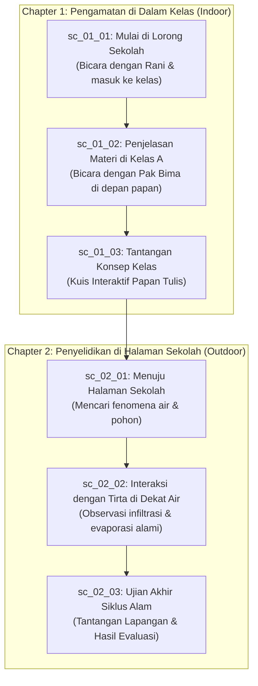

# Rencana Integrasi 2 Map, Karakter Referensi, dan Story Demo

Dokumen ini merinci rencana teknis dan arsitektur untuk memperbarui dunia permainan ClassQuest:
1. **Dua Map Utama**: Gedung Sekolah (Indoor: Lorong & Kelas) dan Halaman Luar (Outdoor: Taman Edukasi/Halaman Sekolah).
2. **Aset Eksternal**: Penggunaan aset referensi dari `D:\Data\LOGICODIX 26\Asset` (pepohonan, interior, semak, dan spritesheet).
3. **Karakter Baru**: Protagonis (MC) menggunakan karakter Nino Nakano dengan kerangka animasi 8 arah (*The Female Adventurer - Free*), dan NPC mentor/teman dengan pose idle.
4. **Story Demo / Fixture**: Pembaruan cerita demo statis (`demo-story.json`) agar skenario cerita secara alami mengeksplorasi kedua map tersebut.

---

## 1. Rencana Dua Map Utama

Mengikuti [ADR 0009](../09-decisions/0009-resolution-and-scale.md) dan [ADR 0010](../09-decisions/0010-map-data-and-camera.md), viewport kamera adalah 640×360 px (40×22.5 tile @ 16px). Ruangan dibuat lebih luas dari layar agar kamera *lerp* (mengikuti pemain).

### Map 1: Gedung Sekolah (Indoor)

Gedung sekolah dibagi menjadi 2 room data terpisah untuk memberikan fokus visual ala *Undertale* / *Omori*:

#### 1A. Lorong Utama (`lorong_sekolah`)
* **Fungsi**: Hub penghubung antar ruangan sekolah dan jalan keluar ke halaman.
* **Ukuran**: 60×18 tile (960×288 px, lorong memanjang horizontal).
* **Lantai & Dinding**: Lantai ubin/koridor (`tile_floor_wood` atau variasi ubin bersih), dinding atas 2 tile dengan pintu-pintu kelas dan jendela kaca.
* **Objek/Prop**: Mading sekolah, loker/pot tanaman, pintu kelas A (`x: 16`), pintu kelas B (`x: 36`), dan pintu keluar ke halaman di ujung kanan (`x: 56`).
* **NPC**: Siswa lain (Rani) yang memberi petunjuk awal sebelum masuk kelas.

#### 1B. Ruang Kelas (`kelas_a`)
* **Fungsi**: Tempat KBM, interaksi dengan Pak Bima, dan pengerjaan kuis/tantangan di papan tulis.
* **Ukuran**: 48×28 tile (768×448 px).
* **Lantai & Dinding**: Lantai parket kayu, dinding plester.
* **Objek/Prop**:
  * Papan tulis besar di dinding depan (`tileX: 20, tileY: 2, tileW: 8, tileH: 2`, `solid: true`).
  * Meja guru di sisi papan tulis.
  * 4–6 pasang meja dan kursi siswa berderet dengan lorong tengah aman (lebar ≥ 2 tile).
  * Pintu keluar di bagian bawah (`tileX: 24, tileY: 27`).
* **NPC**: Pak Bima di dekat papan tulis sebagai pemegang quest utama Chapter 1.

---

### Map 2: Halaman Luar & Taman Botani Edukasi (Outdoor)

#### Halaman Sekolah & Taman Edukasi (`halaman_sekolah`)
* **Fungsi**: Eksplorasi sains/lingkungan (siklus air, ekosistem tanaman). Memberikan suasana petualangan terbuka (*sense of wonder*).
* **Ukuran**: 56×34 tile (896×544 px).
* **Lantai & Dinding**:
  * Lantai dasar: Rumput (`tile_floor_grass`).
  * Batas keliling: Pagar tanaman (`tile_wall_hedge`) dan pagar kayu (`prop_fence`).
  * Jalan setapak: Batu (`tile_floor_rock`).
* **Objek/Prop (Diambil dari referensi Asset)**:
  * Pohon rindang besar (`craftpix-net-385863-free-top-down-trees-pixel-art`).
  * Semak-semak dan bunga (`craftpix-net-141354-free-top-down-bushes-pixel-art`).
  * Kolam kecil / aliran air (`tile_floor_water`).
* **NPC**: Tirta (roh air) di tepi kolam dan Pak Bima yang sedang mengamati alam.

---

## 2. Inventaris Aset & Pemetaan Sumber Referensi

Sumber file di `D:\Data\LOGICODIX 26\Asset`:

| Kategori | Nama di Asset Eksternal | Target di ClassQuest (`public/assets/` & manifest) | Spesifikasi |
|---|---|---|---|
| **Pohon Rindang HD** | `craftpix.../Trees_texture_shadow/Tree1.png` | `prop_tree_large` | Resolusi 128×128 px (8×8 tile), detail bayangan daun bertekstur, ukuran file ~5 KB (sangat ringan). Solid di pangkal batang bawah (2×1 tile). |
| **Pohon Sedang** | `craftpix.../Trees_texture_shadow/Tree2.png` | `prop_tree_medium` | Resolusi 64×64 px (4×4 tile), tekstur bayangan halus. |
| **Pohon Berbunga / Buah** | `craftpix.../Trees_texture_shadow/Flower_tree1.png` | `prop_tree_flower` | 128×128 px, cocok untuk sudut observasi biologi di taman sekolah. |
| **Semak/Bunga** | `craftpix...bushes-pixel-art` | `prop_bush_small`, `prop_flower_patch` | 16×16 atau 32×16 px. |
| **Interior** | `main-characters-home.../Interior.png` | `prop_desk`, `prop_shelf`, `prop_door` | Grid 16px, collision diset pada bagian bawah objek. |
| **Tileset** | `Pixel Art Top Down - Basic v1.2.3` | `tile_floor_corridor`, `tile_floor_wood`, `tile_floor_grass` | 16×16 px tile seamless. |

---

## 3. Rencana Karakter (MC Nino Nakano & NPC)

### 3.1. Main Character (MC - Nino Nakano)
* **Visual**: Mengadaptasi karakter Nino Nakano (rambut kembar/pita kupu-kupu khas) dengan proporsi tubuh chibi top-down 24×32 px.
* **Kerangka Animasi (Template)**: Mengikuti struktur pose 8 arah dari `D:\Data\LOGICODIX 26\Asset\The Female Adventurer - Free`:
  * Arah: `down`, `up`, `left`, `right`, `down-left`, `down-right`, `up-left`, `up-right`.
  * Total frame pada spritesheet horizontal 432×32 px (18 frame @ 24×32 px):
    * Frame 0–1: Idle menghadap depan (kamera).
    * Frame 2–3: Jalan menghadap bawah (Down).
    * Frame 4–5: Jalan menghadap atas (Up).
    * Frame 6–7: Jalan menghadap kiri (Left).
    * Frame 8–9: Jalan menghadap kanan (Right).
    * Frame 10–11: Jalan serong kiri bawah (Down-Left).
    * Frame 12–13: Jalan serong kanan bawah (Down-Right).
    * Frame 14–15: Jalan serong kiri atas (Up-Left).
    * Frame 16–17: Jalan serong kanan atas (Up-Right).
* **Collider**: Kotak tabrakan 12×8 px berjangkar di kaki (`PLAYER_BODY_WIDTH = 12`, `PLAYER_BODY_HEIGHT = 8`).
* **Portrait**: 64×64 px ekspresi wajah Nino untuk kotak dialog DOM.

### 3.2. NPC (Pak Bima, Tirta, Rani)
* **Visual**: Sprite 24×32 px.
* **Animasi**: Cukup 2 frame idle (bernapas halus 2 fps) menghadap ke depan/ke arah ruangan.
* **Interaksi**: Memiliki zona interaksi 1.5 tile di depan sprite untuk memicu dialog atau quest.

---

## 4. Pembaruan Story Demo (`demo-story.json`)

Agar 2 map (Gedung Sekolah dan Halaman Luar) terpakai secara fungsional dalam demo:

* **Manfaat**: Penguji/juri langsung dapat melihat perpindahan mulus dari ruangan indoor (lorong -> kelas) menuju outdoor (taman sekolah) lengkap dengan musik latar yang berganti otomatis (`bgm_school_calm` -> `bgm_adventure`).

