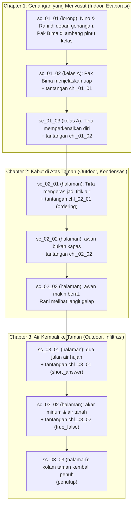

# Rencana Integrasi 2 Map, Karakter Referensi, dan Story Demo

Dokumen ini merinci rencana teknis dan arsitektur untuk memperbarui dunia permainan ClassQuest:

1. **Dua Map Utama**: Gedung Sekolah (Indoor: Lorong & Kelas) dan Halaman Luar (Outdoor: Taman Edukasi/Halaman Sekolah).
2. **Aset Eksternal**: Penggunaan aset referensi dari `D:\Data\LOGICODIX 26\Asset` (pepohonan, interior, semak) yang sudah diproses menjadi prop game.
3. **Karakter Baru**: Protagonis (MC) digambar ulang di generator repo dengan siluet terinspirasi Nino (ekor kembar dan pita kupu-kupu), memakai kerangka animasi 8 arah milik proyek.
4. **Story Demo / Fixture**: Pembaruan cerita demo statis (`demo-story.json`) agar skenario cerita secara alami mengeksplorasi kedua map tersebut.

> **Status implementasi (2026-11-11).** PR 1 (aset + manifest), PR 2 (data
> ruangan), dan PR 3 (story demo) selesai: tile koridor, prop taman/interior,
> `char_nino`, portrait, ruangan `lorong_sekolah`, `kelas_a`, dan
> `halaman_sekolah`, serta cerita demo baru yang memakai Nino sebagai pemain
> dan Rani sebagai NPC.
>
> **Rombakan visual halaman (2026-11-11).** Halaman sekolah kini digambar dari
> satu **gambar peta penuh** (`map_halaman_sekolah`, [ADR 0012](../09-decisions/0012-room-map-image.md))
> yang dijahit `scripts/compose-map.mjs` dari The Fan-tasy Tileset, menggantikan
> kombinasi `tile_floor_grass`/`tile_wall_hedge` + prop taman. Ruangan dalam
> (lorong, kelas) tetap memakai jalur tile ADR 0010.
>
> **Rombakan visual karakter (2026-11-11).** Wajah semua karakter manusia
> digambar ulang: mata 2×3 px dengan satu piksel kilau, mulut kecil, dan tanpa
> piksel hidung yang dulu menyatu dengan mulut (tampak seperti kumis). Nino
> memakai seragam lengkap dengan rok lipit dan kaus kaki. Pose serta proporsinya
> memakai _The adventurer — Female — Free_ hanya sebagai acuan; tidak ada berkas
> paket yang disalin (lihat [inventory.md](../07-assets/inventory.md#sumber-dan-lisensi)).

---

## 1. Rencana Dua Map Utama

Mengikuti [ADR 0009](../09-decisions/0009-resolution-and-scale.md) dan [ADR 0010](../09-decisions/0010-map-data-and-camera.md), viewport kamera adalah 640×360 px (40×22.5 tile @ 16px). Ruangan dibuat lebih luas dari layar agar kamera _lerp_ (mengikuti pemain).

### Map 1: Gedung Sekolah (Indoor)

Gedung sekolah dibagi menjadi 2 room data terpisah untuk memberikan fokus visual ala _Undertale_ / _Omori_:

#### 1A. Lorong Utama (`lorong_sekolah`)

- **Fungsi**: Hub penghubung antar ruangan sekolah dan jalan keluar ke halaman.
- **Ukuran**: 60×24 tile (960×384 px, lorong memanjang horizontal). Tinggi 24 tile dipilih supaya memenuhi minimum 40×23 di [`world-design.md`](./world-design.md) — dengan 18 tile (288 px) kamera 360 px akan memperlihatkan area kosong di luar peta.
- **Lantai & Dinding**: Lantai ubin koridor (`tile_floor_corridor`), dinding atas 2 tile (`tile_wall_plaster`) dengan pintu-pintu kelas dan jendela kaca.
- **Objek/Prop**: Mading sekolah (memakai `prop_blackboard` sebagai papan dekoratif), rak (`prop_shelf`), pintu kelas A (`prop_door` di `tileX: 16`), pintu kelas B (`prop_door` di `tileX: 36`), dan pintu keluar ke halaman di puncak ujung kanan (`tileX: 56`).
- **NPC**: Rani dan Pak Bima di depan kelas untuk scene `sc_01_01`; Rani yang menyapa lebih dulu, jadi ia pemberi quest scene itu.

#### 1B. Ruang Kelas (`kelas_a`)

- **Fungsi**: Tempat KBM, interaksi dengan Pak Bima, dan pengerjaan kuis/tantangan di papan tulis.
- **Ukuran**: 48×28 tile (768×448 px).
- **Lantai & Dinding**: Lantai parket kayu, dinding plester.
- **Objek/Prop**:
  - Papan tulis besar di dinding depan (`tileX: 20, tileY: 2, tileW: 7, tileH: 3`, `solid: true`; ukuran asli `prop_blackboard` 112×48 px).
  - Meja guru di sisi papan tulis.
  - 4–6 pasang meja dan kursi siswa berderet dengan lorong tengah aman (lebar ≥ 2 tile).
  - Pintu keluar di bagian bawah (`tileX: 24, tileY: 27`).
- **NPC**: Pak Bima di dekat papan tulis sebagai pemegang quest utama Chapter 1.

---

### Map 2: Halaman Luar & Taman Botani Edukasi (Outdoor)

#### Halaman Sekolah & Taman Edukasi (`halaman_sekolah`)

- **Fungsi**: Eksplorasi sains/lingkungan (siklus air, ekosistem tanaman). Memberikan suasana petualangan terbuka (_sense of wonder_).
- **Ukuran**: 56×34 tile (896×544 px).
- **Visual**: satu **gambar peta penuh** `map_halaman_sekolah` ([ADR 0012](../09-decisions/0012-room-map-image.md)) hasil jahitan `scripts/compose-map.mjs` dari The Fan-tasy Tileset — rumput, jalan batu, plaza bundar, petak bunga, kolam berpasir, pohon, semak, dan perabot taman. Ruangan **tidak** lagi menyusun `tile_floor_grass`/`tile_wall_hedge` + prop taman satu per satu.
- **Collider (`zone`)**: `roomData.ts` menandai area padat dalam tile — keliling, kolam, petak bunga, pangkal tiap pohon/semak, dan perabot besar (bangku, sumur, papan, tiang lampu, papan petunjuk, tong, keranjang). Zona tidak digambar; ia memakai sumber data collider yang sama (ADR 0012).
- **NPC**: Tirta (roh air) di tepi kolam, Pak Bima yang mengamati alam, dan Rani yang mencatat pengamatan.

---

## 2. Standar Kualitas Visual Aset: "HD Pixel Art Berkualitas Tinggi tapi Tetap Ringan"

Untuk menghasilkan visual game yang terlihat **HD, modern, tajam, dan profesional** (tidak pecah atau blur, mirip standar visual _Omori_, _Stardew Valley_, atau _Eastward_), seluruh kategori aset di ClassQuest menerapkan standar terpadu:

### 2.1. Standar Prop Luar Ruangan (Pohon, Semak, Dekorasi Taman)

- **Sumber**: `D:\Data\LOGICODIX 26\Asset\craftpix-net-385863-free-top-down-trees-pixel-art\` & `craftpix-net-141354-free-top-down-bushes-pixel-art\`
- **Pilihan Varian Wajib**: Gunakan varian bertekstur dengan bayangan — `PNG/Assets_separately/Trees_texture_shadow/` untuk pohon dan `PNG/Assets_texture_shadow/` untuk semak, bukan varian flat.
- **Karakteristik**:
  - Dedaunan memiliki gradasi bayangan dan highlight bertekstur (_textured pixel clusters_).
  - Dilengkapi _built-in soft ambient shadow_ di bagian bawah (transparan alpha), sehingga menyatu alami di atas tile lantai tanpa terlihat melayang.
  - **Pohon Rindang HD**: Resolusi 128×128 px (8×8 tile grid 16px). Sangat megah sebagai kanopi alami.
  - **Semak & Bunga HD**: Resolusi 64×64 px (4×4 tile) atau 32×32 px (2×2 tile).
  - **Ukuran File**: Sangat ringan (~2 KB s.d. ~5 KB per file PNG terkompresi).

### 2.2. Standar Interior & Prop Dalam Ruangan (Sekolah, Meja, Papan Tulis, Rak)

- **Sumber**: `main-characters-home-free-top-down-pixel-art-asset/PNG/Interior.png` (rak buku) & `walls_floor.png` (pintu). Meja, papan tulis, dan prop lain tetap digambar generator `tiles.mjs` supaya ukurannya pas dengan tile 16 px.
- **Karakteristik**:
  - Garis outline 1 px tegas (_dark outline_) yang konsisten, tanpa anti-aliasing buram.
  - Meja kelas dan lemari digambar dari sudut pandang 3/4 top-down (bagian atas meja terlihat luas, bagian kaki memiliki bayangan alas 1–2 px).
  - Prop memiliki ukuran proporsional terhadap karakter (misal meja siswa 48×32 px, papan tulis 112×48 px).
  - Collision padat diset hanya di bagian alas/kaki furnitur, bukan di bagian atas meja, agar karakter terasa berdiri di samping atau di depan meja.

### 2.3. Standar Karakter (MC Nino & NPC)

- **Sumber**: digambar generator repo (`scripts/lib/characters.mjs`). Referensi visual `Nino_Nakano_ver1.webp` hanya dipakai untuk siluet dan warna; tidak ada berkas seni berhak cipta yang disalin. `The adventurer — Female — Free` (Sscary) dipakai **hanya sebagai acuan pose dan proporsi** saat menggambar ulang delapan arah; frame-nya 48×64 px dengan 6 arah sehingga tidak bisa dipaskan langsung ke grid 24×32. Tidak ada berkas paket itu yang disalin atau di-commit.
- **Karakteristik**:
  - Frame karakter standar: **24×32 px** (proporsi chibi top-down 1.5×2 tile). Tidak ada frame 32×48; ADR 0009 sudah menetapkan 24×32.
  - Outline bersih 1 px gelap yang serasi dengan pohon dan dinding ruangan.
  - Wajah standar: dua mata **2×3 px** dengan satu piksel kilau `bone` di sudut kiri atas, mulut kecil 2 px, dan tanpa piksel hidung — hidung `skinShade` yang menempel di atas mulut dulu terbaca seperti kumis.
  - Animasi jalan 8 arah yang mulus (gerakan kaki dan ayunan ekor kembar).
  - Bayangan karakter mengikuti elips bawaan generator; collider tetap kotak 12×8 px di kaki.
  - **Portrait Dialog**: Resolusi **64×64 px** di atas panel dialog DOM, menampilkan wajah Nino dengan pita kupu-kupu di kedua sisi.

### 2.4. Standar Rendering Engine (Phaser & CSS)

- **Zero Blurring**:
  - Kanvas game disetel ke `pixelArt: true` di konfigurasi Phaser (`src/game/config.ts`).
  - CSS kanvas menggunakan `image-rendering: pixelated` dan `crisp-edges`.
  - Kamera memakai `roundPixels: true` agar pergerakan lerp kamera tidak menghasilkan getaran piksel (_pixel jitter_).
- **Performa**: Semua tekstur di-batch dalam atlas/individual PNG ringan, total konsumsi VRAM GPU tetap di bawah 15 MB dan stabil di 60 FPS di semua perangkat sekolah/laptop siswa.

---

## 3. Inventaris Aset & Pemetaan Sumber Referensi

| Kategori                | Berkas Sumber                               | Target di ClassQuest (`public/assets/` & manifest)           | Spesifikasi Standar HD Ringan                                                                                              |
| ----------------------- | ------------------------------------------- | ------------------------------------------------------------ | -------------------------------------------------------------------------------------------------------------------------- |
| **Pohon Rindang HD**    | `.../Trees_texture_shadow/Tree1.png`        | `prop_tree_large`                                            | 128×128 px (8×8 tile), detail bayangan daun bertekstur, ukuran file ~5 KB. Solid hanya di pangkal batang (lihat ADR 0011). |
| **Pohon Sedang HD**     | `.../Trees_texture_shadow/Tree2.png`        | `prop_tree_medium`                                           | 64×64 px (4×4 tile), tekstur bayangan halus.                                                                               |
| **Pohon Berbunga**      | `.../Trees_texture_shadow/Flower_tree1.png` | `prop_tree_flower`                                           | 128×128 px, cocok untuk sudut observasi biologi di taman sekolah.                                                          |
| **Semak Bertekstur HD** | `...bushes.../Autumn_bush1.png`             | `prop_bush_small`                                            | 64×64 px bertekstur bayangan daun rimbun.                                                                                  |
| **Semak Bunga**         | `...bushes.../Bush_pink_flowers1.png`       | `prop_bush_flower`                                           | 64×64 px, aksen bunga merah muda.                                                                                          |
| **Rak Buku**            | `main-characters-home.../Interior.png`      | `prop_shelf`                                                 | Potong `x=160 y=80 32×48`, collision di kaki furnitur.                                                                     |
| **Pintu Kayu**          | `main-characters-home.../walls_floor.png`   | `prop_door`                                                  | Potong `x=112 y=96 32×32`, dipasang di dinding koridor.                                                                    |
| **Kolam Taman**         | generator `tiles.mjs`                       | `prop_pond`                                                  | 96×64 px, kolam dengan bibir batu, riak, dan daun teratai.                                                                 |
| **Lantai & Dinding**    | generator `tiles.mjs`                       | `tile_floor_corridor`, `tile_floor_wood`, `tile_floor_grass` | 16×16 px seamless; koridor memakai ubin teraso, kelas parket, halaman rumput.                                              |
| **MC Nino**             | generator `characters.mjs`                  | `char_nino` + portrait                                       | Spritesheet 8 arah 432×32 (18 frame 24×32), portrait 64×64.                                                                |

> Sejak [ADR 0012](../09-decisions/0012-room-map-image.md), prop taman Craftpix
> (`prop_tree_large`, `prop_tree_medium`, `prop_tree_flower`, `prop_bush_small`,
> `prop_bush_flower`, `prop_pond`) **tidak lagi** dipasang di `halaman_sekolah`:
> halaman memakai `map_halaman_sekolah`. Entri manifest dan berkasnya tetap ada
> untuk pemakaian lain.

---

## 4. Rencana Karakter (MC Nino & NPC)

### 4.1. Main Character (MC - Nino)

- **Visual**: Siluet orisinal terinspirasi Nino (ekor kembar dan pita kupu-kupu) dengan proporsi chibi top-down 24×32 px, digambar generator dengan palet proyek. Rambut memakai aksen karakter `blush` (`#D98FA3`) beserta turunan `blushLight`/`blushShade`, jadi tidak ada warna di luar palet.
- **Seragam**: kemeja `bone` dengan sisi `shirtShade`, rok lipit `skirt` (`mix(cool, night, 0.35)` beserta lipatan yang lebih gelap), kaus kaki `bone`, sepatu `neutral700`. Kaki telanjang dan kaus kaki hanya digambar untuk resep yang punya `skirt`; karakter lain tetap memakai `trouser`.
- **Kerangka Animasi**: Struktur 8 arah ditetapkan proyek (bukan disalin dari pack mana pun):
  - Arah: `down`, `up`, `left`, `right`, `down-left`, `down-right`, `up-left`, `up-right`.
  - Total frame pada spritesheet horizontal 432×32 px (18 frame @ 24×32 px):
    - Frame 0–1: Idle menghadap depan (kamera).
    - Frame 2–3: Jalan menghadap bawah (Down).
    - Frame 4–5: Jalan menghadap atas (Up).
    - Frame 6–7: Jalan menghadap kiri (Left).
    - Frame 8–9: Jalan menghadap kanan (Right).
    - Frame 10–11: Jalan serong kiri bawah (Down-Left).
    - Frame 12–13: Jalan serong kanan bawah (Down-Right).
    - Frame 14–15: Jalan serong kiri atas (Up-Left).
    - Frame 16–17: Jalan serong kanan atas (Up-Right).
- **Collider**: Kotak tabrakan 12×8 px berjangkar di kaki (`PLAYER_BODY_WIDTH = 12`, `PLAYER_BODY_HEIGHT = 8`).
- **Portrait**: 64×64 px wajah Nino dengan pita kupu-kupu untuk kotak dialog DOM. Dagu diisi warna kulit dan leher dibuat sempit supaya latar panel tidak menembus lekuk rahang.

> Catatan: `The adventurer — Female — Free` (Sscary) **tidak disalin**. Berkas aslinya 48×64 per frame (8 frame, 6 arah) dan mengandung garis kecepatan, jadi tidak cocok dengan grid 24×32 proyek; yang dipakai hanya acuan pose dan proporsi.

### 4.2. NPC (Pak Bima, Tirta, Rani)

- **Visual**: Sprite 24×32 px.
- **Animasi**: Cukup 2 frame idle (bernapas halus 2 fps) menghadap ke depan/ke arah ruangan.
- **Interaksi**: Memiliki zona interaksi 1.5 tile di depan sprite untuk memicu dialog atau quest.

---

## 5. Pembaruan Story Demo (`demo-story.json`)

Agar 2 map (Gedung Sekolah dan Halaman Luar) terpakai secara fungsional dalam demo:

- **Manfaat**: Penguji/juri langsung dapat melihat perpindahan mulus dari ruangan indoor (lorong -> kelas) menuju outdoor (taman sekolah), lengkap dengan
  musik latar yang berganti otomatis (`bgm_school_calm` -> `bgm_adventure` ->
  `bgm_ending`).
- **Catatan bentuk**: skema Story mewajibkan **minimal 3 bab**, jadi rencana awal
  dua bab diperluas menjadi tiga bab (9 scene). Tiap bab memakai satu konsep
  (Evaporasi, Kondensasi, Infiltrasi) dan minimal satu tantangan; scene
  pembuka/penutup sengaja tanpa tantangan, yang memunculkan peringatan
  `W_NO_CHALLENGE_IN_SCENE` seperti pada fixture lama.
- **Pemetaan ruangan**: `sc_01_01` -> `lorong_sekolah`, `sc_01_02`/`sc_01_03` ->
  `kelas_a`, dan seluruh `sc_02_*` serta `sc_03_*` -> `halaman_sekolah`.
