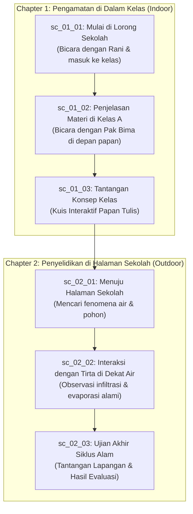

# Rencana Integrasi 2 Map, Karakter Referensi, dan Story Demo

Dokumen ini merinci rencana teknis dan arsitektur untuk memperbarui dunia permainan ClassQuest:

1. **Dua Map Utama**: Gedung Sekolah (Indoor: Lorong & Kelas) dan Halaman Luar (Outdoor: Taman Edukasi/Halaman Sekolah).
2. **Aset Eksternal**: Penggunaan aset referensi dari `D:\Data\LOGICODIX 26\Asset` (pepohonan, interior, semak, dan spritesheet).
3. **Karakter Baru**: Protagonis (MC) menggunakan karakter Nino Nakano dengan kerangka animasi 8 arah (_The Female Adventurer - Free_), dan NPC mentor/teman dengan pose idle.
4. **Story Demo / Fixture**: Pembaruan cerita demo statis (`demo-story.json`) agar skenario cerita secara alami mengeksplorasi kedua map tersebut.

---

## 1. Rencana Dua Map Utama

Mengikuti [ADR 0009](../09-decisions/0009-resolution-and-scale.md) dan [ADR 0010](../09-decisions/0010-map-data-and-camera.md), viewport kamera adalah 640×360 px (40×22.5 tile @ 16px). Ruangan dibuat lebih luas dari layar agar kamera _lerp_ (mengikuti pemain).

### Map 1: Gedung Sekolah (Indoor)

Gedung sekolah dibagi menjadi 2 room data terpisah untuk memberikan fokus visual ala _Undertale_ / _Omori_:

#### 1A. Lorong Utama (`lorong_sekolah`)

- **Fungsi**: Hub penghubung antar ruangan sekolah dan jalan keluar ke halaman.
- **Ukuran**: 60×18 tile (960×288 px, lorong memanjang horizontal).
- **Lantai & Dinding**: Lantai ubin/koridor (`tile_floor_wood` atau variasi ubin bersih), dinding atas 2 tile dengan pintu-pintu kelas dan jendela kaca.
- **Objek/Prop**: Mading sekolah, loker/pot tanaman, pintu kelas A (`x: 16`), pintu kelas B (`x: 36`), dan pintu keluar ke halaman di ujung kanan (`x: 56`).
- **NPC**: Siswa lain (Rani) yang memberi petunjuk awal sebelum masuk kelas.

#### 1B. Ruang Kelas (`kelas_a`)

- **Fungsi**: Tempat KBM, interaksi dengan Pak Bima, dan pengerjaan kuis/tantangan di papan tulis.
- **Ukuran**: 48×28 tile (768×448 px).
- **Lantai & Dinding**: Lantai parket kayu, dinding plester.
- **Objek/Prop**:
  - Papan tulis besar di dinding depan (`tileX: 20, tileY: 2, tileW: 8, tileH: 2`, `solid: true`).
  - Meja guru di sisi papan tulis.
  - 4–6 pasang meja dan kursi siswa berderet dengan lorong tengah aman (lebar ≥ 2 tile).
  - Pintu keluar di bagian bawah (`tileX: 24, tileY: 27`).
- **NPC**: Pak Bima di dekat papan tulis sebagai pemegang quest utama Chapter 1.

---

### Map 2: Halaman Luar & Taman Botani Edukasi (Outdoor)

#### Halaman Sekolah & Taman Edukasi (`halaman_sekolah`)

- **Fungsi**: Eksplorasi sains/lingkungan (siklus air, ekosistem tanaman). Memberikan suasana petualangan terbuka (_sense of wonder_).
- **Ukuran**: 56×34 tile (896×544 px).
- **Lantai & Dinding**:
  - Lantai dasar: Rumput (`tile_floor_grass`).
  - Batas keliling: Pagar tanaman (`tile_wall_hedge`) dan pagar kayu (`prop_fence`).
  - Jalan setapak: Batu (`tile_floor_rock`).
- **Objek/Prop (Diambil dari referensi Asset)**:
  - Pohon rindang besar (`craftpix-net-385863-free-top-down-trees-pixel-art`).
  - Semak-semak dan bunga (`craftpix-net-141354-free-top-down-bushes-pixel-art`).
  - Kolam kecil / aliran air (`tile_floor_water`).
- **NPC**: Tirta (roh air) di tepi kolam dan Pak Bima yang sedang mengamati alam.

---

## 2. Standar Kualitas Visual Aset: "HD Pixel Art Berkualitas Tinggi tapi Tetap Ringan"

Untuk menghasilkan visual game yang terlihat **HD, modern, tajam, dan profesional** (tidak pecah atau blur, mirip standar visual _Omori_, _Stardew Valley_, atau _Eastward_), seluruh kategori aset di ClassQuest menerapkan standar terpadu:

### 2.1. Standar Prop Luar Ruangan (Pohon, Semak, Dekorasi Taman)

- **Sumber**: `D:\Data\LOGICODIX 26\Asset\craftpix-net-385863-free-top-down-trees-pixel-art\` & `craftpix-net-141354-free-top-down-bushes-pixel-art\`
- **Pilihan Varian Wajib**: Gunakan subfolder **`Assets_texture_shadow/`** (bukan varian flat).
- **Karakteristik**:
  - Dedaunan memiliki gradasi bayangan dan highlight bertekstur (_textured pixel clusters_).
  - Dilengkapi _built-in soft ambient shadow_ di bagian bawah (transparan alpha), sehingga menyatu alami di atas tile lantai tanpa terlihat melayang.
  - **Pohon Rindang HD**: Resolusi 128×128 px (8×8 tile grid 16px). Sangat megah sebagai kanopi alami.
  - **Semak & Bunga HD**: Resolusi 64×64 px (4×4 tile) atau 32×32 px (2×2 tile).
  - **Ukuran File**: Sangat ringan (~2 KB s.d. ~5 KB per file PNG terkompresi).

### 2.2. Standar Interior & Prop Dalam Ruangan (Sekolah, Meja, Papan Tulis, Rak)

- **Sumber**: `D:\Data\LOGICODIX 26\Asset\main-characters-home-free-top-down-pixel-art-asset\PNG\Interior.png` & `walls_floor.png`
- **Karakteristik**:
  - Garis outline 1 px tegas (_dark outline_) yang konsisten, tanpa anti-aliasing buram.
  - Meja kelas dan lemari digambar dari sudut pandang 3/4 top-down (bagian atas meja terlihat luas, bagian kaki memiliki bayangan alas 1–2 px).
  - Prop memiliki ukuran proporsional terhadap karakter (misal meja siswa 32×32 atau 48×32 px, papan tulis 96×32 atau 112×32 px).
  - Collision padat diset hanya di bagian alas/kaki furnitur, bukan di bagian atas meja, agar karakter terasa berdiri di samping atau di depan meja.

### 2.3. Standar Karakter (MC Nino Nakano & NPC)

- **Sumber**: `D:\Data\LOGICODIX 26\Asset\The Female Adventurer - Free\` dan referensi visual `Nino_Nakano_ver1.webp`.
- **Karakteristik**:
  - Frame karakter standar: **24×32 px** (proporsi chibi top-down 1.5×2 tile) atau **32×48 px** beresolusi tajam.
  - Outline bersih 1 px gelap yang serasi dengan pohon dan dinding ruangan.
  - Animasi jalan 8 arah yang mulus (gerakan kaki dan ayunan rambut kembar khas Nino).
  - Bayangan karakter menggunakan elips transparan terpisah (`12×4 px` atau `16×6 px`) di bawah kaki agar karakter terasa menapak tanah.
  - **Portrait Dialog**: Resolusi **64×64 px** di atas panel dialog DOM, menampilkan ekspresi wajah Nino yang jelas dan tajam.

### 2.4. Standar Rendering Engine (Phaser & CSS)

- **Zero Blurring**:
  - Kanvas game disetel ke `pixelArt: true` di konfigurasi Phaser (`src/game/config.ts`).
  - CSS kanvas menggunakan `image-rendering: pixelated` dan `crisp-edges`.
  - Kamera memakai `roundPixels: true` agar pergerakan lerp kamera tidak menghasilkan getaran piksel (_pixel jitter_).
- **Performa**: Semua tekstur di-batch dalam atlas/individual PNG ringan, total konsumsi VRAM GPU tetap di bawah 15 MB dan stabil di 60 FPS di semua perangkat sekolah/laptop siswa.

---

## 3. Inventaris Aset & Pemetaan Sumber Referensi

| Kategori                  | Nama di Asset Eksternal                             | Target di ClassQuest (`public/assets/` & manifest)           | Spesifikasi Standar HD Ringan                                                                                                                 |
| ------------------------- | --------------------------------------------------- | ------------------------------------------------------------ | --------------------------------------------------------------------------------------------------------------------------------------------- |
| **Pohon Rindang HD**      | `craftpix.../Trees_texture_shadow/Tree1.png`        | `prop_tree_large`                                            | Resolusi 128×128 px (8×8 tile), detail bayangan daun bertekstur, ukuran file ~5 KB (sangat ringan). Solid di pangkal batang bawah (2×1 tile). |
| **Pohon Sedang HD**       | `craftpix.../Trees_texture_shadow/Tree2.png`        | `prop_tree_medium`                                           | Resolusi 64×64 px (4×4 tile), tekstur bayangan halus, ukuran file ~3.8 KB.                                                                    |
| **Pohon Berbunga / Buah** | `craftpix.../Trees_texture_shadow/Flower_tree1.png` | `prop_tree_flower`                                           | 128×128 px, cocok untuk sudut observasi biologi di taman sekolah.                                                                             |
| **Semak Bertekstur HD**   | `craftpix...bushes.../Autumn_bush1.png`             | `prop_bush_small`                                            | Resolusi 64×64 px bertekstur bayangan daun rimbun, ukuran file ~2.5 KB.                                                                       |
| **Interior Sekolah HD**   | `main-characters-home.../Interior.png`              | `prop_desk`, `prop_shelf`, `prop_door`                       | Detail furnitur kayu berbayangan, collision pada kaki furnitur.                                                                               |
| **Lantai & Dinding HD**   | `walls_floor.png` & `Pixel Art Basic`               | `tile_floor_corridor`, `tile_floor_wood`, `tile_floor_grass` | 16×16 px seamless tile dengan tekstur ubin dan parket bersih.                                                                                 |
| **MC Nino Nakano**        | Template pose `The Female Adventurer` + Desain Nino | `char_nara` (MC)                                             | Spritesheet 8 arah berbayangan alas, portrait dialog 64×64 px tajam.                                                                          |

---

## 3. Rencana Karakter (MC Nino Nakano & NPC)

### 3.1. Main Character (MC - Nino Nakano)

- **Visual**: Mengadaptasi karakter Nino Nakano (rambut kembar/pita kupu-kupu khas) dengan proporsi tubuh chibi top-down 24×32 px.
- **Kerangka Animasi (Template)**: Mengikuti struktur pose 8 arah dari `D:\Data\LOGICODIX 26\Asset\The Female Adventurer - Free`:
  - Arah: `down`, `up`, `left`, `right`, `down-left`, `down-right`, `up-left`, `up-right`.
  - Total frame pada spritesheet horizontal 432×32 px (18 frame @ 24×32 px):
    - Frame 0–1: Idle menghadap depan (kamera).
    - Frame 2–3: Jalan menghadap bawah (Down).
    - Frame 4–5: Jalan menghadap atas (Up).
    - Frame 6–7: Jalan menghadap kiri (Left).
    - Frame 8–9: Jalan menghadap kanan (Right).
    - Frame 10–11: Jalan serong kiri bawah (Down-Left).
    - Frame 12–13: Jalan serong kanan bawah (Down-Right).
    - Frame 14–15: Jalan serong kiri atas (Up-Left).
    - Frame 16–17: Jalan serong kanan atas (Up-Right).
- **Collider**: Kotak tabrakan 12×8 px berjangkar di kaki (`PLAYER_BODY_WIDTH = 12`, `PLAYER_BODY_HEIGHT = 8`).
- **Portrait**: 64×64 px ekspresi wajah Nino untuk kotak dialog DOM.

### 3.2. NPC (Pak Bima, Tirta, Rani)

- **Visual**: Sprite 24×32 px.
- **Animasi**: Cukup 2 frame idle (bernapas halus 2 fps) menghadap ke depan/ke arah ruangan.
- **Interaksi**: Memiliki zona interaksi 1.5 tile di depan sprite untuk memicu dialog atau quest.

---

## 4. Pembaruan Story Demo (`demo-story.json`)

Agar 2 map (Gedung Sekolah dan Halaman Luar) terpakai secara fungsional dalam demo:

- **Manfaat**: Penguji/juri langsung dapat melihat perpindahan mulus dari ruangan indoor (lorong -> kelas) menuju outdoor (taman sekolah) lengkap dengan musik latar yang berganti otomatis (`bgm_school_calm` -> `bgm_adventure`).
