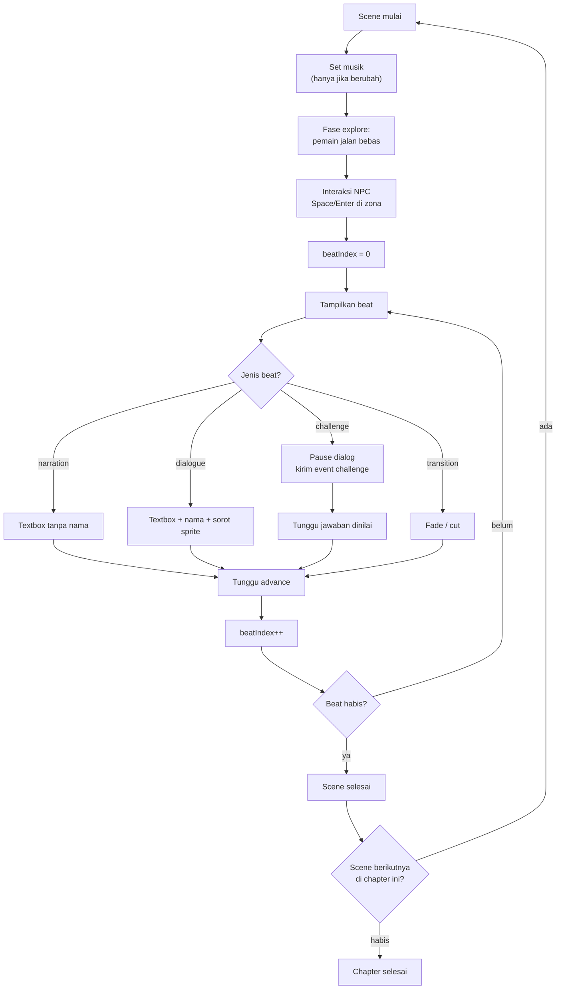

# Format Scene (Cerita → Runtime)

Dokumen ini menjelaskan bagaimana `Story` (JSON) dipetakan menjadi tampilan game.
Ini menjembatani [`../02-data-model/story-schema.md`](../02-data-model/story-schema.md)
dan [`engine.md`](./engine.md).

## Ringkasan mapping

| Story                   | Runtime                                                                   |
| ----------------------- | ------------------------------------------------------------------------- |
| `chapters[]`            | Urutan chapter; satu chapter = satu "bab" gameplay                        |
| `scenes[]`              | Satu pemberi quest + satu override musik + deretan beat                   |
| `beats[]`               | Satu langkah dialog atau satu tantangan                                   |
| `cast[]`                | Sprite yang bisa muncul + potret                                          |
| `challenges[]`          | Overlay React, dipanggil dari beat `challenge`                            |
| `musicId` chapter/scene | Musik yang diputar; override scene berlaku                                |
| `backgroundId`          | Hanya untuk layar judul/hasil; di dalam dunia game latar selalu peta desa |

Sejak dunia menjadi satu peta desa (`world-design.md`), scene **tidak** lagi
menukar gambar latar. Yang benar-benar berubah saat scene berganti: **musik** dan
**NPC pemberi quest**. Dunia, objek, dan posisi pemain tetap.

## Resolusi nilai

Nilai efektif dihitung saat chapter dimulai, bukan tiap beat:

```ts
export function resolveSceneLook(chapter: Chapter, scene: Scene | null) {
  return {
    backgroundId: scene?.backgroundId ?? chapter.backgroundId ?? "bg_default",
    musicId: scene?.musicId ?? chapter.musicId ?? "bgm_default",
  };
}
```

Modul nyata ada di `src/game/sceneAssets.ts`; di sana juga ada
`collectStoryAssets(story)` yang mengumpulkan aset cerita untuk preload.

Aturan:

- `chapter.backgroundId` dan `chapter.musicId` **wajib** di schema; `bg_default`
  dan `bgm_default` hanya terpakai bila field kosong (data rusak) atau untuk
  layar judul/hasil. Jangan memakai itu sebagai pengganti id yang salah.
- Di dalam game, `GameScene` **hanya** memakai `musicId`. `backgroundId` diabaikan
  karena latar dunia adalah peta desa; `putarMusik()` tetap jatuh ke `bgm_default`
  bila audio yang diminta tidak ikut termuat.
- Ganti musik hanya bila `musicId` berbeda dari scene sebelumnya. Jangan restart
  track yang sama.

## Preload

`PreloadScene` memuat, dalam urutan ini:

1. **Seluruh aset dunia desa** (`WORLD` dari `src/assets/manifest.ts`) — peta,
   potongan objek, spritesheet karakter, dan musik default. Dunia tidak bisa
   dirender sebagian, jadi semuanya dimuat sekali di awal.
2. **Aset cerita** lewat `collectStoryAssets(story)`: background chapter +
   override scene, musik chapter + override scene, dan `spriteId` setiap `cast`
   beserta potretnya.
3. **Aset UI dan SFX runtime** (`ui_textbox`, `ui_portrait_frame`, `ui_default`,
   `sfx_click`, `sfx_page`, `sfx_correct`, `sfx_wrong`).

Semua key loader memakai `id` manifest, jadi scene tidak menebak path file.
`manifest.test.ts` menjamin setiap id punya berkasnya, sehingga `PreloadScene`
tidak menyediakan sprite cadangan.

## Dunia dan eksplorasi

Per ADR 0008 dan 0010, cerita dijalankan di atas **satu dunia desa** yang bisa
dijelajahi:

- Dunia dibangun sekali di `GameScene.create()` dari `VILLAGE`
  (`src/game/world/village.json`): gambar peta, 300 penempatan objek, dan 9 NPC.
- Scene dibuka dalam fase `explore`: pemain berdiri di titik spawn, lalu bergerak
  **8 arah** (`W`/`A`/`S`/`D` atau panah) dengan collision dari data dunia.
- Data dunia — peta, penempatan NPC, spawn, sel collision — didefinisikan **di
  sisi game** dan **tidak mengubah kontrak Story JSON**.
- Sprite karakter memakai `spriteId` dari `cast` (spritesheet 8 frame, tinggi
  frame 64 px, lebar per karakter). Bila texture karakter tidak ada, sprite itu
  tidak digambar — tidak ada sprite cadangan.
- Gerak **bukan** fisika Phaser: `movement.ts` menghitung langkah per sumbu dan
  memeriksa `buatTabrakan()` dari sel collision editor. Kotak tabrakan hanya di
  kaki (16×9 px). Detailnya di
  [`world-design.md`](./world-design.md#objek-dan-collision).
- NPC/objek interaksi punya zona 24 px di sekitar titik kaki. Pemain di dalam zona
  → indikator `Space` muncul → `Space`/`Enter` memutar deretan beat scene itu
  (fase `dialog`); gerak terkunci sampai deretan beat habis.

Hanya **NPC pemberi quest** scene aktif yang memunculkan prompt dan bisa memulai
dialog; NPC lain tetap berdiri sebagai penghalang.

## Peta visual

Resolusi internal 640×360 (ADR 0009); lebar kanvas mengikuti rasio layar
(640–960 px) dan tinggi tetap 360. Layout berikut berlaku saat fase `dialog`
(textbox terbuka); saat fase `explore`, textbox tersembunyi dan pemain bebas
bergerak.

```text
┌──────────────────────────────────────────────────────┐ 640×360
│                                                      │
│              PETA DESA (kamera follow)               │
│                                                      │
│                     ┌───────┐                        │
│                     │PEMAIN │  ← di posisi dunianya  │
│                     └───────┘                        │
│                                                      │
│ ┌──────┐ ┌─────────────────────────────────────────┐ │
│ │PORTRA│ │ TEXTBOX (ui_textbox)                    │ │
│ │72 px │ │ Nama                                    │ │
│ └──────┘ │ Teks dialog...                          │ │
│          └─────────────────────────────────────────┘ │
└──────────────────────────────────────────────────────┘
```

| Elemen    | Posisi/ukuran                                                             |
| --------- | ------------------------------------------------------------------------- |
| Dunia     | Peta desa 2390×1792, digambar `setOrigin(0)`, `setDepth(-100000)`         |
| Pemain    | Sprite dunia, `setOrigin(0.5, 1)`, `setDepth(y)`                          |
| Textbox   | 608×104, terpusat horizontal, `y=240`, menempel layar (`setScrollFactor`) |
| Portrait  | Bingkai 72×72 di atas panel, gambar 64×64 di dalamnya                     |
| Nama      | Di dalam textbox, baris pertama (DOM)                                     |
| Teks      | Maks 240 karakter per beat (batas schema), dirender utuh (DOM)            |
| Indikator | Panah kecil berkedip di kanan bawah saat menunggu (DOM)                   |

> **Panel di Phaser, teks di DOM (ADR 0007).** Phaser hanya menggambar
> `ui_textbox`, bingkai portrait, dan portrait-nya. Nama, isi dialog, dan
> indikator "lanjut" dirender `DialogueBox.tsx` di lapisan DOM dengan posisi
> persen dari `src/game/layout.ts`, sehingga huruf tajam di layar. Prompt
> interaksi `Space` juga DOM (`InteractHint.tsx`). Jangan menambah teks game baru
> di canvas: canvas di-upscale `pixelated`, jadi semua huruf di dalamnya
> bergerigi.

Beginilah hasilnya di layar:


> Gambar di atas digambar pada kanvas 320×180 lalu diperbesar agar tajam di
> layar. Yang berlaku untuk aset dan kode adalah angka di tabel: 640×360.

Batas keras **240 karakter per beat** berasal dari schema
(`boundedText(1, 240)`). Panel 608×104 pada ukuran huruf game memuat beberapa
baris; teks yang lebih panjang tetap dirender utuh oleh DOM (belum ada paginasi
otomatis). Kalau kamu mengubah ukuran textbox, periksa ulang tampilannya di
layar kecil.

## Siklus beat



Perhatikan dua hal: `transition` **tidak** menunggu klik (ia hanya menunggu
animasi selesai), dan `challenge` menunggu `resolve_challenge`, bukan `advance`.
Scene **tidak** kembali ke `explore` di tengah deretan beat — eksplorasi hanya
terjadi sebelum beat pertama scene.

## Menampilkan beat

### `narration`

- Textbox tanpa nama.
- Sprite speaker sebelumnya diredam (tidak ada yang disorot).
- Tidak ada portrait.

### `dialogue`

- Textbox dengan nama karakter (`cast.name`, bukan `id`).
- Sprite speaker disorot: `setTint(0xffffff)` untuk yang bicara, `setTint(0x9a9a9a)`
  untuk yang tidak. **Ingat:** `setTintFill()` sudah dihapus di Phaser 4.
- Portrait ditampilkan bila entri manifest karakter punya `portraitPath`.

### `challenge`


- Panel tantangan muncul **di atas dialog**, bukan sebagai jendela tengah yang
  menutupi seluruh layar. Tidak ada lapisan gelap penuh.
- Dialog **dipause**, bukan ditutup: baris terakhir tetap terlihat sebagai
  konteks soal, dan typewriter dibekukan selama fase `challenge`.
- Isi soal yang panjang digulir di dalam panel; tombol aksi menempel di bawah.
- Event `challenge` dikirim ke React dengan `challengeId`.
- Phaser menunggu perintah `resolve_challenge` sebelum lanjut.

### `transition`

- `effect: "fade"` → kamera fade out/in 300 ms.
- `effect: "cut"` → langsung ganti.
- `text` opsional ditampilkan sebagai kartu singkat (mis. "Keesokan pagi").
- Tidak boleh menjadi beat terakhir scene (sudah divalidasi).

## Typewriter

- Kecepatan 35 karakter/detik (`Typewriter`, default 35; rentang desain 30–40).
- Klik/Spasi saat mengetik → tampilkan seluruh teks (bukan lanjut beat).
- Klik/Spasi saat selesai → lanjut beat.
- Teks di-`setText` utuh, bukan per karakter dengan `Text` baru; gunakan counter
  dan `slice(0, n)` — cukup untuk 240 karakter.

## Perpindahan scene dan chapter

| Peristiwa         | Visual                                                            |
| ----------------- | ----------------------------------------------------------------- |
| Scene → scene     | Musik berganti bila `musicId` berubah; NPC pemberi quest berganti |
| Chapter → chapter | Kartu judul chapter, musik berganti bila perlu                    |
| Chapter terakhir  | Fade ke layar hasil (React)                                       |

Dunia **tidak** dibangun ulang dan pemain **tidak** dikembalikan ke spawn saat
scene berganti. Spawn hanya dipakai saat memulai cerita atau saat **"Ulangi
chapter"** dari menu jeda.

## Contoh lengkap

Story: [`../02-data-model/story.example.json`](../02-data-model/story.example.json)

Chapter 1, scene `sc_01_02` ("Tiga Kali Resep"):

```json
{
  "id": "sc_01_02",
  "title": "Tiga Kali Resep",
  "beats": [
    {
      "type": "dialogue",
      "speakerId": "char_npc_10",
      "text": "Sebelum mulai, ayo pastikan takarannya benar. Salah takaran, kue pesta bisa gagal."
    },
    { "type": "challenge", "challengeId": "chl_01_01" },
    {
      "type": "dialogue",
      "speakerId": "char_npc_1",
      "text": "Benar, sembilan cangkir tepung butuh enam cangkir gula. Kamu sudah paham perbandingan."
    },
    {
      "type": "narration",
      "text": "Nara menuang bahan dengan hati-hati. Aroma kue mulai memenuhi dapur."
    },
    {
      "type": "dialogue",
      "speakerId": "char_mc",
      "text": "Jadi selama perbandingannya tetap, rasa kue juga tetap enak."
    }
  ]
}
```

Yang terjadi:

1. Musik chapter tetap `bgm_default` (tidak berganti).
2. Dunia desa tidak berubah; pemain tetap di posisi terakhirnya.
3. Pemberi quest scene ini adalah Pak Wira (`char_npc_10`); dekati dia → `Space`.
4. Pak Wira tampil, textbox berisi nama + kalimat.
5. Klik → beat tantangan → dialog pause, overlay `chl_01_01` muncul.
6. Siswa menjawab → feedback + penjelasan → overlay tertutup.
7. Bu Sri (`char_npc_1`) tampil, dialog.
8. Narasi tanpa nama.
9. Scene selesai → `sc_01_03`.

## Data yang dikirim ke React

Jangan kirim seluruh `Story` ke overlay. Kirim yang perlu saja:

```ts
type ChallengeView = {
  id: string;
  type: ChallengeType;
  prompt: string;
  conceptTag: string;
  options?: { id: string; text: string }[];
  statement?: string;
  items?: { id: string; text: string }[];
  hints?: string[];
};
```

**Jangan** kirim `correctOptionId`, `correctAnswer`, `correctOrder`, atau
`acceptedAnswers` ke komponen presentasional. Penilaian dilakukan di modul yang
memegang `Story`, lalu hasil boolean dikirim ke UI.

> Catatan jujur: jawaban tetap ada di bundle karena game dinilai di client. Ini
> batasan MVP yang diterima (lihat
> [`../01-architecture/security-and-privacy.md`](../01-architecture/security-and-privacy.md)).
> Yang penting: jangan menampilkannya di DOM/atribut.

## Kesalahan mapping yang harus dihindari

| Kesalahan                              | Akibat                              |
| -------------------------------------- | ----------------------------------- |
| Membangun ulang dunia saat scene ganti | Posisi pemain hilang, peta berkedip |
| Restart musik tiap scene               | Musik terasa terpotong              |
| Menutup textbox saat tantangan         | Dialog kehilangan konteks           |
| Mengirim jawaban benar ke komponen UI  | Jawaban bocor di DOM                |
| Membuat `Text` baru tiap karakter      | FPS turun, memori naik              |
| Memakai indeks array sebagai id        | Progress rusak saat cerita diedit   |
