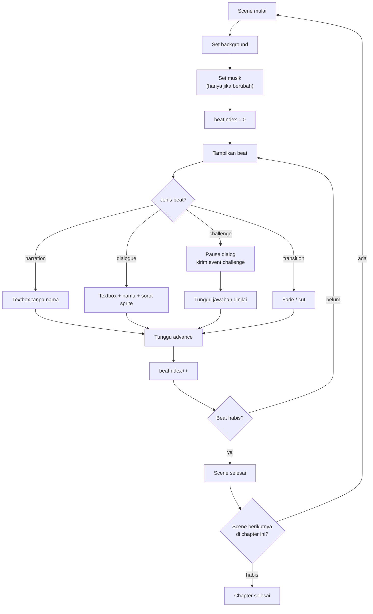

# Format Scene (Cerita → Runtime)

Dokumen ini menjelaskan bagaimana `Story` (JSON) dipetakan menjadi tampilan game.
Ini menjembatani [`../02-data-model/story-schema.md`](../02-data-model/story-schema.md)
dan [`engine.md`](./engine.md).

## Ringkasan mapping

| Story                   | Runtime                                            |
| ----------------------- | -------------------------------------------------- |
| `chapters[]`            | Urutan chapter; satu chapter = satu "bab" gameplay |
| `scenes[]`              | Satu background + satu musik + deretan beat        |
| `beats[]`               | Satu langkah dialog atau satu tantangan            |
| `cast[]`                | Sprite yang bisa muncul + portrait                 |
| `challenges[]`          | Overlay React, dipanggil dari beat `challenge`     |
| `backgroundId` chapter  | Default background untuk semua scene di chapter    |
| `backgroundId` scene    | Override background chapter                        |
| `musicId` chapter/scene | Sama, override berlaku                             |

## Resolusi nilai

Nilai efektif dihitung sekali saat chapter dimulai, bukan tiap beat:

```ts
export function resolveSceneLook(story: Story, chapter: Chapter, scene: Scene) {
  return {
    backgroundId: scene.backgroundId ?? chapter.backgroundId ?? "bg_default",
    musicId: scene.musicId ?? chapter.musicId ?? "bgm_default",
  };
}
```

Aturan:

- `bg_default`/`bgm_default` **hanya** dipakai kalau aset yang diminta gagal
  dimuat. Kalau id tidak ada di manifest, itu bug validasi — jangan diam-diam
  mengganti.
- Ganti musik hanya bila `musicId` berbeda dari scene sebelumnya. Jangan restart
  track yang sama.

## Peta visual

Resolusi 480×270. Posisi dalam piksel:

```text
┌──────────────────────────────────────────────────┐ 480×270
│                                                  │
│                BACKGROUND (full)                 │
│                                                  │
│     ┌──────┐                                     │
│     │SPRITE│  ← karakter aktif, kiri bawah       │
│     │48×72 │                                     │
│     └──────┘                                     │
│ ┌──────────────────────────────────────────────┐ │
│ │ TEXTBOX (ui_textbox)                         │ │
│ │ Nama                                         │ │
│ │ Teks dialog...                               │ │
│ └──────────────────────────────────────────────┘ │
└──────────────────────────────────────────────────┘
```

| Elemen     | Posisi/ukuran                                              |
| ---------- | ---------------------------------------------------------- |
| Background | `0,0`, 480×270, `setOrigin(0)`                             |
| Sprite     | `x=36`, `y=180`, origin bottom-left (kaki di atas textbox) |
| Portrait   | Opsional, di atas textbox, 96×96                           |
| Textbox    | `x=12`, `y=180`, lebar 456, tinggi 78                      |
| Nama       | Di dalam textbox, baris pertama                            |
| Teks       | Maks 3 baris per halaman, ~60 karakter/baris               |
| Indikator  | Panah kecil berkedip di kanan bawah saat menunggu          |

Beginilah hasilnya di layar:


> Gambar di atas digambar pada kanvas 320×180 lalu diperbesar agar tajam di
> layar. Yang berlaku untuk aset dan kode adalah angka di tabel: 480×270. Kalau
> menggambar aset baru, kalikan koordinat gambar ini dengan 1.5.

Batas keras **240 karakter per beat** berasal dari schema. Satu halaman textbox
hanya memuat 3 baris × ~60 karakter ≈ 180 karakter, jadi beat yang lebih panjang
ditampilkan sebagai **dua halaman**: siswa menekan lanjut sekali lagi sebelum beat
berikutnya. Dengan begitu tidak ada teks yang terpotong, dan angka 240 di
validator tetap punya alasan. Kalau kamu mengubah ukuran textbox, hitung ulang
kedua angka itu.

## Siklus beat



Perhatikan dua hal: `transition` **tidak** menunggu klik (ia hanya menunggu
animasi selesai), dan `challenge` menunggu `resolve_challenge`, bukan `advance`.

## Menampilkan beat

### `narration`

- Textbox tanpa nama.
- Sprite karakter sebelumnya **tetap** tampil (kecuali scene berganti).
- Tidak ada portrait.

### `dialogue`

- Textbox dengan nama karakter (`cast.name`, bukan `id`).
- Sprite speaker disorot: `setTint(0xffffff)` untuk yang bicara, `setTint(0x9a9a9a)`
  untuk yang tidak. **Ingat:** `setTintFill()` sudah dihapus di Phaser 4.
- Portrait ditampilkan bila entri manifest karakter punya `portraitPath`.

### `challenge`


- Dialog **dipause**, bukan ditutup. Setelah dijawab, dialog kembali.
- Event `challenge` dikirim ke React dengan `challengeId`.
- Phaser menunggu perintah `resolve_challenge` sebelum lanjut.

### `transition`

- `effect: "fade"` → kamera fade out/in 300 ms.
- `effect: "cut"` → langsung ganti.
- `text` opsional ditampilkan sebagai kartu singkat (mis. "Keesokan pagi").
- Tidak boleh menjadi beat terakhir scene (sudah divalidasi).

## Typewriter

- Kecepatan 30–40 karakter/detik.
- Klik/Spasi saat mengetik → tampilkan seluruh teks (bukan lanjut beat).
- Klik/Spasi saat selesai → lanjut beat.
- Teks harus di-`setText` utuh, bukan per karakter dengan `Text` baru; gunakan
  counter dan `setText(text.slice(0, n))` — cukup untuk 240 karakter.

## Perpindahan scene dan chapter

| Peristiwa         | Visual                                                 |
| ----------------- | ------------------------------------------------------ |
| Scene → scene     | Fade 300 ms; musik lanjut bila sama                    |
| Chapter → chapter | Fade + kartu judul chapter (1,5 detik), musik berganti |
| Chapter terakhir  | Fade ke layar hasil (React)                            |

Kartu judul chapter diambil dari `chapter.title` dan `chapter.concept`.

## Contoh lengkap

Story: [`../02-data-model/story.example.json`](../02-data-model/story.example.json)

Chapter 1, scene `sc_01_02`:

```json
{
  "id": "sc_01_02",
  "title": "Uap yang Tak Terlihat",
  "beats": [
    {
      "type": "dialogue",
      "speakerId": "char_pak_bima",
      "text": "Air bisa berubah wujud. Saat dipanaskan matahari, air menjadi uap yang tidak terlihat."
    },
    { "type": "challenge", "challengeId": "chl_01_01" },
    {
      "type": "dialogue",
      "speakerId": "char_tirta",
      "text": "Aku uap yang baru lepas dari genangan itu. Ringan sekali, sampai aku bisa naik."
    },
    {
      "type": "narration",
      "text": "Nara mengikuti arah naiknya uap, meski matanya tidak bisa melihat apa pun."
    }
  ]
}
```

Yang terjadi:

1. Background tetap `bg_classroom_day` (dari chapter).
2. Pak Bima tampil, textbox berisi nama + kalimat.
3. Klik → beat tantangan → dialog pause, overlay `chl_01_01` muncul.
4. Siswa menjawab → feedback + penjelasan → overlay tertutup.
5. Tirta muncul (sprite `char_tirta`), dialog.
6. Narasi tanpa nama.
7. Scene selesai → `sc_01_03`.

## Data yang dikirim ke React

Jangan kirim seluruh `Story` ke overlay. Kirim yang perlu saja:

```ts
type ChallengeView = {
  id: string;
  type: ChallengeType;
  prompt: string;
  conceptTag: string;
  options?: { id: string; text: string }[];
  statement?: string;
  items?: { id: string; text: string }[];
  hints?: string[];
};
```

**Jangan** kirim `correctOptionId`, `correctAnswer`, `correctOrder`, atau
`acceptedAnswers` ke komponen presentasional. Penilaian dilakukan di modul yang
memegang `Story`, lalu hasil boolean dikirim ke UI.

> Catatan jujur: jawaban tetap ada di bundle karena game dinilai di client. Ini
> batasan MVP yang diterima (lihat
> [`../01-architecture/security-and-privacy.md`](../01-architecture/security-and-privacy.md)).
> Yang penting: jangan menampilkannya di DOM/atribut.

## Kesalahan mapping yang harus dihindari

| Kesalahan                               | Akibat                            |
| --------------------------------------- | --------------------------------- |
| Memakai `chapter.backgroundId` langsung | Override scene diabaikan          |
| Restart musik tiap scene                | Musik terasa terpotong            |
| Menutup textbox saat tantangan          | Dialog kehilangan konteks         |
| Mengirim jawaban benar ke komponen UI   | Jawaban bocor di DOM              |
| Membuat `Text` baru tiap karakter       | FPS turun, memori naik            |
| Memakai indeks array sebagai id         | Progress rusak saat cerita diedit |
