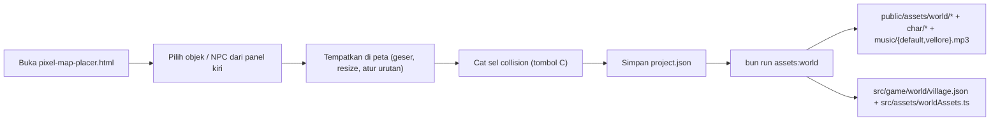

# Desain Dunia Top-Down

Dokumen ini menjawab satu pertanyaan: **bagaimana dunia game digambar dan
disusun supaya terasa seperti Omori, Undertale, atau Stardew Valley** — dunia
yang dilihat dari atas, karakter kecil, dan ruang yang bisa dijelajahi.

Dokumen pendamping:

- Arah visual, palet, dan suasana: [`game-design.md`](./game-design.md)
- Spesifikasi file gambar: [`../07-assets/asset-guide.md`](../07-assets/asset-guide.md)
- Keputusan resolusi: [`../09-decisions/0009-resolution-and-scale.md`](../09-decisions/0009-resolution-and-scale.md)
- Keputusan data map dan kamera: [`../09-decisions/0010-map-data-and-camera.md`](../09-decisions/0010-map-data-and-camera.md)
- Keputusan sub-collider prop besar: [`../09-decisions/0011-large-prop-subcollider.md`](../09-decisions/0011-large-prop-subcollider.md)
- Keputusan peta sebagai satu gambar penuh: [`../09-decisions/0012-room-map-image.md`](../09-decisions/0012-room-map-image.md)

> **Status:** draft. Angka di dokumen ini disalin dari kode dan data yang berlaku
> sekarang (`src/game/world/`, `src/game/scenes/GameScene.ts`), bukan dari
> rencana. Kalau kode berubah, dokumen ini ikut berubah.

## Satu dunia, satu peta

Seluruh cerita berjalan di **satu dunia desa**. Tidak ada perpindahan ruangan:
saat chapter berganti, pemain tetap berdiri di tempatnya — hanya scene cerita
dan musik yang berganti. `GameScene` membangun peta, objek, dan NPC **sekali**
di `create()`, lalu tidak pernah membangunnya ulang.

| Hal                 | Nilai                                                |
| ------------------- | ---------------------------------------------------- |
| Peta                | `world_map_village`, 2390×1792 px                    |
| Objek terpasang     | 80 potongan unik, total 300 penempatan               |
| Sel collision padat | 4.925 dari grid 300×300                              |
| NPC di peta         | 9 karakter dari `story.cast`                         |
| Titik mulai pemain  | `x=1246,785`, `y=1523,2`, menghadap bawah (`face=0`) |

Isi dunia (nama desa, rumah, balai, sawah, dan lagu latar) mengikuti cerita demo
**Pesta Panen Desa**; lihat [`../02-data-model/story.example.json`](../02-data-model/story.example.json).

Posisi NPC punya makna cerita, bukan sekadar dekorasi: Marlow di jembatan
sungai, Theo di kebun dekat sumur, Elias di depan perpustakaan, Edric di rumah
beratap merah, Eldric di rumah beratap biru, Clara di kolam timur, Elian di
alun-alun, dan Leonhardt di pintu masuk selatan. AI penulis cerita **tidak**
menerima peta maupun koordinat, jadi tata letak itu dikirim lewat blok `LOKASI`
dari `CAST_PLACES` di `src/story/cast.ts` (ADR 0029). Kalau peta diubah,
`CAST_PLACES` harus ikut diubah — `src/story/cast.test.ts` menegur bila ada NPC
di peta yang tidak punya lokasi di prompt.

## Satuan dasar

Resolusi internal tetap **640×360 px** (ADR 0009). Berbeda dari rencana awal,
dunia desa **tidak** memakai satuan tile 16×16: editor peta menempel gambar di
koordinat piksel bebas, dan angka itu disalin apa adanya ke game. Jadi hampir
semua nilai di bawah dinyatakan dalam piksel.

| Hal                   | Nilai                                                        |
| --------------------- | ------------------------------------------------------------ |
| Resolusi internal     | 640×360 px                                                   |
| Lebar kanvas          | lebar kontainer ÷ skala, dijepit 640–960 px (tinggi 360)     |
| Skala ke layar        | bulat saat sisa ruang ≤6%, selain itu penuh (mis. 1,83×)     |
| Peta desa             | 2390×1792 px                                                 |
| Sel collision editor  | 7,9667×5,9733 px (peta dibagi rata menjadi grid 300×300)     |
| Frame sprite karakter | kotak potong per karakter (33–52 px lebar × 61–66 px tinggi) |
| Tinggi karakter       | 56 px di peta (diskalakan dari tinggi frame)                 |
| Portrait dialog       | 64×64 px                                                     |
| Kecepatan pemain      | 180 px/detik                                                 |
| Kotak kaki pemain     | 16×9 px, membentang ke atas dari titik kaki                  |
| Zona interaksi NPC    | 44 px masuk / 52 px keluar (histeresis 8 px)                 |
| Dead zone kamera      | 128×96 px di tengah layar                                    |
| Zoom kamera           | 0,8 — bingkai 640×360 menampilkan 800×450 px dunia           |

Skala kanvas dihitung `ukuranKanvas()` di `src/game/constants.ts` dengan dua
mode. Kalau kontainer hampir pas kelipatan tinggi 360 (sisa ≤6%, `SISA_SKALA_MAKS`),
skala **bulat**: satu piksel internal jatuh tepat di 1, 2, 3, … piksel layar dan
pixel art paling tajam. Kalau tidak, skala **penuh** (tinggi kontainer ÷ 360,
mis. 1,83×) supaya game mengisi bingkai — dulu jendela 1366×660 hanya mendapat
kanvas 960×360, terlihat seperti strip kecil dengan bar gelap besar. Skala
pecahan aman karena posisi objek, kamera, dan vertex sudah dikunci ke piksel
utuh (`roundPixels`, `fullAuto`, `CAMERA_LERP` 1), jadi pola piksel tidak
bergeser saat pemain berjalan. Kamera dunia sendiri sedikit keluar dari 1:1
(`ZOOM_KAMERA`, lihat [Kamera](#kamera)); itu mematikan pembulatan piksel
kamera, tetapi `lerp` 1 menahan getarannya.

Lebar internal (`lebarKanvas()`) dijepit 640–960 px supaya layar lebar
menampilkan **lebih banyak dunia ke samping**, bukan potongan atas-bawah. Halaman
game juga memberi margin kecil dan bingkai membulat, jadi sisa ruang (kalau ada)
terbaca sebagai bingkai jendela, bukan kanvas yang bocor ke tepi peramban.

## Perspektif

Aturan supaya dunia terbaca "dari atas":

1. **Tanah mendominasi.** Peta desa adalah hamparan rumput, jalan, dan air yang
   mengisi sebagian besar layar; sisi bangunan hanya tampil sebagai pita pendek
   di bagian atas.
2. **Objek berdiri punya alas.** Rumah, pohon, sumur, dan bangku digambar dengan
   sisi atas terlihat dan bayangan 1–2 px di bawah alasnya. Objek tanpa alas
   terlihat seperti tempelan.
3. **Wajah karakter hanya di depan.** Sprite menghadap kamera; bagian atas kepala
   lebih besar dari area kaki. Karakter tidak digambar setengah badan seperti
   presentasi visual novel.
4. **Urutan gambar mengikuti kaki.** Objek yang alasnya lebih bawah tampil di
   depan. Rumusnya dari editor (lihat [Objek dan collision](#objek-dan-collision));
   pemain memakai `setDepth(y)` sehingga bisa berjalan di belakang rumah atau
   pohon.
5. **Tidak ada horizon.** Langit hanya muncul di tepi atas peta, bukan garis
   pemandangan di tengah layar.

## Alur kerja editor peta

Dunia digambar dan ditempatkan di satu alat: **`pixel-map-placer.html`** (editor
HTML mandiri). Alurnya:

Catatan singkat pemakaian editor:

- **Objek** diambil dari panel aset lalu ditempel; `Drag` memindah, `Resize`
  (Shift = rasio bebas) mengubah ukuran, `Ctrl+D` menduplikat, `L` mengunci,
  `Del` menghapus. `Ctrl+Z`/`Ctrl+Shift+Z` undo/redo.
- **Collision** dicat per sel grid dengan tombol `C`; mulai dari sel yang sudah
  merah berarti menghapus. Hanya sel inilah yang memblok pemain di game.
- **NPC** ditempatkan dari panel kiri; `Shift+klik` menambah di titik yang sama.
- Simpan lewat `Save project` → `project.json`; tombol **Download HTML** hanya
  menghasilkan salinan yang bisa dimainkan, bukan data untuk repo.

`scripts/import-world.mjs` membaca `project.json` dan
`pixel-map-placer.html` dari folder paket aset di luar repo
(`Asset/assets_classquest`, bisa diganti lewat env `CLASSQUEST_WORLD_SOURCE`),
lalu menulis aset ke `public/assets/` dan data ke repo. Skrip ini
**deterministik**: dijalankan sekali, hasilnya di-commit, dan tidak ada angka
yang dihitung ulang di runtime.

## Objek dan collision

Dua lapis data dunia menentukan tabrakan, dan keduanya berasal dari editor yang
sama (ADR 0010):

| Lapis     | Isi                                                                                     | Dipakai untuk                        |
| --------- | --------------------------------------------------------------------------------------- | ------------------------------------ |
| `blocked` | Daftar sel grid padat, ditulis `"kolom,baris"`                                          | Tembok, pagar, air, pangkal bangunan |
| `objects` | 80 potongan gambar dengan `x`, `y`, `w`, `h`, dan `depth` (bagian kaki yang dibulatkan) | Visual berlapis dengan urutan `y`    |
| `npcs`    | Titik kaki, arah hadap (`face` 0–7), dan `solid`                                        | Karakter desa + penghalang           |

Aturan collision:

- Pemain bergerak **tanpa fisika Phaser**. `movement.ts` menghitung titik kaki
  baru per sumbu, memeriksa `buatTabrakan()` (`src/game/world/collision.ts`), lalu
  menjepitnya ke batas peta.
- Kotak pemain adalah **kotak kaki 16×9 px** (`x ± 8`, `y − 9 … y`), bukan
  seluruh sprite. NPC solid memakai kotak yang sama terhadap titik kakinya.
- Sumbu X dan Y diperiksa terpisah supaya pemain bisa menyusur dinding. Arah
  diagonal **tidak** dinormalisasi (tetap 1 di tiap sumbu), persis seperti
  editor.
- Kalau gambar dan sel collision berasal dari editor yang sama, bug "nabrak
  benda tak terlihat" tidak bisa muncul.

## Kamera

| Aturan            | Nilai                                                                  |
| ----------------- | ---------------------------------------------------------------------- |
| Mode              | Mengikuti pemain, kamera berhenti di tepi peta (`setBounds`)           |
| Dead zone         | Kotak 128×96 px di tengah layar; kamera diam selama pemain di dalamnya |
| Zoom              | 0,8 — kamera melihat 800×450 px dunia, bukan 640×360                   |
| Pergerakan kamera | `lerp` 1 — menempel pemain, tanpa luncuran                             |
| Dunia = layar     | Kamera dikunci ke tengah dunia, tidak bergerak                         |
| `roundPixels`     | `true`, tetapi hanya aktif saat zoom bilangan bulat                    |
| Pembulatan posisi | Titik kaki pemain, NPC, dan objek selalu bilangan bulat                |

Karena peta desa jauh lebih luas dari layar, mode yang berlaku selalu `follow`.
Mode `lock` tetap ada di `camera.ts` untuk peta kecil yang mungkin dibuat kelak.

**Kamera keluar sedikit dari 1:1 (2026-11-13).** Bingkai 640×360 pada zoom 1
hanya menampilkan potongan dunia selebar 640 px, sehingga karakter desa setinggi
56 px menutupi ~15,5% tinggi layar dan terasa dekat. `ZOOM_KAMERA` di
`camera.ts` menurunkannya ke **0,8**: kamera melihat 800×450 px dunia (25% lebih
luas) dan karakter turun ke ~12,4%, tanpa mengubah ukuran aset maupun resolusi
internal. Karena dunia dan UI dibaca dari rumus yang sama
(`duniaKeLayar()` di `layar.ts`), prompt dan penanda DOM ikut benar; panel dialog
Phaser yang menempel layar (`scrollFactor(0)`) diskalakan terbalik lewat
`posisiUiTerkunci()` supaya tetap di tempatnya. Dead zone tetap 128×96 px di
layar karena `deadzoneDunia()` membaginya dengan zoom.

**Luncuran kamera dibuang (2026-11-13).** Sebelumnya kamera memakai `lerp` 0,12
supaya gerak terasa sinematik. Di pixel art keputusan itu salah: kamera selalu
mengejar ketinggalan, jadi seluruh dunia bergeser pelan sepanjang waktu dan mata
membacanya sebagai getaran yang membuat pusing. Sekarang kamera menempel pemain;
`lerp` 1 juga menjaga `scrollX/scrollY` tetap bilangan bulat.

Zoom 0,8 adalah pecahan, jadi Phaser mematikan pembulatan piksel kamera
(`renderRoundPixels`) dan dunia bisa bergeser ~0,8 px tiap langkah. Efeknya
ditekan `lerp` 1: kamera tidak meluncur tiap frame, jadi getaran hanya muncul
saat pemain benar-benar melangkah, bukan sepanjang waktu. Nilai ini satu angka di
`camera.ts`; kalau terasa kurang pas, cukup ubah di situ.

**Objek terskala tetap dibulatkan.** Objek dari editor diskalakan dengan faktor
pecahan (mis. `house_red` 185×128 digambar 308×212 ≈ 1,66×), dan karakter
diskalakan ke tinggi tetap 56 px.
Phaser hanya membulatkan objek yang "hanya translasi" (`safeAuto`), jadi objek
terskala diberi `setVertexRoundMode("fullAuto")` di `GameScene`. Tanpa itu objek
meluncur di sub-piksel sementara peta membulat — sumber getaran yang paling
terlihat.

## Sprite karakter

| Hal         | Nilai                                                                      |
| ----------- | -------------------------------------------------------------------------- |
| Frame       | spritesheet berpetak: 8 baris arah × (idle [+ walk]) kolom                 |
| Urutan arah | selatan, tenggara, timur, timur laut, utara, barat laut, barat, barat daya |
| Ukuran      | kotak potong per karakter (33–52 px lebar × 61–66 px tinggi)               |
| Anchor      | Kaki di tengah bawah (`setOrigin(0.5, 1)`)                                 |
| Skala       | tinggi diseragamkan ke 56 px di peta                                       |
| Animasi     | idle selalu berputar; pemain menambah walk saat bergerak                   |
| Portrait    | kanvas 456×360 px, enam ekspresi, dirender DOM (ADR 0023)                  |

Animasi didaftarkan sekali per karakter di `GameScene` (kunci
`<id>:<jenis>:<arah>`, `repeat: -1`), dari metadata
`src/assets/characterFrames.ts`. Arah hadap NPC berubah saat diajak bicara:
NPC berbalik menghadap titik kaki pemain (`arahKe`).

## Lampiran aset latar

Latar di dalam permainan **bukan** satu gambar pemandangan, dan juga bukan
susunan tile per ruangan. Ia adalah **satu peta desa penuh** (kind `world`)
ditimpa potongan objek dari editor:

| Lapisan  | Isi                                                           | Contoh id manifest                          |
| -------- | ------------------------------------------------------------- | ------------------------------------------- |
| Peta     | Gambar desa penuh, satu berkas JPEG                           | `world_map_village`                         |
| Objek    | Rumah, pohon, bunga, bangku, sumur, tiang lampu, pagar, jalan | `world_house_red`, `world_tree_regular_1_1` |
| Karakter | Sprite 8 arah + potret 6 ekspresi untuk `story.cast`          | `char_mc`, `char_npc_7`                     |
| Musik    | Dua lagu bergantian, mulai dari pilihan acak tiap sesi        | `bgm_default`, `bgm_vellore`                |

> Semua entri di atas terdaftar di `src/assets/worldAssets.ts` (dibangkitkan
> `import-world.mjs`) dan [`../07-assets/inventory.md`](../07-assets/inventory.md).
> Entri kind `world` **tidak** boleh dirujuk sebagai `backgroundId` cerita.

Latar `bg_default` (640×360, PNG) tetap dipakai untuk **layar judul dan layar
hasil**, karena di sana komposisi yang rapi lebih penting daripada navigasi.
Sebagian besar berkas aset dunia cukup besar (peta ≈ 3,1 MB, dua track musik
≈ 8 MB), jadi keduanya di-commit sekali dan tidak dihasilkan ulang saat build.

Sumber aset dunia ada di [`../07-assets/asset-guide.md`](../07-assets/asset-guide.md).

## Teks dan font

Font monospace sistem yang dulu dipakai (`textbox.ts`, `interaction.ts`) tidak
cocok dengan pixel art dan, lebih penting, teks yang digambar di canvas 640×360
selalu bergerigi setelah upscale `image-rendering: pixelated`.

Keputusan (ADR 0007, diperluas ADR 0023): **teks permainan pindah ke DOM**.

- Panel, potret, nama, isi dialog, dan indikator "lanjut" dirender React
  (`DialogueBox.tsx`). Panel bukan lagi gambar `ui_textbox`, melainkan kotak CSS
  navy gelap membulat. Potret anime tidak dibungkus bingkai: NPC berdiri di
  sisi kiri atas panel, MC (dicerminkan) di sisi kanan — dasarnya menempel
  tepi atas panel, dengan jarak masuk sedikit lebih besar dari radius sudut
  panel supaya siluetnya tidak terpotong lengkungan — dan berekspresi sesuai
  `expression` beat atau varian teks yang menang (ADR 0024). Importer menormalkan tinggi kepala, menyusun potret
  relatif ke satu patokan tanpa memotong sisinya, menaikkan skala karakter
  berbadan pendek supaya isinya menyentuh tepi bawah
  kanvas, dan memadatkan tepi bawah yang memudar jadi potongan rata; jadi
  wajah semua karakter sama besar, siluetnya utuh, dan tidak ada
  potret yang melayang di atas panel. Slotnya digambar 85% dari setengah panel
  supaya tidak mendominasi layar. Potret MC hanya menemani dialog scene yang
  memang memuat giliran MC — dialog antar-NPC dan obrolan singkat NPC non-quest
  tampil tanpanya. Pembicara
  menyala, lawan bicaranya meredup dan tetap terlihat; selama soal belum dijawab
  kedua potret disembunyikan. Prompt interaksi `Space` juga DOM
  (`InteractHint.tsx`).
- Nama pembicara memakai **Pixelify Sans** (utility `font-pixel`, variabel
  `--font-pixelify` dipasang di `src/app/layout.tsx`): huruf pixel kapital teal
  untuk hierarki nama, sedangkan isi dialog tetap Patrick Hand.
- Font isi game: **Patrick Hand** (SIL Open Font License), disimpan lokal di
  `public/fonts/` (`patrick-hand-latin.woff2`,
  `patrick-hand-latin-ext.woff2`, `OFL.txt`) dan dimuat lewat `next/font/local`
  sebagai variabel `--font-handwriting`.
- Token Tailwind `--font-game` (utility `font-game`) dipakai HUD, dialog, prompt,
  dan layar overlay supaya satu keluarga huruf di seluruh permukaan game.
- Phaser tetap memakai nama keluarga literal (`fontGame()` di `src/game/font.ts`)
  bila suatu saat butuh `Phaser.GameObjects.Text`, karena `fontFamily` Phaser
  tidak membaca CSS variable. Hari ini **tidak ada satu pun** teks yang digambar
  ke canvas: label progres "Memuat…" sudah pindah ke layar muat DOM
  (`LoadingScreen.tsx`, `font-game`), sehingga `teksTajam()` dan `fontGame()`
  hanya tersisa sebagai utilitas yang tidak dipakai scene.
- Geometri panel/portrait dan rumus ukuran huruf tinggal di `src/game/layout.ts`
  supaya canvas dan DOM memakai angka yang sama; ukuran huruf memakai
  `clamp()` berbasis `cqw` (lihat
  [`accessibility.md`](./accessibility.md#ukuran-teks)).

> Kandidat font pixel bitmap **di canvas** dibatalkan: teks bitmap di canvas
> tetap terkena upscale non-integer. `Patrick Hand` dipilih untuk isi dialog
> karena handwriting-nya jelas, punya `latin-ext`, dan lisensinya OFL. Nama
> pembicara tetap boleh memakai huruf pixel lewat DOM (`font-pixel`), yang tidak
> bergerigi karena digambar browser pada resolusi layar asli.

## Yang sengaja tidak dikerjakan

- Parallax lebih dari satu lapisan latar.
- Beberapa peta yang tersambung (transisi antar-ruangan): seluruh cerita memakai
  satu peta desa.
- Rotasi kamera. Zoom dunia hanya satu nilai tetap yang sedikit keluar dari 1:1
  (lihat [Kamera](#kamera)); tidak ada zoom dinamis saat bermain.

## Referensi

- [`../09-decisions/0009-resolution-and-scale.md`](../09-decisions/0009-resolution-and-scale.md)
- [`../09-decisions/0010-map-data-and-camera.md`](../09-decisions/0010-map-data-and-camera.md)
- [`../09-decisions/0011-large-prop-subcollider.md`](../09-decisions/0011-large-prop-subcollider.md)
- [`../09-decisions/0012-room-map-image.md`](../09-decisions/0012-room-map-image.md)
- [`game-design.md`](./game-design.md) — palet, arah visual, loop permainan
- [`scene-format.md`](./scene-format.md) — bagaimana scene cerita dipilih
- [`../../scripts/import-world.mjs`](../../scripts/import-world.mjs) — impor dunia
