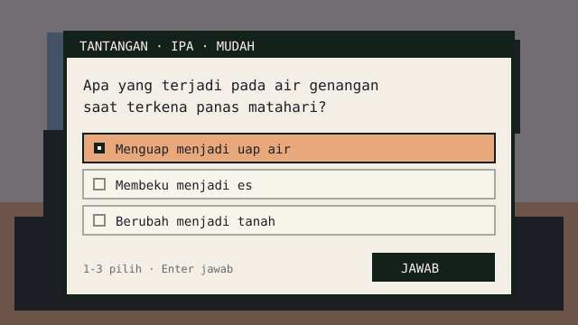

# Game Player (Halaman Siswa)

Halaman `/play/[storyId]` adalah tempat cerita dimainkan. Ia harus ringan,
cepat, dan tidak pernah menampilkan error mentah.

## Struktur halaman

```text
src/app/play/[storyId]/page.tsx        (Server Component)
  ├─ ambil cerita published
  ├─ notFound() bila tidak ada
  └─ <GameShell story={story} />       (Client Component)
        ├─ <TitleScreen />             (DOM, sebelum Mulai)
        ├─ <GameCanvas />              (Phaser, dynamic import, setelah Mulai)
        ├─ <ChallengeOverlay />        (DOM)
        ├─ <QuestTracker />            (DOM)
        ├─ <NpcHintLayer />            (DOM: penanda `!` + kotak `Space`)
        ├─ <ChapterCard />             (DOM, transisi)
        ├─ <QuestToast />              (DOM, transisi)
        ├─ <HUD />                     (DOM)
        ├─ <PauseMenu />               (DOM)
        └─ <ResultScreen />            (DOM, saat selesai)
```

Server Component **tidak** merender Phaser. Ia hanya mengambil data dan
menyerahkan JSON ke client.

> **Yang ada hari ini:** `TitleScreen`, `GameShell`, `GameCanvas`,
> `ChallengeOverlay`, `QuestTracker`, `NpcHintLayer` (berisi `NpcMarker` dan
> `InteractHint`), `ChapterCard`, `QuestToast`, `HUD`, `PauseMenu`, dan
> `ResultScreen` sudah ada.
>
> `/play/[storyId]` membaca cerita terbit lewat `getPlayableStory()`
> (`src/server/stories/playable.ts`). Hanya `status = 'published'` dengan
> `published_version` yang dilayani; status lain, id tidak dikenal, dan id
> tidak valid → 404. Id demo `st_demo_siklus_air` tetap memakai fixture
> `src/game/demoStory.ts` supaya pengembangan frontend tidak butuh database.
> Progres `localStorage` dan layar "Lanjutkan" **belum** ada.

## Pengambilan data

```tsx
export default async function PlayPage(props: PageProps<"/play/[storyId]">) {
  const { storyId } = await props.params;
  const story = await getPlayableStory(storyId);
  if (story === null) notFound();

  return <GameShell story={story} />;
}
```

Aturan:

- Hanya versi `published` yang boleh diambil.
- Jangan mengembalikan `draft` ke siswa, walaupun tahu `storyId`.
- `generateMetadata` memakai judul cerita.
- Respons `GET /api/stories/[storyId]` memakai `Cache-Control: no-store`.
- Status 404 asli dibuat oleh `src/proxy.ts`, bukan oleh halaman. Dengan Cache
  Components + Partial Prefetching, `/play/[storyId]` adalah route `◐`: App
  Shell terkirim lebih dulu (status 200), lalu `notFound()` berjalan — hasilnya
  soft 404 (`200` + UI 404 + `noindex`). Proxy memeriksa `getPlayableStory()`
  **sebelum** halaman dirender dan menulis ulang ke `/_not-found`, sehingga
  checker/analytics melihat `404`.
- `export const instant = false` di halaman menandai route ini boleh memblokir
  saat menunggu baca database. Ini hanya mematikan validasi instant-navigation,
  bukan model render.

## State di client

```ts
type GameShellState =
  | { phase: "judul" }
  | { phase: "loading" }
  | { phase: "ready" }
  | { phase: "playing"; chapterIndex: number; sceneIndex: number }
  | { phase: "paused" }
  | { phase: "finished"; result: PlayResult }
  | { phase: "error"; code: string };
```

Ini **state layar**, bukan state cerita. Soal yang sedang terbuka dilacak oleh
`RunnerState.phase === "challenge"` di [`../04-game/engine.md`](../04-game/engine.md#alur-state);
`GameShell` hanya menampilkan overlay-nya. Pemetaan lengkap ada di
[`../04-game/interaction-loop.md`](../04-game/interaction-loop.md#dua-state-bukan-satu).

Implementasi sekarang memegang `judul | main | hasil` di `GameShell`, sedangkan
`paused` dipegang `GameCanvas` karena menu jeda hanya relevan selama sesi
permainan aktif. `QuestTracker` menerima daftar quest lewat event `quest` dari
Phaser, diturunkan dari scene dan status runner — bukan ditebak dari DOM.

State ini yang bertahan saat komponen di-remount oleh `<Activity>` (lihat
[`../04-game/engine.md`](../04-game/engine.md)). Sumber kebenaran progres:
`localStorage`, bukan Phaser.

## Layar

### Loading

- Latar gelap sesuai palet game.
- Canvas menampilkan teks progres `Memuat… N%` selama aset cerita dimuat;
  layar loading DOM dengan judul cerita belum dibuat.
- Tombol "Batal" kembali ke halaman awal.

### Ready / judul

- Layar penuh dengan latar `bg_mountain_night` dan sprite pemain dari `cast`.
- Judul, synopsis singkat, mata pelajaran, kelas, jumlah chapter, perkiraan
  durasi.
- Tombol "Mulai", "Kontrol", dan "Kembali". Panah atas/bawah memindahkan
  fokus, Enter menjalankan pilihan.
- Phaser **baru** dipasang setelah "Mulai" ditekan; sebelum itu tidak ada
  kanvas yang berjalan di latar belakang.
- Tombol "Lanjutkan" (bila ada progres valid) belum ditampilkan karena progres
  `localStorage` belum ada.

### Playing

- Kanvas diskalakan lewat `ukuranKanvas()` (`Scale.NONE` + `zoom`): kanvas selalu
  tampil utuh (tidak pernah ter-crop). Skala **bulat** dipakai saat sisa ruang
  kontainer ≤6% (pixel paling tajam); selain itu skala **penuh** supaya kanvas
  mengisi bingkai — di jendela laptop 1366×660 dulu hanya dapat 960×360. Halaman
  memberi margin 8–24 px dan sudut membulat, jadi sisa ruang terbaca sebagai
  bingkai jendela, bukan kanvas yang menempel ke tepi.
- Tombol buku quest di kiri atas (`Q` Quest): membuka jendela buku catatan ala Minecraft journal dengan 2 halaman perkamen yang menampilkan bab, judul scene, daftar tugas dengan status `Aktif`/`Selesai`/`Terkunci`, dan hitungan tantangan. Dapat dibuka/tutup dengan tombol `Q` atau `Esc`.
- HUD kanan atas: tombol jeda dan tombol suara. Semua tombol HUD dan quest
  menampilkan tombol keyboardnya sebagai keycap konsisten (`Tab`, `B`, `Q`,
  `Esc`) lewat komponen `Keycap`. Judul chapter tidak menetap di
  HUD; ia muncul sebentar sebagai `ChapterCard` saat bab berganti, dan
  `QuestToast` memberi tahu saat quest baru dimulai.
- **Pergantian bab berjalan otomatis.** Setelah beat terakhir sebuah bab selesai,
  GameScene membuka bab berikutnya sendiri (jeda singkat, lalu `ChapterCard`
  menandai bab baru). Pemain tidak perlu menekan tombol untuk lanjut; menekan
  Space/Enter hanya mempercepat. Cerita yang sudah bab terakhir langsung masuk
  ke `ResultScreen` lewat jalur yang sama.
- **Papan nama** muncul di atas kepala **semua** NPC yang terlihat (dari
  `cast.name`), rapat di atas sprite, supaya siswa mengenali siapa saja di desa.
  NPC pemberi quest ditandai **kotak `!`** bergaya HUD di atas papan namanya; UI
  kotak ini sama persis di dua keadaan supaya konsisten. Saat pemain dekat, kotak
  hanya naik-turun ringan. Saat NPC di luar pandangan, kotak menjadi **beacon** di
  tepi layar dengan cincin denyut dan penunjuk kecil di atas kotak yang berputar
  mengikuti arah NPC. Beacon tetap dekat tepi bingkai game, tetapi penunjuk arah
  dan cincin denyutnya utuh di semua sisi — jarak aman (`INSET_PENANDA` 24 px)
  selalu lebih besar dari jangkauan penunjuk, jadi tidak ada bagian yang
  terpotong tepi kanvas. Beacon juga tembus klik, jadi tidak ada tombol HUD yang
  tertutup. Beacon ikut bergeser saat pemain berjalan mendekat, lalu berubah
  kembali menjadi kotak `!` ketika NPC masuk layar. Kotak `!` **tidak** hilang
  saat pemain mendekat: kotak `Space` bergaya sama dengan `!` duduk rapat di
  kanannya, jadi keduanya terbaca sebagai satu widget; pemberi quest
  meluncurkan kotak itu dari `!` (`animate-quest-slide-in`). NPC obrolan singkat
  tidak punya penanda, jadi kotak `Space`-nya muncul halus seperti pop-up
  (`animate-quest-pop`), bukan meluncur ke kanan. Zona interaksi memakai
  histeresis (masuk 30 px, keluar 38 px) supaya kotak tidak berkedip di batas
  zona. Posisi papan nama, penanda, dan kotak `Space` diperbarui tiap frame lewat
  `NpcHintLayer`, jadi tanda tetap menempel pada NPC saat kamera bergeser, dan
  disembunyikan selama dialog, tantangan, atau menu jeda.
- Tombol `Percepat` (`Tab`) tampil di HUD hanya selama fase dialog, dengan
  petunjuk "Tahan untuk mempercepat" di atas panel dialog. Pola tahan-tombol
  ala Persona 3 Reload: selama ditahan, beat dialog/narasi maju seperti
  time-lapse dan garis kecepatan menyala di tepi atas/bawah kanvas
  (`SpeedLines`); dilepas, tempo kembali normal. Soal tidak bisa dilewati —
  tombol dan pintasan berhenti di beat tantangan, dan fade transisi tetap
  diputar.
- Tombol `Catatan` (`B`) membuka buku catatan dua halaman: riwayat dialog
  (dikelompokkan per scene, dengan chip nama pembicara) dan jurnal konsep
  (conceptTag, status benar/perlu diulang, penjelasan). Dunia dibekukan
  selama buku terbuka; musik tetap diputar penuh. Buku dibersihkan saat
  "Ulangi chapter" atau sesi baru.
- Tombol musik (`♪`) mengatur volume musik saja: nyala/mati. Efek suara
  diatur terpisah di panel pengaturan menu jeda; keduanya dipisah supaya
  siswa bisa mematikan musik tanpa kehilangan umpan balik jawaban. Preferensi
  tersimpan di `localStorage` (`classquest:settings:v1`) dan dikirim ke scene
  lewat command `set_audio`. Musik mulai setelah "Mulai" ditekan (aturan
  autoplay browser), lalu berganti hanya saat `musicId` scene berubah.
- Klik di mana saja untuk lanjut.

### Challenge



- Teks soal/pertanyaan ditampilkan langsung di dalam `DialogueBox` NPC, bukan elemen tambahan di atasnya.
- Yang melayang di atas dialog HANYA pilihan jawabannya:
  - Opsi pendek (seperti "1", "2", "4"): ditata 1 baris horizontal di kanan atas dialog.
  - Opsi teks panjang: ditata bertumpuk vertikal di kanan atas dialog; lebar seluruh box seragam mengikuti opsi terpanjang.
  - Persoalan matematika / matriks: ditata sebagai kartu berjejer agar formula terlihat jelas.
- Konsistensi visual HCI dengan DialogueBox:
  - Gaya box jawaban dan kartu umpan balik setelah dijawab persis seperti DialogueBox (`bg-[#14201a]/95` dengan `border-2 border-[#F7F4EC]`), flat tanpa drop shadow.
  - Setelah dijawab (`graded`), pilihan box jawaban disembunyikan dan hanya kartu umpan balik yang muncul agar tidak memicu scrollbar.
  - Ukuran huruf dan line-height opsi dan penjelasan umpan balik proporsional dan nyaman dibaca (`ukuranHuruf(13.5, 12, 20)` & `lineHeight: 1.3`).
  - Segitiga kursor penunjuk `▶` berada di **luar box jawaban, di sebelah kirinya**, dan saat aktif diwarnai gelap/hitam (`#0b120e`) agar terlihat jelas dan kontras terhadap pemandangan dunia game.
  - Tombol aksi `Jawab` disejajarkan sempurna dengan kotak jawaban di atasnya.
  - Teks petunjuk tombol shortcut (`hints`) diberi latar gelap (`bg-[#0b120e]`) dengan font putih (`#F7F4EC`) untuk keterbacaan tinggi.
- Segitiga lanjut dialog `▼` diposisikan di **sudut kanan bawah kotak dialog**.
- Tanpa background kotak pembungkus hitam luar (hanya baris pilihan yang memiliki latar), tanpa tombol jawab/lanjut terpisah. Memilih opsi langsung mengirim respon dialog, dan kartu umpan balik cerita dapat diklik atau ditekan Spasi/Enter untuk lanjut.
- Kontrol keyboard-first meminimalkan ketergantungan mouse/touchpad:
  - `multiple_choice` / `true_false`: angka `1`–`5` langsung memilih & mengirim, panah/WASD menggeser sorotan, `Enter`/`Spasi` memilih.
  - `ordering`: panah atas/bawah atau `W`/`S` memilih baris, panah kiri/kanan atau `A`/`D` menggeser posisi naik/turun, angka `1`–`N` loncat baris, `Enter` mengirim jawaban.
  - `short_answer`: input otomatis fokus saat muncul; `Enter` langsung mengirim jawaban.
- Isi soal digulir di dalam panel bila panjang; tombol aksi menempel di bawah.
- Di layar sangat pendek, panel memakai hampir seluruh tinggi ruang game dan
  boleh menutup dialog (fallback) supaya soal tetap terbaca.
- Fokus keyboard masuk ke panel saat muncul dan kembali ke area game saat
  ditutup.
- `Esc` tidak menutup overlay sebelum soal dijawab; lihat
  [`../04-game/accessibility.md`](../04-game/accessibility.md#keyboard).
- Keempat tipe soal punya UI jawaban sendiri:
  - `multiple_choice` / `true_false`: daftar opsi; angka `1`–`5` memilih,
    panah atas/bawah memindah sorotan, `Enter` mengirim.
  - `ordering`: tombol naik/turun per item (bukan drag), urutan awal diacak
    deterministik per `challengeId` agar tidak sama dengan urutan cerita.
  - `short_answer`: satu input teks; `Enter` atau tombol "Jawab" mengirim.
- Overlay hanya mengirim jawaban mentah. Trim, lowercase, dan pembuangan tanda
  baca akhir dilakukan `src/story/scoring.ts`, bukan di komponen.
- `hints` tampil sebagai catatan kecil bila ada; jawaban benar tidak pernah ikut
  ke `ChallengeView`.

### Paused

- Lanjut, ulangi chapter, pengaturan suara (slider Musik dan Efek suara
  terpisah + tombol mute per baris), keluar.
- Game di-pause (`scene.pause()`), input dialog berhenti.
- Musik tidak dihentikan, hanya dikecilkan (volume 0,35 → 0,12) agar jeda tidak
  terasa memutus suasana; volume kembali saat lanjut atau ulangi chapter.
- Fokus masuk ke tombol "Lanjut" dan kembali ke tombol HUD saat menu ditutup.

### Finished

- Skor dan jumlah benar.
- Daftar `weakConcepts` dengan kalimat: "Coba ulang bagian ini: Kondensasi".
- Tombol "Main lagi" dan "Kembali ke awal".
- Tanpa ranking, tanpa perbandingan dengan siswa lain.
- Hasil disimpan lewat Server Action `savePlayResult` (`src/app/play/actions.ts`):
  `GameScene` mengirim event `finished` berisi `result` **dan** `answers`
  percobaan pertama, lalu `GameShell` mengirim `{ storyId, result: { answers } }`.
  Hanya jawaban yang dikirim — server menghitung ulang skor dari cerita terbit.
  Layar hasil tampil tanpa menunggu simpan; statusnya ditulis jujur di bawah
  ringkasan: "Menyimpan hasil main…", "Hasil main tersimpan.", atau
  "Hasil main belum tersimpan.".
- Cerita demo (`/game` dan `/play/st_demo_siklus_air`) dibaca tanpa database,
  jadi tidak punya baris `stories` untuk dirujuk `play_results`. Di sana action
  menjawab `not_found` dan status berbunyi "belum tersimpan" — bukan bug
  tampilan. Untuk menguji penyimpanan, mainkan cerita terbit lewat
  `/play/<storyId>`.

### Error

| Kode                 | Pesan ke siswa                                    |
| -------------------- | ------------------------------------------------- |
| `STORY_NOT_FOUND`    | "Cerita ini tidak ditemukan."                     |
| `SCHEMA_UNSUPPORTED` | "Cerita ini dibuat dengan versi yang lebih baru." |
| `UNKNOWN`            | "Terjadi masalah. Coba muat ulang halaman."       |

Aset yang gagal dimuat **bukan** layar error: game tetap berjalan dengan latar
default (`bg_default`) dan panel default (`ui_default`). Sprite karakter tidak
punya cadangan — sprite yang hilang tidak digambar. Lihat tabel penanganan error
di [`../04-game/interaction-loop.md`](../04-game/interaction-loop.md#penanganan-error-runtime).

## Responsif

| Layar             | Perilaku                                                     |
| ----------------- | ------------------------------------------------------------ |
| Desktop ≥ 1024 px | Kanvas mengisi bingkai (margin 24 px, sudut membulat)        |
| Tablet            | Sama — margin 16 px, dunia tetap utuh                        |
| HP landscape      | Kanvas mengisi bingkai, skala ±1×; HUD kecil                 |
| HP portrait       | Saran "Putar layar untuk pengalaman terbaik" (bisa dilewati) |

Halaman game memakai seluruh viewport dengan margin 8–24 px dan bingkai bersudut
membulat. Kanvas **selalu tampil utuh**: skala bulat dipakai bila sisa ruangnya
≤6%, selain itu kanvas dibesarkan penuh mengikuti bingkai supaya tidak muncul bar
gelap besar. Fullscreen API peramban tidak dipakai dan tidak dipaksa, jadi tidak
ada konten yang terpotong di layar apa pun.

## Berbagi

Guru membagikan:

- tautan `/play/[storyId]`,
- kode kelas (opsional, `TBD`).

Siswa tidak perlu akun. Nama panggilan opsional, disimpan lokal.

## Performa

| Target                         | Cara                                            |
| ------------------------------ | ----------------------------------------------- |
| First content < 2 s            | Shell HTML + skeleton; Phaser dimuat setelahnya |
| Aset hanya yang dipakai        | `assetUsage`                                    |
| Tidak ada layout shift         | Kanvas berukuran tetap mengikuti mode `ENVELOP` |
| Bundle Phaser tidak di landing | Dynamic import hanya di halaman game            |

Ukuran Phaser besar (~1 MB+). Jangan mengimpor Phaser di halaman guru atau
landing.

## Integrasi overlay

```tsx
<GameCanvas story={story} onEvent={handleGameEvent} />;

{
  beat.type === "challenge" && (
    <ChallengeOverlay
      challenge={findChallenge(story, beat.challengeId)}
      onResolve={(answer) => {
        const correct = isCorrect(challenge, answer);
        recordAnswer(challenge.id, correct);
        bridge.send({
          type: "resolve_challenge",
          challengeId: challenge.id,
          correct,
        });
      }}
    />
  );
}
```

`beat` berasal dari `currentBeat(runner, story)` — fungsi murni yang sama yang
dipakai Phaser untuk menampilkan dialog. Jadi overlay dan canvas tidak mungkin
menunjuk soal yang berbeda.

Aturan:

- `ChallengeOverlay` menerima `ChallengeView` tanpa jawaban benar.
- Penilaian di `GameShell`, bukan di overlay.
- Setelah resolve, overlay menampilkan penjelasan sebelum ditutup.

## Progres

- Simpan setelah setiap beat (throttle 500 ms).
- Kunci: `classquest:progress:{storyId}`.
- Saat mount, baca progres; kalau `storyVersion` beda → tawarkan mulai ulang.
- Saat selesai, kirim **jawaban** ke `savePlayResult` (server menghitung ulang
  skor); jangan mengirim field skor.

## Checklist implementasi

- [ ] Hanya cerita `published` yang bisa diakses.
- [ ] `notFound()` untuk id tidak dikenal.
- [ ] Phaser hanya dimuat di halaman game.
- [ ] Kanvas tampil utuh di bingkai halaman (margin 8–24 px, sudut membulat).
- [ ] Overlay tidak menerima jawaban benar.
- [ ] Progres bisa dipulihkan.
- [ ] Error aset tidak menghentikan permainan.
- [ ] Bisa dimainkan dengan keyboard.
- [ ] Tidak ada error `window is not defined` saat build.
