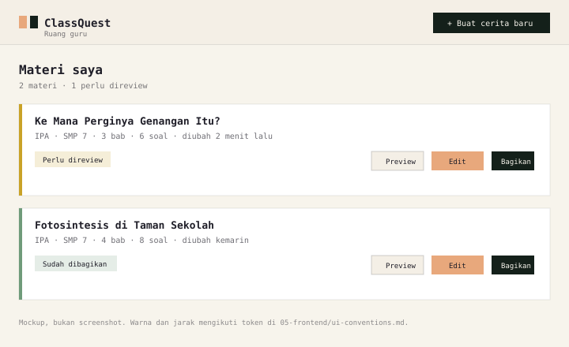

# Dashboard Guru

Dashboard adalah tempat guru mengubah PDF menjadi cerita. Ini permukaan produk
yang paling menentukan apakah ide ini terasa berguna atau merepotkan.

## Halaman

### `/guru/masuk` — akun guru

Satu-satunya halaman guru yang bisa dibuka tanpa sesi. Isinya: field
**username** dan **sandi** (dengan tombol tampilkan/sembunyikan), tombol
"MASUK KE PORTAL", dan pesan error yang tidak membocorkan apakah username-nya
tidak terdaftar atau sandinya salah (keduanya dijawab `401` dengan pesan yang
sama). Setelah berhasil, server menyetel cookie sesi lalu halaman redirect ke
`/guru`; sidebar dan sapaan dashboard memakai `displayName` dari sesi.

Panel kiri memakai bahasa visual portal dan landing: logo brand penuh, chip
`LOGICODIX 2026`, dan empat langkah alur. **Tidak ada statistik hiasan** (level,
XP, jumlah siswa) — hanya yang benar-benar ada di produk. Detailnya di
[`ui-conventions.md`](./ui-conventions.md#halaman-masuk-guru-gurumasuk).

Belum ada pendaftaran mandiri atau reset sandi. Akun dibuat/diganti lewat
`bun run db:seed` (lihat [`../08-workflow/setup.md`](../08-workflow/setup.md)).

### `/guru` — daftar materi

Isi:

- Tombol utama "Buat cerita baru".
- Daftar kartu materi: judul, mata pelajaran, jumlah chapter, status, waktu update.
- Aksi per kartu: buka, edit, preview, bagikan, hapus.
- Empty state yang menjelaskan alur dalam 3 langkah.

Status yang ditampilkan:

| Status       | Label             | Aksi tersedia                   |
| ------------ | ----------------- | ------------------------------- |
| `processing` | "Sedang dibuat…"  | Lihat progres                   |
| `draft`      | "Perlu direview"  | Edit, preview, bagikan, hapus   |
| `published`  | "Sudah dibagikan" | Edit (buat versi baru), bagikan |
| `failed`     | "Gagal dibuat"    | Lihat alasan, coba lagi, hapus  |
| `archived`   | "Diarsipkan"      | Pulihkan, hapus                 |

Lima status, sesuai enum di
[`../06-backend/persistence.md`](../06-backend/persistence.md#siklus-status).
Tidak ada `ready`: begitu guru selesai review, langkah berikutnya adalah
"bagikan", dan itu langsung memindahkan status ke `published`.



### `/guru/materi/baru` — upload

Form minimal:

| Field          | Wajib | Catatan                                                               |
| -------------- | ----- | --------------------------------------------------------------------- |
| File PDF       | Ya    | Drag & drop atau pilih file                                           |
| Judul          | Ya    | Default dari nama file, bisa diedit                                   |
| Mata pelajaran | Ya    | Teks bebas atau pilihan umum                                          |
| Jenjang/kelas  | Ya    | Mis. "SMP 7"                                                          |
| Bahasa         | Ya    | Default "id"                                                          |
| Mode permainan | Ya    | `menjelaskan`, `pertanyaan`, atau `mix`; **tanpa default** (ADR 0034) |
| Nada cerita    | Tidak | Default "hangat dan penasaran"                                        |

Mode permainan wajib dipilih. Form tidak bisa dikirim dan server menolak
permintaan tanpa mode yang sah (`400 INVALID_INPUT`), karena bentuk game
(cerita utuh, kuis padat, atau gabungan) menentukan isi yang dihasilkan. Tiap
pilihan disertai satu kalimat penjelas di bawah dropdown.

Aturan UX:

- Validasi file **sebelum** upload (tipe, ukuran), tapi server tetap memvalidasi.
- Tampilkan nama file + ukuran setelah dipilih.
- Tombol submit disabled sampai field wajib valid.
- Setelah submit, langsung pindah ke halaman status. Jangan menahan guru di form.

### `/guru/materi/[storyId]` — status dan ringkasan

Tiga keadaan:

**1. Sedang diproses**

- Progress per tahap: "Membaca PDF", "Menyusun kerangka", "Menulis cerita",
  "Memeriksa hasil".
- Estimasi kasar, bukan persentase palsu yang macet di 90%.
- Tombol "Boleh ditinggal" — job tetap berjalan.

**2. Selesai**

- Ringkasan: judul, jumlah chapter, jumlah tantangan, konsep yang tercakup.
- Peringatan `source.gaps` bila ada.
- Tombol: "Review cerita", "Preview", "Bagikan".
- Banner kuning bila memakai fallback.

**3. Gagal**

- Alasan dalam bahasa manusia.
- Langkah berikutnya: "Coba lagi", "Ganti PDF", "Kurangi halaman".
- Tidak menampilkan stack trace atau kode provider.

### `/guru/analitik` — poin dan kesalahan per siswa

Halaman ini menjawab satu pertanyaan: "setelah kelas memainkan game ini, siapa
sudah paham dan bagian mana yang masih salah?"

Alur: pilih **kelas** → pilih **game** → tabel siswa muncul. Kedua pilihan
disimpan di query string (`?kelas=<id>&storyId=<id>`), jadi tautannya bisa
dibagikan atau di-bookmark dan server yang menghitung agregatnya.

Isi:

- Empat kartu ringkasan: siswa bermain / total siswa, total percobaan,
  rata-rata poin terbaik, dan jumlah konsep yang perlu diulang.
- Tabel per siswa: nama (+ NIS), **poin terbaik**, percobaan terakhir, jumlah
  percobaan, chip konsep yang sering salah, dan tanggal main terakhir.
- Siswa yang **belum bermain tetap tampil** dengan poin 0 dan label
  "Belum main" — guru perlu melihat yang tertinggal, bukan hanya yang sudah
  mengerjakan.
- Tanpa ranking kompetitif dan tanpa perbandingan antar kelas; nadanya sama
  dengan layar hasil siswa.

Sumber data:

- Satu-satunya sumber adalah `play_results` yang sudah dihubungkan ke
  `classrooms`/`students` saat hasil disimpan. Tidak ada tabel analytics
  terpisah dan tidak ada perhitungan skor ulang di halaman.
- `getClassroomAnalytics()` (`src/server/analytics`) memfilter
  `classrooms.teacher_id` **dan** `stories.teacher_id`; kelas atau game milik
  guru lain dan yang tidak ada sama-sama `null`.
- Satu baris = satu `student_id`. Nama bebas dikelompokkan per nama
  (tanpa peduli huruf besar/kecil). Siswa yang sudah dihapus tetap tampil
  dengan nama salinan di `play_results`.
- Yang tersimpan hanya `weak_concepts`, bukan jawaban per opsi — halaman ini
  tidak mengarang detail jawaban yang tidak ada
  ([`../06-backend/persistence.md`](../06-backend/persistence.md#hasil-bermain)).

Hasil main baru masuk analytics bila siswa memakai tautan kelas dari dialog
"Bagikan" di `/guru/game` (`/play/[storyId]?kelas=QST-XXXX`). Hasil main tanpa
tautan kelas tetap tersimpan, tetapi tidak muncul di halaman ini.

## Komponen

| Komponen             | Tanggung jawab                                |
| -------------------- | --------------------------------------------- |
| `UploadForm`         | Input file + metadata + submit                |
| `GenerationProgress` | Polling status job, tampilan per tahap        |
| `StorySummaryCard`   | Ringkasan hasil + aksi                        |
| `StoryList`          | Daftar materi + status                        |
| `ShareGameDialog`    | Tautan per kelas (`?kelas=`) + tombol salin   |
| `DeleteStoryDialog`  | Konfirmasi hapus (ketik judul bila published) |
| `ClassesBrowser`     | Daftar kelas, detail kelas, modal buat kelas  |
| `CreateClassModal`   | Form kelas baru (nama, mapel, jenjang, tahun) |
| `AddStudentModal`    | Form tambah siswa (nama, NIS opsional)        |
| `AnalyticsBrowser`   | Penyaring kelas/game + tabel poin & kesalahan |

## Alur status generasi

```text
Upload berhasil
   ↓
redirect ke /guru/materi/[storyId]
   ↓
komponen client polling GET /api/jobs/[jobId] setiap 1.5 s
   ↓
stage berubah → UI berubah
   ↓
stage "done" → router.refresh() → tampilkan ringkasan
stage "failed" → tampilkan alasan
```

Aturan polling:

- Saat `done`/`failed`: panggil `router.refresh()` **sekali**, lalu terus periksa
  sampai halaman berhenti merender kartu progres (ringkasan tampil) atau batas
  waktu habis. Refresh bisa tiba sebelum halaman melihat status cerita yang baru,
  jadi berhenti tepat di `done` membuat kartu berhenti di langkah terakhir
  walaupun cerita sudah tersimpan.
- Hentikan saat tab tidak aktif; lanjutkan saat aktif.
- Batas waktu total 3 menit, lalu tampilkan "masih diproses, cek lagi nanti".
- Jangan polling lebih cepat dari 1 detik.

## Pesan error yang baik

| Situasi               | Jangan              | Pakai                                                                                                   |
| --------------------- | ------------------- | ------------------------------------------------------------------------------------------------------- |
| Bukan PDF             | "Invalid mime type" | "File ini bukan PDF. Pilih file .pdf ya."                                                               |
| Terlalu besar         | "413"               | "PDF-nya 4,5 MB, batasnya 4 MB. Coba kompres dulu."                                                     |
| PDF scan              | "NO_TEXT_LAYER"     | "PDF ini sepertinya hasil scan, jadi teksnya tidak bisa dibaca. Pakai PDF yang teksnya bisa diseleksi." |
| AI gagal              | "AI_TIMEOUT"        | "Pembuatan cerita memakan waktu terlalu lama. Coba lagi."                                               |
| Materi terlalu pendek | "400"               | "Materinya masih sangat sedikit. Tambahkan beberapa halaman agar ceritanya cukup."                      |

## Aksesibilitas

- Semua field punya `<label>`.
- Error field dihubungkan dengan `aria-describedby`.
- Drag & drop bukan satu-satunya cara memilih file.
- Progress dilaporkan lewat `role="status"` / `aria-live="polite"`.
- Tombol punya teks, bukan hanya ikon.

## Yang tidak ada di MVP

- Pencarian dan filter lanjutan.
- Folder/kelas.
- Kolaborasi antar guru.
- Statistik per siswa.
- Duplikasi cerita.

Catatan untuk "folder/kelas": kelas **sudah ada** sebagai halaman
(`/guru/kelas` + tabel `classrooms`/`students`), tetapi belum dipakai untuk
mengelompokkan materi atau menugaskan game. Yang tetap di luar MVP adalah
folder materi dan statistik/progres per siswa.

## Checklist implementasi

- [x] Upload memvalidasi tipe dan ukuran di client dan server.
- [x] Guru langsung diarahkan ke halaman status.
- [x] Progress per tahap, bukan spinner kosong.
- [x] Polling berhenti dengan benar.
- [x] Error dalam bahasa manusia.
- [x] Empty state menjelaskan alur.
- [x] Tombol hapus punya konfirmasi.
- [x] `requireTeacher()` di semua aksi.

Catatan status: upload, halaman status, polling, aksi cerita, dan empty state
sudah tersambung (`src/app/guru/(portal)/`). Yang belum ada adalah **editor
cerita**, **preview versi draft**, dan `ShareDialog` dengan kode kelas — lihat
tabel status di [`routes.md`](./routes.md#status-implementasi-portal-guru).
