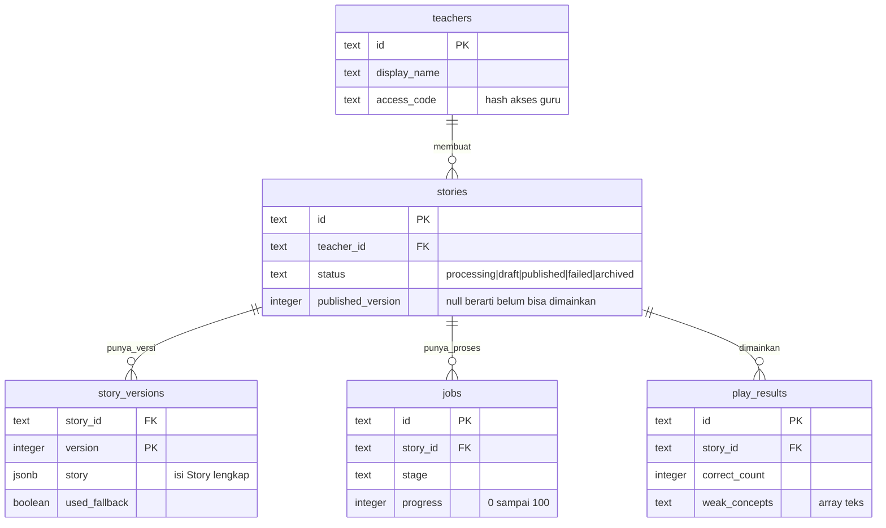
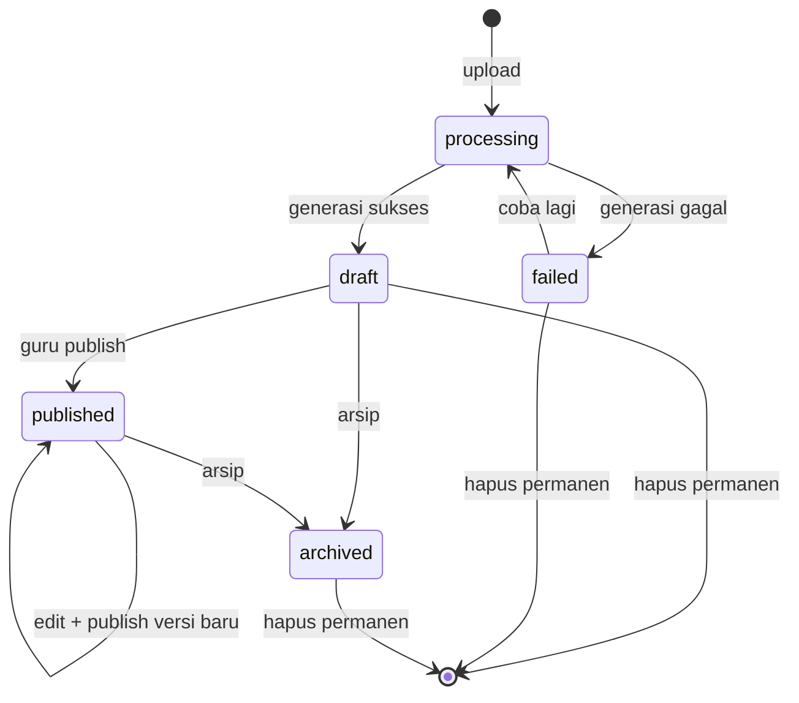

# Persistence dan Storage

> **Status: belum diputuskan.** Keputusan dicatat di
> [ADR 0005](../09-decisions/0005-persistence-and-storage.md). Dokumen ini
> menetapkan **kebutuhan** dan **skema target**, bukan vendor.

## Kebutuhan

| Kebutuhan                    | Catatan                              |
| ---------------------------- | ------------------------------------ |
| Simpan cerita + versi        | Cerita bisa besar (JSON 50–300 KB)   |
| Simpan PDF                   | File 1–20 MB, tidak boleh publik     |
| Query daftar materi per guru | Butuh index sederhana                |
| Status job                   | Sering di-update, dibaca via polling |
| Hasil main (opsional)        | Volume kecil di MVP                  |
| Konsistensi versi            | Publish harus atomik                 |
| Biaya rendah                 | Hackathon                            |

## Opsi

| Opsi                              | Kelebihan                                      | Kekurangan                                           |
| --------------------------------- | ---------------------------------------------- | ---------------------------------------------------- |
| **Supabase (Postgres + Storage)** | DB + file storage + auth dalam satu, free tier | Vendor lock-in ringan, cold start                    |
| **Neon/Vercel Postgres + S3/R2**  | Postgres standar, storage murah                | Dua layanan untuk dikonfigurasi                      |
| **SQLite + Prisma (lokal/VPS)**   | Paling sederhana, cepat, tanpa jaringan        | Tidak cocok untuk serverless multi-instance          |
| **File JSON di disk**             | Nol setup                                      | Tidak aman, tidak konkuren, jangan untuk demo publik |

**Rekomendasi awal:** Supabase, karena satu layanan menutup DB + storage dan
cukup untuk demo. Tetap perlu ADR sebelum dipakai.

## Skema target

Nama tabel dan kolom ini yang dipakai kode, apa pun vendornya.



Dua hal yang paling mudah salah dibaca dari gambar itu:

- **`stories.status` dan `published_version` yang menentukan boleh dimainkan atau
  tidak.** Status tidak pernah disimpan di dalam JSON cerita.
- **`story_versions` tidak pernah ditimpa.** Setiap simpan menambah baris baru.

Diagram di atas versi ringkas. SQL di bawah yang mengikat; kalau keduanya
berbeda, SQL yang menang dan diagram harus diperbaiki.

```sql
-- Guru (minimal; auth bisa disederhanakan di MVP)
create table teachers (
  id           text primary key,
  display_name text not null,
  access_code  text,              -- hash, bukan plaintext
  created_at   timestamptz not null default now()
);

-- Cerita: satu baris per materi
create table stories (
  id                 text primary key,          -- st_xxx
  teacher_id         text not null references teachers(id),
  title              text not null,
  subject            text not null,
  grade_level        text not null,
  language           text not null,
  status             text not null,             -- processing|draft|published|failed|archived
  published_version  integer,
  source_file_name   text not null,
  source_file_path   text not null,             -- path di storage, bukan URL publik
  source_page_count  integer,
  created_at         timestamptz not null default now(),
  updated_at         timestamptz not null default now()
);

create index stories_teacher_idx on stories (teacher_id, updated_at desc);
create index stories_status_idx on stories (status);

-- Versi cerita: setiap simpan = baris baru
create table story_versions (
  story_id     text not null references stories(id) on delete cascade,
  version      integer not null,
  story        jsonb not null,                  -- Story lengkap
  created_by   text not null,
  created_at   timestamptz not null default now(),
  prompt_version text,
  used_fallback  boolean not null default false,
  primary key (story_id, version)
);

-- Job generasi
create table jobs (
  id           text primary key,                -- job_xxx
  story_id     text not null references stories(id) on delete cascade,
  stage        text not null,
  progress     integer not null default 0,
  message      text,
  error_code   text,
  started_at   timestamptz not null default now(),
  finished_at  timestamptz,
  log          jsonb                            -- GenerationLog
);

create index jobs_story_idx on jobs (story_id, started_at desc);

-- Hasil main (opsional di MVP)
create table play_results (
  id             text primary key,
  story_id       text not null references stories(id) on delete cascade,
  story_version  integer not null,
  nickname       text,                          -- opsional, tanpa identitas asli
  correct_count  integer not null,
  total_count    integer not null,
  earned_points  integer not null,
  weak_concepts  text[] not null default '{}',
  created_at     timestamptz not null default now()
);

create index play_results_story_idx on play_results (story_id, created_at desc);
```

### Catatan desain

- **`story` disimpan sebagai JSONB**, bukan tabel ternormalisasi. Alasannya:
  schema cerita masih berubah, dan seluruh cerita selalu dibaca utuh. Jangan
  mencoba query ke dalam JSON di MVP.
- **`stories` dan `story_versions` dipisah** agar publish tidak menghapus riwayat
  dan agar siswa tetap di versi lama saat guru mengedit.
- **`status` dan `published_version`** adalah satu-satunya sumber kebenaran
  "boleh dimainkan". Jangan menaruh status di dalam JSON cerita.
- **`source_file_path`** bukan URL. Signed URL dibuat saat dibutuhkan.
- **Jangan menyimpan jawaban siswa per opsi** di MVP. Cukup agregat.

## Storage

| Bucket/prefix          | Isi       | Akses                           |
| ---------------------- | --------- | ------------------------------- |
| `materials/{storyId}/` | PDF asli  | Privat; hanya server            |
| `public/assets/`       | Aset game | Publik, di repo (bukan storage) |

Aturan:

- Jangan pernah membuat bucket PDF publik.
- Nama file di storage memakai id internal, bukan nama asli.
- Hapus file saat cerita dihapus permanen (atau jadwalkan pembersihan).

## Siklus status



Lima status, tidak lebih: `processing`, `draft`, `published`, `failed`, `archived`.

Aturan transisi:

- `published` tanpa `published_version` = bug.
- `archived` tidak bisa dimainkan.
- `processing` tidak bisa dipublish.
- Hapus permanen hanya untuk `draft`/`failed`/`archived`, dengan konfirmasi.

### Kenapa tidak ada `ready`

Dokumen lama sempat punya status `ready` ("siap dibagikan"). Itu dihapus dengan
sengaja, bukan karena lupa:

- **Tidak ada aksi yang menaikkannya.** Server Action yang ada hanya
  `saveStoryDraft`, `publishStory`, `archiveStory`, `deleteStory`. Tidak ada
  `markReady`.
- **Artinya sudah dicakup `published`.** "Siap dibagikan" dan "sudah dibagikan"
  dibedakan oleh tautan yang dibagikan, bukan oleh status record.
- **Setiap status tambahan harus punya transisi, aksi UI, dan tes.** Tiga hal itu
  tidak ada untuk `ready`, jadi yang jujur adalah membuangnya.

Kalau nanti benar-benar butuh memisahkan "sudah direview guru" dari "baru dari
AI", tambahkan sebagai kolom terpisah (mis. `reviewed_at`), bukan status baru.

## Konkurensi dan versi

- Setiap simpan mengirim `baseVersion`. Server menolak bila `baseVersion` ≠ versi
  terbaru, dan mengembalikan `{ conflict: true, latestVersion }`.
- `version` dinaikkan di dalam transaksi: `insert into story_versions ... select max(version)+1`.
- Publish menetapkan `published_version` dalam transaksi yang sama dengan
  pengecekan validasi.

## Migrasi

- Migrasi disimpan di `supabase/migrations/` atau `drizzle/` (tergantung pilihan).
- Setiap migrasi harus bisa dijalankan dari database kosong.
- Jangan mengubah migrasi yang sudah dijalankan; buat migrasi baru.
- Skema dokumen ini dan migrasi harus sinkron di PR yang sama.

## Auth (TBD)

MVP cukup:

- Satu kode akses guru dari env (`TEACHER_ACCESS_CODE`), dibandingkan dengan
  perbandingan waktu-tetap setelah di-hash.
- Setelah berhasil, server menerbitkan cookie `httpOnly` berisi token bertanda
  tangan HMAC-SHA256 dengan `TEACHER_SESSION_SECRET`; masa berlaku 8 jam.
- `requireTeacher()` memverifikasi tanda tangan dan masa berlaku token, lalu
  mengembalikan identitas guru dari baris `teachers` tetap (`teacher_demo`).
- Tidak ada pendaftaran, reset password, atau multi-guru. Kolom `access_code`
  dibiarkan kosong karena kode mentah tidak boleh disimpan.

Jangan mengklaim ini aman untuk produksi. Untuk produksi, gunakan penyedia auth
nyata dan tabel `teachers` di atas.

## Checklist sebelum memilih vendor

- [ ] Bisa menyimpan JSON 300 KB tanpa masalah.
- [ ] Bisa menyimpan file 20 MB secara privat.
- [ ] Ada free tier yang cukup untuk demo.
- [ ] Bisa diakses dari Node runtime Next.js (bukan Edge).
- [ ] Mendukung transaksi untuk publish.
- [ ] Ada cara backup/export.
- [ ] Kredensial hanya di server.
- [ ] Keputusan dicatat di ADR 0005.
