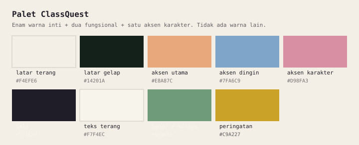

# Panduan Aset

Aset disiapkan **di awal** dan bersifat tetap. Ini keputusan inti produk: dengan
aset terbatas, AI hanya menyusun cerita, hasilnya konsisten dan bisa dibangun
dalam waktu hackathon.

- Keputusan: [ADR 0003](../09-decisions/0003-fixed-asset-library.md)
- Manifest: [`../02-data-model/asset-manifest.md`](../02-data-model/asset-manifest.md)
- Daftar aset: [`inventory.md`](./inventory.md)
- Dunia desa dan urutan gambarnya:
  [`../04-game/world-design.md`](../04-game/world-design.md)

## Dua jalur aset

Aset di `public/assets/` datang dari dua jalur yang tidak saling menimpa:

1. **Generator repo** — `bun run assets:generate`. Membuat aset generik: latar
   default 640×360, panel UI, dan empat efek suara. Gambar digambar tanpa
   dependensi di `scripts/lib/`.
2. **Impor dunia desa** — `bun run assets:world` (`scripts/import-world.mjs`).
   Menyalin peta, potongan objek, dan lagu dari paket aset proyek di luar repo,
   lalu membangkitkan `src/assets/worldAssets.ts` dan
   `src/game/world/village.json`.
3. **Impor karakter beranimasi** — `bun run assets:characters`
   (`scripts/import-characters.mjs`). Menyusun spritesheet 8 arah dari folder
   karakter (idle pemain + NPC, plus walk pemain), lalu membangkitkan
   `src/assets/characterFrames.ts`.
4. **Impor potret berekspresi** — `bun run assets:portraits`
   (`scripts/import-portraits.mjs`). Menyusun enam potret dialog per karakter ke
   `public/assets/portrait/<nama>/<ekspresi>.png` dan membersihkan potret
   tunggal lama.

Angka di bagian berikut adalah spesifikasi yang **berlaku sekarang**, disalin
dari [`../04-game/world-design.md#satuan-dasar`](../04-game/world-design.md#satuan-dasar).

## Spesifikasi

### Background

| Properti     | Nilai                                                   |
| ------------ | ------------------------------------------------------- |
| Resolusi     | **640×360** (16:9, ADR 0009)                            |
| Format       | PNG, indexed/24-bit                                     |
| Transparansi | Tidak perlu                                             |
| Gaya         | Pixel art, tanpa anti-aliasing                          |
| Ukuran file  | ≤ 80 KB per gambar                                      |
| Area aman    | 90 px bawah untuk textbox (jangan taruh detail penting) |

Background (`bg_default`) hanya dipakai **layar judul dan layar hasil**. Di dalam
permainan, latar yang terlihat adalah peta desa (kind `world`), bukan background.

### Dunia desa (kind `world`)

| Properti       | Nilai                                                            |
| -------------- | ---------------------------------------------------------------- |
| Peta           | JPEG, 2390×1792 px (`world_map_village`)                         |
| Potongan objek | PNG transparan, 80 berkas di `public/assets/world/`              |
| Skala objek    | Ditentukan data editor (`w`/`h` di `village.json`), bukan berkas |
| Anchor objek   | Kiri-atas                                                        |
| Urutan gambar  | `depth` dari editor (`round(y + dy*h)`), disalin apa adanya      |

Peta **hanya seni**: collider, spawn, dan posisi NPC berasal dari sel collision
dan data editor yang sama (`village.json`), bukan dari gambar. Menggeser objek di
editor lalu impor ulang berarti menggeser gambar dan collider sekaligus.

### Sprite karakter

| Properti     | Nilai                                                                      |
| ------------ | -------------------------------------------------------------------------- |
| Format       | PNG spritesheet berpetak: **8 baris** arah × (idle [+ walk]) kolom         |
| Urutan baris | selatan, tenggara, timur, timur laut, utara, barat laut, barat, barat daya |
| Urutan kolom | frame idle lebih dulu, lalu frame walk (pemain saja)                       |
| Ukuran frame | dipotong ke kotak karakter; ±33–52 px lebar × 61–66 px tinggi per karakter |
| Anchor       | Kaki di tengah bawah                                                       |
| Skala        | Tinggi diseragamkan ke 56 px di peta (`TINGGI_KARAKTER`)                   |
| Animasi      | Idle selalu berputar; pemain menambah walk saat bergerak                   |

Contoh: `char_mc` berframe 38×66 dengan 4 frame idle + 8 frame walk; NPC hanya
punya 4–8 frame idle. `frameWidth`/`frameHeight` disimpan per karakter di
manifest (dari `src/assets/characterFrames.ts`), karena ukurannya tidak seragam.

### Potret

| Properti   | Nilai                                                       |
| ---------- | ----------------------------------------------------------- |
| Resolusi   | **456×360 px**, kanvas dan rasio sama untuk semua karakter  |
| Format     | PNG dengan latar transparan, satu berkas per ekspresi       |
| Ekspresi   | `neutral`, `happy`, `sad`, `angry`, `shocked`, `thinking`   |
| Lokasi     | `public/assets/portrait/<nama>/<ekspresi>.png`              |
| Pemakaian  | Dialog, obrolan singkat NPC, layar judul, halaman pemasaran |
| Asal impor | `bun run assets:portraits` (`scripts/import-portraits.mjs`) |

Nama folder mengikuti berkas sumber (`mc`, `npc_1`, …), bukan id manifest.
Manifest karakter memetakan keenamnya lewat `portraits`, dan **semua ekspresi
wajib ada** untuk setiap karakter. Potret tidak memakai bingkai: `DialogueBox`
menggambarnya di atas panel dialog dengan dasar menempel tepi atas panel, jadi
tidak ada bagian potret yang tertutup kotak (ADR 0017). Importer menormalkan
**tinggi kepala**, bukan tinggi gambar, lalu menyusun semua potret ke kanvas
456×360 yang identik — wajah tiap karakter tampil sebesar yang sama dan
rasionya sama. Seluruh potret satu karakter digeser dengan **satu nilai tetap**
lalu dipotong sedikit di sisi luarnya, jadi karakternya mentok sejajar sisi
kotak dialog dan tidak melompat sama sekali saat ekspresi berganti. Karakter
berbadan pendek dinaikkan skalanya sedikit supaya isinya menyentuh tepi bawah
kanvas, dan tepi bawah yang memudar dipadatkan jadi potongan rata, jadi potret
tidak tampak melayang di atas kotak. Slot potret di DOM masuk 14 px dari sisi
panel (sebesar radius sudutnya), sehingga bahu karakter tidak terpotong
lengkungan sudut. MC
dicerminkan di DOM sehingga rata kiri kanvas menjadi rata kanan slotnya. Berkas
disimpan dengan filter PNG adaptif (±8 MB untuk 60 berkas) supaya cepat dimuat.
Karena potret dirender DOM, berkasnya tidak dimuat `PreloadScene`.

### Musik

| Properti    | Nilai                              |
| ----------- | ---------------------------------- |
| Format      | **MP3** (satu lagu: `bgm_default`) |
| Pemakaian   | Diputar di seluruh permainan, loop |
| Ukuran file | ≈ 4 MB                             |
| Lokasi      | `public/assets/music/default.mp3`  |

Chapter **tidak** berganti lagu: seluruh cerita memakai satu musik.

### SFX

| Properti | Nilai                                   |
| -------- | --------------------------------------- |
| Format   | OGG atau WAV                            |
| Durasi   | ≤ 1 detik                               |
| Ukuran   | ≤ 30 KB                                 |
| Loudness | Konsisten, tidak lebih keras dari musik |

### UI

| Properti       | Nilai                                            |
| -------------- | ------------------------------------------------ |
| Textbox        | 608×104 px (panel malam, border 3 px)            |
| Bingkai potret | `ui_portrait_frame` 72×72 px, tidak dipakai lagi |
| Panel default  | `ui_default`, cadangan bila panel khusus absen   |
| Format         | PNG dengan transparansi                          |

Sejak ADR 0017 potret tidak memakai bingkai, jadi `ui_portrait_frame` hanya
tersimpan sebagai aset lama di manifest.

## Aturan pixel art

1. **Satu grid.** Gambar generator digambar pada grid 1 px dari resolusi
   640×360. Jangan mengecilkan gambar besar.
2. **Tanpa anti-aliasing.** Tidak ada blur, gradient halus, atau bayangan lembut.
3. **Palet terbatas untuk aset generator.** Maksimal 9 warna per gambar (6 inti +
   2 fungsional + 1 aksen karakter), diambil dari palet proyek
   ([`../04-game/game-design.md`](../04-game/game-design.md)). Aset dunia desa
   buatan tim dengan alat AI generatif **tidak** terikat batas ini; paletnya
   milik gambar itu sendiri.
4. **Konsisten.** Karakter yang sama harus punya proporsi dan outline sama di
   semua pose. Semua karakter desa tampil setinggi 56 px di peta, apa pun ukuran
   frame aslinya.

## Palet



| Nama          | Hex       | Peran                    |
| ------------- | --------- | ------------------------ |
| Latar terang  | `#F4EFE6` | inti                     |
| Latar gelap   | `#14201A` | inti                     |
| Aksen utama   | `#E8A87C` | inti                     |
| Aksen dingin  | `#7FA6C9` | inti                     |
| Teks          | `#1F1E28` | inti                     |
| Teks terang   | `#F7F4EC` | inti                     |
| Hijau lembut  | `#6F9B7A` | fungsional: benar/sukses |
| Kuning lembut | `#C9A227` | fungsional: peringatan   |
| Rosa lembut   | `#D98FA3` | aksen karakter           |

Warna di luar palet harus ditambahkan ke dokumen ini dulu — kecuali untuk aset
dunia desa yang sudah final.

## Struktur folder

```text
public/assets/
├── bg/          # background layar judul/hasil
├── char/        # spritesheet karakter desa
├── portrait/    # potret 64×64
├── world/       # peta desa + 80 potongan objek
├── music/
├── sfx/
└── ui/
```

Nama file: `snake_case` tanpa prefix (`default.png`, `house_red.png`), karena
prefix ada di `id` manifest (`bg_default`, `world_house_red`). Lihat
[`naming-conventions.md`](./naming-conventions.md).

### Aset brand (bukan aset game)

Logo, ikon aplikasi, dan favicon **tidak** masuk manifest dan tidak punya `id`:
mereka tidak pernah dipilih AI atau dirujuk cerita. Tempatnya:

| Berkas                             | Dipakai di                                                           |
| ---------------------------------- | -------------------------------------------------------------------- |
| `public/brand/classquest_logo.png` | Header `/`, halaman 404, sidebar portal guru, panel brand masuk guru |
| `public/brand/classquest_icon.png` | Kaki halaman `/` dan halaman 404 (`AppFooter`)                       |
| `src/app/favicon.ico`              | Tab browser (16/32/48 px, hasil konversi)                            |
| `src/app/icon.png`                 | Ikon PWA/tab modern, 192×192                                         |
| `src/app/apple-icon.png`           | `apple-touch-icon` 192×192                                           |

Aturan:

- Logo penuh dipasang dengan tinggi **48 px** (ponsel) dan **56 px** (≥ `sm`).
  Di bawah 48 px huruf pixel di dalam logo mulai pecah; jangan mengecilkannya
  untuk menghemat ruang header.
- **Jangan** meniru logo dengan ikon Font Awesome + teks `font-pixel`. Versi lama
  (gamepad kuning + tulisan "Class Quest") sudah diganti karena tulisan di dalam
  logo adalah bagian dari identitas brand.
- **Saturasi: pakai berkas asli apa adanya** (keputusan 2026-11-13). Menaikkan
  saturasi ±15–30% membuat "Quest" jadi oranye menyala dan bertabrakan dengan
  palet pastel game; menurunkannya membuat teks biru kehilangan kontras di atas
  putih. Kalau logo perlu kontras di latar gelap, tambahkan bidang terang di
  belakangnya, bukan mengubah warnanya.
- Warna yang dipakai ulang dari logo ada di `@theme inline` `src/app/globals.css`:
  `--color-krem` (`#FEF4E4`, kertas) dan `--color-navy` (`#233654`, garis luar).
- Mengganti berkas logo berarti mengganti isi file, bukan namanya — sama seperti
  aturan aset lain.

## Placeholder

Saat aset belum siap, **tetap buat file placeholder** agar manifest test dan game
bisa berjalan:

- Background: kotak warna + label teks kecil ("BG: Kelas, siang").
- Sprite: siluet dengan label inisial.
- Musik: file senyap 1 detik (atau nada sederhana).
- SFX: klik pendek.

Aturan:

- Placeholder **wajib** punya nama file dan id yang sama dengan aset final.
- Jangan menandai placeholder sebagai `ready` di inventory.
- Game harus tetap bisa dimainkan dengan placeholder.

## Lisensi

- Semua aset harus dibuat sendiri, CC0/public domain, atau pihak ketiga dengan
  lisensi yang mengizinkan pemakaian di game.
- Catat sumber di [`inventory.md`](./inventory.md) kolom "Sumber".
- Jangan memakai aset dari game komersial (termasuk Omori) walau hanya untuk
  referensi gaya.
- Jangan memakai font berbayar tanpa lisensi web.

### Aset dunia desa (buatan tim)

Aset dunia desa — peta, 80 potongan objek, spritesheet karakter, potret, dan lagu
— **dibuat tim sendiri dengan alat AI generatif**, lalu disusun di editor peta
`pixel-map-placer.html`. Tidak ada berkas dari situs paket aset gratis maupun
dari game komersial.

- Repo hanya memuat **berkas jadi** yang dipakai game (`map_village.jpg`,
  `world/*.png`, `char/*.png`, `portrait/*.png`, `music/default.mp3`), bukan
  berkas mentah atau `project.json` editor.
- Regenerasi dunia membutuhkan folder paket proyek di luar repo
  (`Asset/assets_classquest`, atau `CLASSQUEST_WORLD_SOURCE`), lalu
  `bun run assets:world`. Spritesheet karakter dibuat terpisah dengan
  `bun run assets:characters`, dan enam potret dialog dengan
  `bun run assets:portraits`.
- Kalau nanti memakai aset pihak ketiga, aturannya sama seperti aset lain:
  lisensi jelas, hanya berkas jadi yang di-commit, dan sumber dicatat di
  [`inventory.md`](./inventory.md) serta
  [`../../README.md`](../../README.md#atribusi-pihak-ketiga).

Generator **tidak** boleh menimpa aset impor. Karena itu aset impor tidak
didafarkan di `IMAGES` (`scripts/generate-assets.mjs`) dan hanya dibuat lewat
`import-world.mjs`, `import-characters.mjs`, dan `import-portraits.mjs`.

## Cara menambah aset

1. Buat file sesuai spesifikasi di atas.
2. Simpan di folder yang benar.
3. Tambahkan entri di `src/assets/manifest.ts` (id, kind, path, label, tags).
4. Tambahkan baris di [`inventory.md`](./inventory.md).
5. Jalankan `bun run test` (test manifest memeriksa file ada).
6. Update dokumen ini bila menambah kategori baru.

## Yang tidak boleh

- Aset dari internet tanpa lisensi jelas.
- Gambar resolusi tinggi yang diperkecil (menghasilkan pixel tidak konsisten).
- File > batas ukuran tanpa persetujuan tim.
- Nama file dengan spasi, huruf besar, atau karakter non-ASCII.
- Mengubah `id` aset yang sudah dipakai cerita.
