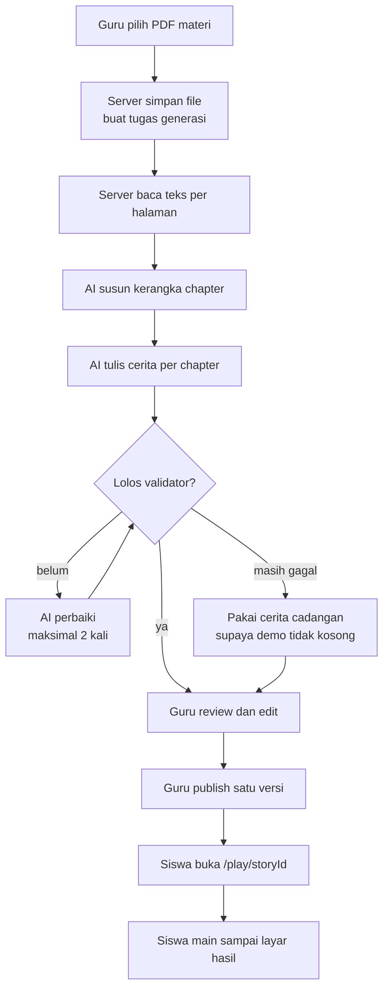

# Dokumentasi ClassQuest

> **Baca halaman ini dulu sebelum menyentuh kode.** Repo ini dikerjakan beberapa
> orang sekaligus, sebagian di antaranya AI agent. Folder `docs/` adalah tempat
> kita sepakat dulu sebelum menulis kode: apa yang dibangun, bentuk datanya, dan
> aturan mainnya. Kode boleh berubah cepat; kesepakatan di sini jangan.

## Isi singkat

ClassQuest mengubah materi pelajaran (PDF dari guru) menjadi **game pixel 2D
bergaya Omori**: ada cerita, suasana, dan soal yang menyatu di dalam cerita.

Alurnya cuma empat langkah:

Dua hal yang membuat ide ini masuk akal:

1. **Gambar dan suara disiapkan di awal dan tidak berubah.** AI hanya menyusun
   cerita dari aset yang sudah ada, jadi tampilan selalu konsisten dan tidak ada
   biaya gambar.
2. **Guru tetap pegang kendali isi.** Semua yang ditulis AI bisa dibaca dan diedit
   guru sebelum sampai ke siswa.

Versi panjangnya ada di [`00-product/vision.md`](./00-product/vision.md).

## Soal diagram

Semua diagram alur di docs ini memakai **Mermaid**, bukan gambar. Alasannya:
bisa direview seperti kode, bisa diubah tanpa membuka alat desain, dan tidak ada
file biner yang harus di-commit.

Cara melihatnya:

- **GitHub / GitLab** — otomatis jadi gambar saat file dibuka.
- **VS Code** — pasang ekstensi Markdown Preview Mermaid Support.
- **Terminal** — akan terlihat sebagai teks kode. Itu wajar; buka di tempat lain
  kalau perlu gambarnya.

Satu pengecualian: **sketsa layar** (wireframe) di beberapa dokumen masih memakai
teks ASCII, karena di situ yang penting justru susunan kotak dan proporsinya, bukan
alur logika. Contohnya ada di [`10-roadmap/demo-script.md`](./10-roadmap/demo-script.md).
Untuk gambaran yang butuh warna — palet, layar game, overlay tantangan, dashboard
guru — dipakai SVG di [`assets/`](./assets/), supaya terlihat sama di GitHub dan di
editor mana pun tanpa file biner.

## Kondisi kode hari ini

Jujur dulu, supaya tidak ada yang salah paham:

| Bagian           | Keadaan sekarang                                                                                |
| ---------------- | ----------------------------------------------------------------------------------------------- |
| Aplikasi Next.js | Ada. Next 16.4.5, App Router, Tailwind 4, Bun.                                                  |
| Landing page     | Halaman pilih peran (guru/siswa) di `/` (bukan lagi starter `create-next-app`).                 |
| Halaman siswa    | `/play/[storyId]` sudah jalan; `/game` adalah demo Phaser dan pintu siswa di `/`.               |
| UI guru          | Portal jalan: dashboard, materi, kelas, login. Editor cerita & preview belum ada.               |
| Backend          | Upload PDF, job generasi, cerita, auth guru, dan hasil main sudah ada (libSQL).                 |
| Pipeline AI      | Ada: mock provider + Anthropic/OpenAI-compatible, dipilih lewat env.                            |
| Aset game        | Sudah ada di `public/assets/` (generator repo + dunia desa buatan tim, `bun run assets:world`). |

Artinya: dokumen bertanda `stable` adalah **keputusan yang sudah disepakati untuk
dibangun**; dokumen bertanda `draft`/`tbd` bisa jadi sudah sebagian diimplementasi
tanpa mengubah arah. Daftar mana yang sudah ada dan mana yang masih rencana ada di
tabel status di
[`01-architecture/repo-structure.md`](./01-architecture/repo-structure.md#status-kode-sekarang);
tabel itu ikut dicek otomatis, jadi tidak bisa berbohong lama-lama.

## Arti status dokumen

Setiap file punya kepala dokumen (front-matter):

| Field           | Arti                                                        |
| --------------- | ----------------------------------------------------------- |
| `status`        | `stable`, `draft`, atau `tbd`                               |
| `last_reviewed` | Tanggal terakhir isinya dicek ulang terhadap kode/keputusan |
| `owner`         | Yang bisa ditanya kalau isinya membingungkan                |

- **`stable`** — sudah disepakati, boleh dipakai sebagai acuan kerja.
- **`draft`** — arahnya jelas, detailnya masih bisa berubah.
- **`tbd`** — belum diputuskan. Isinya pilihan + kriteria, bukan keputusan.

Kalau kamu mengubah isi sebuah dokumen, ubah juga `last_reviewed`-nya. Tanggal
itu satu-satunya cara kita tahu dokumen mana yang perlu dibaca ulang.

Tanggal itu juga dijaga tes, bukan sekadar diisi:

- Dokumen `stable` dipakai sebagai acuan kerja, jadi umurnya maksimal **6 bulan**.
- Dokumen `draft` dan `tbd` maksimal **1 tahun**.

Kalau lewat, tes akan gagal dan menyebut nama dokumennya. Jangan hanya mengganti
tanggalnya — baca dulu isinya, cek masih sesuai kode atau tidak, baru perbarui.
Itu satu-satunya cara `last_reviewed` berarti sesuatu.

## Cara membaca docs ini

Tidak perlu baca semua. Pilih sesuai pekerjaanmu, lalu ikuti tautannya.

| Kalau kamu mau...        | Baca minimal                                                                                                                                             |
| ------------------------ | -------------------------------------------------------------------------------------------------------------------------------------------------------- |
| Paham proyek secara umum | [`00-product/vision.md`](./00-product/vision.md)                                                                                                         |
| Ubah alur produk / scope | [`00-product/mvp-scope.md`](./00-product/mvp-scope.md), [`00-product/user-flows.md`](./00-product/user-flows.md)                                         |
| Ubah format cerita JSON  | [`02-data-model/story-schema.md`](./02-data-model/story-schema.md), [`02-data-model/validation-rules.md`](./02-data-model/validation-rules.md)           |
| Ubah prompt / aturan AI  | [`03-ai-pipeline/prompt-contract.md`](./03-ai-pipeline/prompt-contract.md), [`03-ai-pipeline/generation-rules.md`](./03-ai-pipeline/generation-rules.md) |
| Tambah tipe soal         | [`02-data-model/challenge-types.md`](./02-data-model/challenge-types.md)                                                                                 |
| Kerja di game/Phaser     | [`04-game/engine.md`](./04-game/engine.md), [`04-game/scene-format.md`](./04-game/scene-format.md)                                                       |
| Kerja di map/visual game | [`04-game/world-design.md`](./04-game/world-design.md), [`04-game/game-design.md`](./04-game/game-design.md)                                             |
| Kerja di UI guru         | [`05-frontend/teacher-dashboard.md`](./05-frontend/teacher-dashboard.md), [`05-frontend/story-editor.md`](./05-frontend/story-editor.md)                 |
| Tambah endpoint API      | [`06-backend/api-contract.md`](./06-backend/api-contract.md)                                                                                             |
| Tambah/ganti aset        | [`07-assets/asset-guide.md`](./07-assets/asset-guide.md), [`07-assets/inventory.md`](./07-assets/inventory.md)                                           |
| Tulis dialog / persona   | [`07-assets/cast-bible.md`](./07-assets/cast-bible.md)                                                                                                   |
| Setup environment        | [`08-workflow/setup.md`](./08-workflow/setup.md)                                                                                                         |
| Sebelum buka PR          | [`08-workflow/git-and-pr.md`](./08-workflow/git-and-pr.md), [`11-logicodix/05-aturan-commit-dan-git.md`](./11-logicodix/05-aturan-commit-dan-git.md)     |
| **Aturan lomba**         | [`11-logicodix/README.md`](./11-logicodix/README.md) — wajib sebelum menulis kode                                                                        |
| **Sebelum submission**   | [`11-logicodix/11-submission-checklist.md`](./11-logicodix/11-submission-checklist.md)                                                                   |
| Ambil keputusan teknis   | [`09-decisions/README.md`](./09-decisions/README.md)                                                                                                     |
| Latihan demo             | [`10-roadmap/demo-script.md`](./10-roadmap/demo-script.md)                                                                                               |

## Daftar semua dokumen

Tabel ini harus lengkap. Kalau kamu menambah atau menghapus dokumen, perbarui
tabel ini — ada tes yang akan gagal kalau lupa.

<!-- docs-index:start -->

| Dokumen                                                                                                                        | Status | Isi                                                          |
| ------------------------------------------------------------------------------------------------------------------------------ | ------ | ------------------------------------------------------------ |
| [`README.md`](./README.md)                                                                                                     | stable | Halaman ini: peta docs dan aturan dasar                      |
| [`00-product/vision.md`](./00-product/vision.md)                                                                               | stable | Kenapa proyek ini ada dan mau ke mana                        |
| [`00-product/personas-and-roles.md`](./00-product/personas-and-roles.md)                                                       | stable | Siapa saja yang memakai ClassQuest                           |
| [`00-product/user-flows.md`](./00-product/user-flows.md)                                                                       | stable | Alur lengkap dari upload sampai siswa main                   |
| [`00-product/mvp-scope.md`](./00-product/mvp-scope.md)                                                                         | stable | Apa yang dikerjakan dan apa yang sengaja tidak               |
| [`00-product/glossary.md`](./00-product/glossary.md)                                                                           | stable | Arti istilah: materi, cerita, chapter, scene, beat           |
| [`01-architecture/overview.md`](./01-architecture/overview.md)                                                                 | draft  | Bentuk sistem dan pembagian lapisan                          |
| [`01-architecture/tech-stack.md`](./01-architecture/tech-stack.md)                                                             | stable | Pilihan teknologi dan alasannya                              |
| [`01-architecture/repo-structure.md`](./01-architecture/repo-structure.md)                                                     | draft  | Isi folder sekarang vs struktur target                       |
| [`01-architecture/data-flow.md`](./01-architecture/data-flow.md)                                                               | draft  | Data pindah ke mana dan batas kepercayaannya                 |
| [`01-architecture/security-and-privacy.md`](./01-architecture/security-and-privacy.md)                                         | draft  | Rahasia, data siswa, dan batas aman MVP                      |
| [`02-data-model/story-schema.md`](./02-data-model/story-schema.md)                                                             | stable | **Kontrak utama**: bentuk cerita JSON                        |
| [`02-data-model/validation-rules.md`](./02-data-model/validation-rules.md)                                                     | draft  | Kode error validator dan artinya                             |
| [`02-data-model/challenge-types.md`](./02-data-model/challenge-types.md)                                                       | draft  | Empat tipe soal dan cara menilainya                          |
| [`02-data-model/asset-manifest.md`](./02-data-model/asset-manifest.md)                                                         | draft  | Bentuk dan aturan daftar aset                                |
| [`03-ai-pipeline/pipeline.md`](./03-ai-pipeline/pipeline.md)                                                                   | draft  | Perjalanan PDF menjadi cerita                                |
| [`03-ai-pipeline/prompt-contract.md`](./03-ai-pipeline/prompt-contract.md)                                                     | draft  | Isi prompt dan aturan output model                           |
| [`03-ai-pipeline/generation-rules.md`](./03-ai-pipeline/generation-rules.md)                                                   | stable | Aturan menulis cerita yang baik                              |
| [`03-ai-pipeline/validation-and-repair.md`](./03-ai-pipeline/validation-and-repair.md)                                         | draft  | Cara memperbaiki hasil AI yang rusak                         |
| [`03-ai-pipeline/provider-setup.md`](./03-ai-pipeline/provider-setup.md)                                                       | tbd    | Pilihan penyedia model AI                                    |
| [`04-game/game-design.md`](./04-game/game-design.md)                                                                           | stable | Arah visual, suasana, dan loop permainan                     |
| [`04-game/engine.md`](./04-game/engine.md)                                                                                     | draft  | Cara Phaser 4 dipasang di Next.js                            |
| [`04-game/scene-format.md`](./04-game/scene-format.md)                                                                         | draft  | Cara cerita JSON jadi tampilan game                          |
| [`04-game/world-design.md`](./04-game/world-design.md)                                                                         | draft  | Dunia desa, editor peta, collision, kamera, dan font         |
| [`04-game/interaction-loop.md`](./04-game/interaction-loop.md)                                                                 | draft  | Perilaku saat siswa klik, jawab, atau menutup tab            |
| [`04-game/plan-map-character-demo.md`](./04-game/plan-map-character-demo.md)                                                   | draft  | Catatan historis: rencana map dan karakter yang ditinggalkan |
| [`04-game/accessibility.md`](./04-game/accessibility.md)                                                                       | draft  | Keyboard, kontras, dan batas aksesibilitas MVP               |
| [`05-frontend/routes.md`](./05-frontend/routes.md)                                                                             | draft  | Daftar halaman dan endpoint                                  |
| [`05-frontend/teacher-dashboard.md`](./05-frontend/teacher-dashboard.md)                                                       | draft  | Halaman guru: upload, status, ringkasan                      |
| [`05-frontend/story-editor.md`](./05-frontend/story-editor.md)                                                                 | draft  | Editor cerita untuk guru                                     |
| [`05-frontend/game-player.md`](./05-frontend/game-player.md)                                                                   | draft  | Halaman siswa dan lapisan UI-nya                             |
| [`05-frontend/ui-conventions.md`](./05-frontend/ui-conventions.md)                                                             | draft  | Aturan tampilan dan komponen bersama                         |
| [`06-backend/api-contract.md`](./06-backend/api-contract.md)                                                                   | draft  | Bentuk request/response dan error                            |
| [`06-backend/persistence.md`](./06-backend/persistence.md)                                                                     | tbd    | Rencana database, storage, dan versi cerita                  |
| [`06-backend/jobs-and-limits.md`](./06-backend/jobs-and-limits.md)                                                             | draft  | Batas ukuran, waktu, dan status pekerjaan                    |
| [`07-assets/asset-guide.md`](./07-assets/asset-guide.md)                                                                       | draft  | Spesifikasi gambar, musik, dan suara                         |
| [`07-assets/cast-bible.md`](./07-assets/cast-bible.md)                                                                         | stable | Persona lengkap sepuluh karakter tetap                       |
| [`07-assets/inventory.md`](./07-assets/inventory.md)                                                                           | draft  | Daftar aset yang direncanakan beserta statusnya              |
| [`07-assets/naming-conventions.md`](./07-assets/naming-conventions.md)                                                         | stable | Aturan penamaan file aset                                    |
| [`08-workflow/setup.md`](./08-workflow/setup.md)                                                                               | stable | Menyiapkan environment lokal                                 |
| [`08-workflow/commands.md`](./08-workflow/commands.md)                                                                         | stable | Perintah Bun yang ada dan kapan dipakai                      |
| [`08-workflow/testing.md`](./08-workflow/testing.md)                                                                           | draft  | Apa yang dites, apa yang tidak                               |
| [`08-workflow/git-and-pr.md`](./08-workflow/git-and-pr.md)                                                                     | stable | Alur git, commit, dan pull request                           |
| [`08-workflow/ai-agent-rules.md`](./08-workflow/ai-agent-rules.md)                                                             | stable | **Aturan lengkap untuk AI agent dan manusia**                |
| [`09-decisions/README.md`](./09-decisions/README.md)                                                                           | stable | Cara memakai dan menulis ADR                                 |
| [`09-decisions/template.md`](./09-decisions/template.md)                                                                       | stable | Kerangka ADR baru                                            |
| [`09-decisions/0001-nextjs-app-router.md`](./09-decisions/0001-nextjs-app-router.md)                                           | stable | Kenapa Next.js App Router                                    |
| [`09-decisions/0002-story-json-as-contract.md`](./09-decisions/0002-story-json-as-contract.md)                                 | stable | Kenapa cerita JSON jadi kontrak tunggal                      |
| [`09-decisions/0003-fixed-asset-library.md`](./09-decisions/0003-fixed-asset-library.md)                                       | stable | Kenapa aset disiapkan di awal                                |
| [`09-decisions/0004-phaser-4.md`](./09-decisions/0004-phaser-4.md)                                                             | stable | Kenapa Phaser 4, bukan Phaser 3                              |
| [`09-decisions/0005-persistence-and-storage.md`](./09-decisions/0005-persistence-and-storage.md)                               | tbd    | Database dan storage belum dipilih                           |
| [`09-decisions/0006-ai-provider.md`](./09-decisions/0006-ai-provider.md)                                                       | tbd    | Penyedia model AI belum dipilih                              |
| [`09-decisions/0007-hybrid-ui.md`](./09-decisions/0007-hybrid-ui.md)                                                           | stable | Kenapa canvas dan DOM dipakai bersama                        |
| [`09-decisions/0008-top-down-movement.md`](./09-decisions/0008-top-down-movement.md)                                           | stable | Gerak bebas top-down dengan map dummy                        |
| [`09-decisions/0009-resolution-and-scale.md`](./09-decisions/0009-resolution-and-scale.md)                                     | stable | Resolusi 640x360, tile 16, karakter 24x32                    |
| [`09-decisions/0010-map-data-and-camera.md`](./09-decisions/0010-map-data-and-camera.md)                                       | stable | Map data per scene, kamera follow dengan batas map           |
| [`09-decisions/0011-large-prop-subcollider.md`](./09-decisions/0011-large-prop-subcollider.md)                                 | stable | Sub-collider untuk prop besar seperti pohon dan rak          |
| [`09-decisions/0012-room-map-image.md`](./09-decisions/0012-room-map-image.md)                                                 | stable | Peta ruangan sebagai satu gambar penuh                       |
| [`09-decisions/0013-hosting-vercel-turso.md`](./09-decisions/0013-hosting-vercel-turso.md)                                     | stable | Hosting Vercel dan database Turso                            |
| [`09-decisions/0014-auth-akun-guru-siswa.md`](./09-decisions/0014-auth-akun-guru-siswa.md)                                     | draft  | Akun guru/siswa di database, tanpa vendor auth               |
| [`09-decisions/0015-kelas-dan-siswa.md`](./09-decisions/0015-kelas-dan-siswa.md)                                               | draft  | Tabel kelas dan siswa, daftar awal kosong                    |
| [`09-decisions/0016-obrolan-singkat-npc.md`](./09-decisions/0016-obrolan-singkat-npc.md)                                       | stable | Obrolan singkat NPC di luar perannya                         |
| [`09-decisions/0017-anggaran-pipeline-per-unit.md`](./09-decisions/0017-anggaran-pipeline-per-unit.md)                         | stable | Anggaran pipeline per unit dan reasoning dimatikan           |
| [`09-decisions/0018-plafon-output-thinking.md`](./09-decisions/0018-plafon-output-thinking.md)                                 | stable | Plafon output, batas outline, dan reasoning default mati     |
| [`09-decisions/0019-branching-konsekuensi-jawaban-salah.md`](./09-decisions/0019-branching-konsekuensi-jawaban-salah.md)       | stable | Percabangan sebagai konsekuensi jawaban salah                |
| [`09-decisions/0020-kutipan-jawaban-siswa-di-dialog.md`](./09-decisions/0020-kutipan-jawaban-siswa-di-dialog.md)               | stable | Kutipan jawaban siswa lewat token `{{jawaban}}`              |
| [`09-decisions/0021-varian-dialog-per-jawaban-salah.md`](./09-decisions/0021-varian-dialog-per-jawaban-salah.md)               | stable | Varian dialog berbeda untuk tiap jawaban salah               |
| [`09-decisions/0022-pemain-mengucapkan-jawaban-di-dialog.md`](./09-decisions/0022-pemain-mengucapkan-jawaban-di-dialog.md)     | stable | Pemain mengucapkan jawabannya sebelum dibalas tokoh          |
| [`09-decisions/0023-potret-ekspresi-persona.md`](./09-decisions/0023-potret-ekspresi-persona.md)                               | stable | Potret berekspresi di atas kotak dialog                      |
| [`09-decisions/0024-kontrol-sentuh-hp.md`](./09-decisions/0024-kontrol-sentuh-hp.md)                                           | stable | Kontrol sentuh dan tata letak HP                             |
| [`09-decisions/0025-layar-penuh-lanskap.md`](./09-decisions/0025-layar-penuh-lanskap.md)                                       | stable | Layar penuh, kunci lanskap, dan ketukan responsif            |
| [`09-decisions/0026-tombol-aksi-tanpa-sasaran.md`](./09-decisions/0026-tombol-aksi-tanpa-sasaran.md)                           | stable | Tombol aksi sentuh tetap hidup tanpa sasaran                 |
| [`09-decisions/0027-tombol-bicara-dan-kontrol-saat-dialog.md`](./09-decisions/0027-tombol-bicara-dan-kontrol-saat-dialog.md)   | stable | Tombol Bicara dan kontrol yang hilang saat dialog            |
| [`09-decisions/0028-jangkauan-interaksi-dan-bar-hud-potret.md`](./09-decisions/0028-jangkauan-interaksi-dan-bar-hud-potret.md) | stable | Jangkauan interaksi, menu jeda, dan bar HUD potret           |
| [`09-decisions/0029-desain-hud-dan-tombol-bicara.md`](./09-decisions/0029-desain-hud-dan-tombol-bicara.md)                     | stable | Desain HUD seragam dan tombol Bicara menjauh dari tepi       |
| [`09-decisions/0030-desain-tantangan-seragam-dialog.md`](./09-decisions/0030-desain-tantangan-seragam-dialog.md)               | stable | Desain tantangan seragam dan penunjuk pilihan yang presisi   |
| [`09-decisions/0031-warna-ui-selaras-penanda-quest.md`](./09-decisions/0031-warna-ui-selaras-penanda-quest.md)                 | stable | Warna UI selaras penanda quest dan penunjuk tangan SVG       |
| [`09-decisions/0032-emosi-per-varian-jawaban.md`](./09-decisions/0032-emosi-per-varian-jawaban.md)                             | stable | Emosi berbeda per varian jawaban                             |
| [`09-decisions/0033-pemilihan-pembicara-keahlian.md`](./09-decisions/0033-pemilihan-pembicara-keahlian.md)                     | stable | Dialog bidang tertentu jatuh ke tokoh yang ahli              |
| [`09-decisions/0034-mode-permainan.md`](./09-decisions/0034-mode-permainan.md)                                                 | stable | Mode permainan dipilih guru                                  |
| [`09-decisions/0035-penempatan-tokoh-tetap.md`](./09-decisions/0035-penempatan-tokoh-tetap.md)                                 | stable | Tokoh punya tempat tetap yang sejalan dengan peta desa       |
| [`09-decisions/0036-menu-jeda-dua-kolom.md`](./09-decisions/0036-menu-jeda-dua-kolom.md)                                       | stable | Menu jeda dua kolom agar muat di lanskap pendek              |
| [`10-roadmap/hackathon-plan.md`](./10-roadmap/hackathon-plan.md)                                                               | draft  | Urutan kerja dan pembagian tugas                             |
| [`10-roadmap/demo-script.md`](./10-roadmap/demo-script.md)                                                                     | draft  | Naskah demo 3 menit + sketsa layar                           |
| [`11-logicodix/README.md`](./11-logicodix/README.md)                                                                           | stable | **Aturan kompetisi**: peta aturan dan 10 aturan termahal     |
| [`11-logicodix/01-ringkasan-guidebook.md`](./11-logicodix/01-ringkasan-guidebook.md)                                           | stable | Tema, subtema, bentuk kegiatan, timeline resmi               |
| [`11-logicodix/02-ketentuan-peserta-dan-karya.md`](./11-logicodix/02-ketentuan-peserta-dan-karya.md)                           | stable | Ketentuan peserta, karya, larangan, kategori                 |
| [`11-logicodix/03-jadwal-dan-code-freeze.md`](./11-logicodix/03-jadwal-dan-code-freeze.md)                                     | stable | Jadwal WIB dan aturan setelah code freeze                    |
| [`11-logicodix/04-orisinalitas-dan-riwayat-repo.md`](./11-logicodix/04-orisinalitas-dan-riwayat-repo.md)                       | stable | Orisinalitas, satu repo kanonik, riwayat commit              |
| [`11-logicodix/05-aturan-commit-dan-git.md`](./11-logicodix/05-aturan-commit-dan-git.md)                                       | stable | Format commit, branch, PR, larangan rewrite                  |
| [`11-logicodix/06-keamanan-kredensial.md`](./11-logicodix/06-keamanan-kredensial.md)                                           | stable | `.env`, `.env.example`, aturan pemakaian env                 |
| [`11-logicodix/07-readme-wajib.md`](./11-logicodix/07-readme-wajib.md)                                                         | stable | Sembilan isi README wajib + kerangka siap pakai              |
| [`11-logicodix/08-video-demo.md`](./11-logicodix/08-video-demo.md)                                                             | stable | Aturan video, urutan wajib, shot list                        |
| [`11-logicodix/09-deploy-dan-akses-juri.md`](./11-logicodix/09-deploy-dan-akses-juri.md)                                       | stable | Deploy, akun demo, kuota API selama penilaian                |
| [`11-logicodix/10-surat-pernyataan.md`](./11-logicodix/10-surat-pernyataan.md)                                                 | stable | Surat pernyataan orisinalitas dan konsistensi data           |
| [`11-logicodix/11-submission-checklist.md`](./11-logicodix/11-submission-checklist.md)                                         | stable | Checklist final sebelum submit                               |
| [`11-logicodix/12-rubrik-penilaian.md`](./11-logicodix/12-rubrik-penilaian.md)                                                 | stable | Bobot penilaian dan cara memenuhinya                         |
| [`11-logicodix/13-pelanggaran-dan-sanksi.md`](./11-logicodix/13-pelanggaran-dan-sanksi.md)                                     | stable | Bentuk pelanggaran, hak verifikasi, catatan risiko           |
| [`11-logicodix/14-ai-dan-atribusi.md`](./11-logicodix/14-ai-dan-atribusi.md)                                                   | stable | Dokumentasi penggunaan AI dan atribusi                       |
| [`11-logicodix/15-babak-final.md`](./11-logicodix/15-babak-final.md)                                                           | stable | Top 8, technical meeting, persiapan live demo                |

<!-- docs-index:end -->

Catatan soal status ADR: front-matter hanya mengenal `stable`, `draft`, `tbd`,
sedangkan badan ADR memakai `Proposed`/`Accepted`. Pemetaannya: **`Proposed` →
`tbd`**, **`Accepted` → `stable`**. Kalau sebuah ADR diterima, ubah tiga tempat
bersamaan: badan ADR, front-matter, dan baris di tabel indeks ini.

Tiga file di `02-data-model/` bukan Markdown, tapi sama pentingnya:

- [`story.example.json`](./02-data-model/story.example.json) — contoh cerita yang
  harus selalu lolos validator.
- [`story.schema.json`](./02-data-model/story.schema.json) — bentuk cerita dalam
  format JSON Schema. Dokumen `story-schema.md` menjelaskannya untuk manusia;
  file ini untuk mesin dan tes.
- [`story-schema.test.ts`](./02-data-model/story-schema.test.ts) — tes yang
  menjaga schema, contoh cerita, dan angka batas di dokumen tetap sinkron.

## Aturan untuk AI agent

Aturan lengkapnya hanya di satu tempat:
[`08-workflow/ai-agent-rules.md`](./08-workflow/ai-agent-rules.md). Baca itu, jangan
cari aturan yang sama di file lain — supaya tidak ada dua versi aturan yang
berbeda.

Tiga hal yang paling sering bikin pekerjaan harus diulang:

1. **Kamu mengubah kontrak tanpa mengubah yang lain.** Cerita JSON dipakai prompt,
   validator, editor, dan game. Ubah satu, ubah semua, dan naikkan `schemaVersion`
   kalau breaking.
2. **Kamu mengarang id aset.** Hanya id dari
   [`07-assets/inventory.md`](./07-assets/inventory.md) yang boleh dipakai.
3. **Kamu menyebut "selesai" tanpa menjalankan `bun run check` dan
   `bun run build`.**

## Menjaga docs tetap jujur

Docs yang tidak dicek akan cepat berbohong. Karena itu ada tes otomatis:

- `docs/docs.test.ts` — memeriksa kepala dokumen, tautan rusak, kelengkapan tabel
  di halaman ini, dan klaim "ada/rencana" di `repo-structure.md`.
- `docs/02-data-model/story-schema.test.ts` — memastikan `story.schema.json`
  menerima contoh cerita, menolak cerita rusak, memakai field tingkat atas yang
  sama dengan `story-schema.md`, dan memakai angka batas teks yang sama dengan
  `validation-rules.md`/`challenge-types.md`.

Yang **tidak** dicek otomatis: arti dan perilaku tiap field. Kalau kamu mengubah
arti sesuatu, tidak ada tes yang akan menangkapnya — kamu yang harus memperbarui
dokumennya.

Cara memperbarui docs:

- Perubahan kecil (typo, kalimat lebih jelas): langsung PR.
- Perubahan kontrak (schema, route, API): buat atau ubah ADR dulu di
  [`09-decisions/`](./09-decisions/), lalu sinkronkan dokumen terkait.
- Jangan menghapus bagian `TBD` sebelum ada keputusan. Ubah statusnya, jangan
  hilangkan pertanyaannya.
